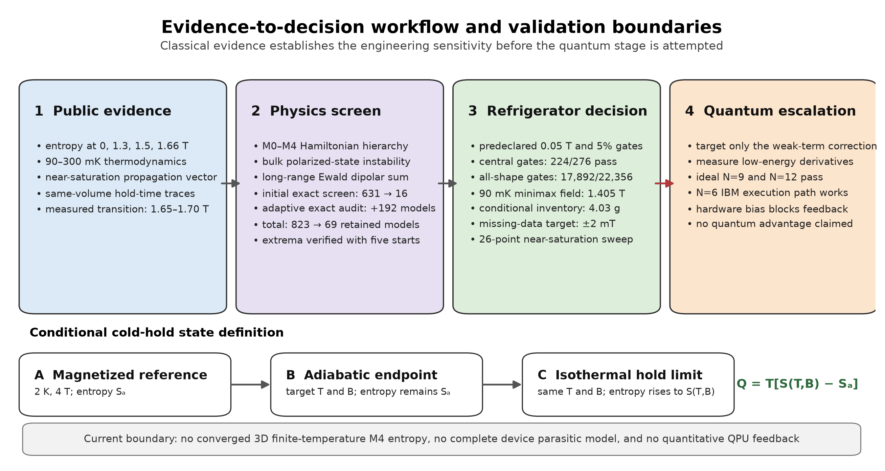

# NBCP magnetocaloric model risk and quantum spectral flow

[](https://doi.org/10.5281/zenodo.23325918)

This repository contains a public-data study of how weak interactions in the frustrated quantum refrigerant Na2BaCo(PO4)2 change sub-kelvin magnetic-refrigeration decisions, followed by a resource-gated quantum-algorithm validation.

The study asks whether long-range dipolar coupling, bond-dependent exchange, and interlayer exchange move the optimal terminal field enough to matter in a refrigerator. Quantum circuits are tested only after the classical engineering gate is passed.

## Main findings

- A nearest-neighbor dipolar truncation shifts the polarized critical field by about 0.0825 T, but the full Ewald sum nearly cancels that shift under the tin-foil convention. Local dipoles are therefore a poor bulk proxy.
- A multistart deterministic local 375-member interlayer grid retains 12 public-propagation-vector-compatible models with critical-field ablations of 0.05365–0.16365 T. None of 18 one-coordinate outward neighbors survives, but this local closure is not a global proof.
- A broader multistart 256-point Sobol audit retains four models, including two outside the local box. Their shifts span 0.07260–0.14757 T, and independent repeated searches verify every retained mode.
- An adaptive inverse audit starts from those 631 exact evaluations and selects 192 additional exact M4 calculations near the public-q boundary, predicted shift extrema, and poorly covered regions. Sixty-nine of 823 exact models are retained, including 53 newly found models, and independent five-start checks reproduce the expanded 0.03340–0.20211 T shift range.
- A four-point lower-field fan-curve holdout tests information that was not used for model retention. All 69 curves pass the near-critical internal check, but holdout error rises strongly with critical-field shift (Spearman rho=0.940). The 23 models no worse than the published representative span 0.03340–0.10730 T; this is a descriptive ranking because the representative curve itself is systematically biased.
- An independent public 3.5 T INS audit tests the same 69 models against a different observable. Thirty remain at or below the source's 18.048 microelectronvolt indicative bandwidth reference, unchanged across all matched one-standard-deviation exchange and g-factor corners. Their shift range is 0.03340–0.14757 T and bandwidth correlates with shift at Spearman rho=0.882. A stronger direct check reproduces the archived linewidth calculation with 0.000141 meV RMSE and profiles the unresolved twin mixture: all 69 M4 models then have chi-square no larger than the source curve. The 30-model contraction is therefore a sensitivity scenario rather than a calibrated rejection, and all 69 remain authoritative.
- A direct finite-temperature M4 audit on N=12 rejects rigid critical-field transfer. The strongest model gives a 0.100 T optimum shift, a 0.919 peak-heat ratio, and total W95-width ratios of 1.46–2.05.
- A preregistered minimum, nominal, median-distinct, and maximum-effect M4 cover is recalculated with M3 on the three-sublattice-compatible N=18 cluster. N=18 optimum shifts span 0.293–0.425 T and peak-heat ratios span 0.537–0.852; 4 of four models cross the major-transfer threshold. Numerical checks pass inside the projected cluster, which is not a bulk solution.
- Four N=18 templates, two experimental anchors, and two mappings give 16 correlated stresses. Together with 52 N=12 scenarios, the 68-scenario design has 34.55% unmeasured worst regret at 1.4890 T. N=12-derived fields and masses remain pre-convergence examples.
- The multimodel peak support is 1.2943–1.7136 T. The required grid contains 107 fields from 1.292 to 1.716 T. Exhausting all 5,671 two-point panels selects 1.292 and 1.716 T and leaves 4.246% regret at a ±2.5% heat bound.
- Sample shape is a separate first-order field coordinate. An equal-volume spheroid for a public B-parallel-c plate gives a conservative 0.136 T saturation correction. Aligning the long dimension with c and requiring c/a of at least 2.72 or 4.68 bounds it below 20 or 10 mT.
- The load and transient envelopes remain verified scaling identities, but their numerical NBCP masses inherit the failed N=12 heat input and are not final inventory predictions.
- A definition-matched public comparison shows that NBCP has 6.13 times the volumetric heat absorption, 2.09 times the source-defined cycle efficiency, and 2.98 times the observed below-1-K span of the better FAA/CPA comparator for each metric.
- A second-material external check uses 12 public Gd2B2MoO9 coordinates: heat-capacity-derived adiabatic temperature changes reproduce direct measurements with 13.8 mK mean absolute and 27.6 mK maximum error. This validates the thermodynamic-processing step, not the NBCP field-shift or package model.
- An independent public-device check uses two YbNi1.6Sn warm-up loads. A 0.21–0.25 K calibration recovers 15.22 g effective mass and 0.254 microWatt parasitic load against separate reports of approximately 15 g and less than 0.4 microWatt. The frozen balance predicts the disjoint 0.25–0.28 K interval with 0.592% normalized root-mean-square error.
- Direct public entropy curves select 1.5 T at 90–120 mK, 1.3 T at 150–200 mK, and 0 T at 250–300 mK among the measured candidate fields.
- A low-energy spectral-flow estimator passes all N=9 and N=12 ideal entropy tests. Physics-informed N=9 state-preparation circuits pass at 1.40, 1.45, and 1.50 T.
- Two complete nine-circuit N=6 jobs on IBM Kingston used 151 seconds of free Open Plan QPU time. Both resolve the negative entropy-correction sign; ZNE reduces absolute bias by 25.8%, while the magnitude remains quantitatively biased.
- A public-source audit found that Extended Data Fig. 6 sheets a/b do not reproduce the article's identifiable 94 mK NBCP point under their workbook labels. Those labels are excluded from new rankings; independent sheet-d time traces are used only as contextual material evidence.

No quantum advantage is claimed. The material and engineering conclusions use classical calculations and public experimental data. The hardware result is a complete six-qubit method benchmark with a passed sign gate and a failed quantitative-magnitude gate.

## Manuscript

- [Integrated physics/engineering/quantum manuscript](manuscript/Manuscript_draft_20261012.md)
- [Integrated Supplementary Information](manuscript/Supplementary_Information_draft_20261012.md)
- [Cryogenics-targeted manuscript](manuscript/Manuscript_Cryogenics_20261012.md)
- [Cryogenics-targeted Supplementary Information](manuscript/Supplementary_Information_Cryogenics_20261012.md)
- [Cryogenics Word manuscript](manuscript/Manuscript_Cryogenics_20261012.docx)
- [Cryogenics Word Supplementary Information](manuscript/Supplementary_Information_Cryogenics_20261012.docx)
- [References](manuscript/references.bib)
- [Coauthor review checklist](manuscript/COAUTHOR_REVIEW_CHECKLIST.md)
- [Completion audit](연구목표_완료감사_20261012.md)

## Repository map

- `sources/`: input manifests and magnetic-lattice provenance. Large public originals are downloaded locally and are not redistributed.
- `data/`: compact digitized or derived inputs used by the calculations.
- `results/`: machine-readable JSON and CSV outputs, including stopping decisions.
- `figures/`: generated figures.
- `manuscript/`: article draft, supplement, references, and author metadata.
- `octave/`: independent Octave cross-check code. The 3.7 GB local Octave runtime is excluded.
- top-level Python files: calculation, compilation, validation, and audit scripts.

## Quick verification

Python 3.14 was used for the frozen run. Create an isolated environment and install:

```text
python -m venv .venv
.venv\Scripts\python -m pip install -r requirements.txt
```

Run the fast frozen-result checks:

```text
python verify_engineering_decision.py
python verify_quantum_stateprep_qpu.py
python verify_second_screen.py
python test_quantum_local_benchmark.py
python test_bulk_polarized_stability.py
python test_interlayer_robustness.py
python audit_interlayer_envelope_boundaries.py
python screen_interlayer_expanded_sobol.py
python verify_local_interlayer_modes.py
python verify_expanded_sobol_modes.py
python stress_test_expanded_sobol_shape.py
python adaptive_interlayer_inverse_uq.py
python verify_adaptive_interlayer_inverse_uq.py
python audit_field_dependent_fan_holdout.py
python verify_field_dependent_fan_holdout.py
python audit_public_ins_interlayer_bandwidth.py
python verify_public_ins_interlayer_bandwidth.py
python audit_m4_finite_temperature_cluster.py
python verify_m4_finite_temperature_cluster.py
python test_general_truncated_magnon_operator.py
python verify_n18_stacked_m4_convergence.py
python verify_n18_multimodel_plan.py
python verify_n18_multimodel_cover.py
python verify_n18_multimodel_design.py
python integrate_n18_multimodel_manuscript.py
python stress_test_thermodynamic_shape.py
python stress_test_microscopic_shape_templates.py
python verify_microscopic_shape_templates.py
python optimize_measurement_value_of_information.py
python verify_measurement_value_of_information.py
python verify_cluster_size_transfer.py
python verify_sample_demagnetization_envelope.py
python extract_refrigerant_benchmark.py
python compile_refrigerant_common_basis.py
python verify_refrigerant_common_basis.py
python compile_adr_stage_load_envelope.py
python verify_adr_stage_load_envelope.py
python compile_adr_transient_cycle_envelope.py
python verify_adr_transient_cycle_envelope.py
python audit_second_material_public_validation.py
python verify_second_material_validation.py
python audit_external_stage_heat_balance.py
python verify_external_stage_heat_balance.py
python compile_adaptive_n6_qpu_evidence.py
python verify_adaptive_n6_qpu_evidence.py
python verify_manuscript_claims.py
python prepare_cryogenics_submission.py
python verify_cryogenics_submission.py
python build_cryogenics_docx.py
python verify_cryogenics_docx.py
python make_bulk_manifest.py
```

The commands do not submit a quantum job. `run_adaptive_n6_qpu.py` and `run_open_plan_n6_pilot.py` default to local dry runs and require the explicit `--submit` flag plus an Open-only account guard.

See [REPRODUCE.md](REPRODUCE.md) for public-input download and longer calculation paths.

## Data scope

The repository preserves hashes and official URLs for every external input. Publisher workbooks, article source archives, and third-party software checkouts are not relicensed here. `fetch_sources.py` and `fetch_public_inputs.py` download or verify them from their public locations.

The reported cooling heat is a conditional magnetic entropy budget. The adaptive interlayer audit is an exact, surrogate-guided stress design; it does not claim a posterior or mathematical exhaustion of the continuous parameter box. The N=18 calculation is numerically checked within its projected space and falsifies quantitative transfer of the N=12 template; it is not a converged bulk solution. The revised measurement panel is conditional on 52 N=12 scenarios plus four correlated N=18 size stresses. Its heat-error bounds are resolution requirements, and an out-of-envelope observation falsifies the panel model. The six-qubit QPU calculation uses exact eigenvectors as fitting targets, resolves the correction sign, and does not supply a bulk value or scalable state-discovery proof. The spheroidal demagnetization curve is a conservative package envelope; final field conversion requires actual dimensions, packing, orientation, and M(B,T). The field-dependent fan and INS audits remain model challenges rather than calibrated confidence sets. Stage-load and transient results are scaling identities whose former NBCP masses inherit the failed N=12 heat input. Nuclear and lattice heat capacity, package construction, heat-switch conduction, contact resistance, ramp-rate loss, and warm-side regeneration remain necessary for a finished-device prediction.



## License and citation

Original code in this repository is released under the MIT License. Original text, tables, figures, and derived data are released under CC BY 4.0 unless a file identifies a different upstream license. External source files retain their original terms.

Citation metadata are provided in `CITATION.cff`, and Zenodo deposit metadata are provided in `.zenodo.json`. The archival DOI will be inserted after coauthor confirmation and the author-approved GitHub release are connected to Zenodo.
