# Finite-size, quantum-hardware accuracy, and package-shape gates for a sub-kelvin Na2BaCo(PO4)2 magnetic-refrigerator stage

**Ugwiyeon Lee**1,* (ORCID: 0009-0008-8976-5363), **Seong-Yun Bae**1 (0009-0003-8731-428X), **Hakrae Kim**1 (0009-0002-5048-3568), and **Jungsu Lee**1 (0009-0006-9347-453X)

1Korea Gas Safety Corporation, Republic of Korea
*Corresponding author: lyullee@kgs.or.kr

Cryogenics-targeted working draft. Numerical values and scope statements are frozen to the reproducibility manifest dated 12 October 2026.

## Abstract

Selecting a sub-kelvin magnetic refrigerant requires testing whether a microscopic heat profile transfers across numerical size, whether a quantum processor resolves the required correction, and whether internal field maps to package field. Using public data for Na2BaCo(PO4)2, we audit these gates. An adaptive search retains 69 of 823 exact interlayer models with a 0.0334–0.2021 T critical-field-shift range. A preregistered four-model cover on a three-sublattice-compatible 18-spin cluster gives optimum shifts of 0.293–0.425 T and peak-heat ratios of 0.537–0.852; all four models cross the declared major size-transfer threshold, while N=18 is not treated as bulk. An adaptive six-qubit hardware benchmark then reconstructs a complete three-level spectral-flow entropy correction from nine circuits on IBM Kingston. Twirled readout mitigation and zero-noise extrapolation both recover the exact negative sign and exclude zero, but the best hardware value, −0.02682 kB per spin, remains biased relative to the exact −0.04161; hardware magnitude therefore fails the quantitative gate. Propagating the correlated N=18 stresses gives 34.55% unmeasured worst regret at 1.4890 T. Exhaustive search over 5,671 two-point panels selects 1.292 and 1.716 T, leaving 4.246% regret at a ±2.5% heat bound. A demagnetization envelope gives a 0.136 T plate correction and requires c/a at least 2.72 for a 0.02 T bound. The defensible outputs are a falsifiable heat-measurement plan, a measured quantum-hardware accuracy gate, and a package-geometry specification.

## I. Introduction

Magnetic refrigeration below 1 K depends on entropy stored in a magnetic material. In an adiabatic-demagnetization refrigerator (ADR), useful material properties must ultimately be converted into stage field, refrigerant mass or volume, hold time, and recycle requirements [7–10]. Frustration and quantum fluctuations can retain unusually large entropy at low temperature, making frustrated magnets promising refrigerants. Na2BaCo(PO4)2 (NBCP) is a strong example. Public measurements report a giant magnetocaloric response and cooling below 100 mK, together with an easy-axis triangular-lattice spin-1/2 description [1–4]. Recent spectroscopy further resolves field-dependent Kramers-doublet excitations and a transverse-field evolution from a continuum to sharp magnons [11,12].

The public experiments already establish a material-screening premise. In same-volume time traces, NBCP remains below 1 K for an observed span of 96.0 min, compared with 32.2 min for ferric ammonium alum and 24.7 min for chromium potassium alum. The source article further reports a volumetric heat absorption of approximately 19 mJ cm(^{-3}) and a cycle efficiency of approximately 23%, compared with 3.0–3.1 mJ cm(^{-3}) and 9–11% for the two hydrate salts [1,17]. Relative to the better hydrate comparator for each metric, these values correspond to factors of 6.13 in volumetric heat absorption, 2.09 in source-defined efficiency, and 2.98 in observed time below 1 K. These results show that NBCP merits refrigerator development, but they do not determine a robust near-critical terminal field, the useful field tolerance, or the inventory required for a specified stage load.

The material question and the engineering question are different. A microscopic study asks which spin Hamiltonian produces the observed phases. A refrigerator designer must choose a terminal field, determine how accurately that field must be reached, size the refrigerant, and allocate capacity to steady and transient losses. A model can reproduce broad thermodynamics while moving a narrow low-temperature optimum enough to change those decisions. This risk is greatest near a critical field, where a small error in an interaction energy can produce a substantial loss at a fixed operating point.

The commonly used nearest-neighbor XXZ Hamiltonian captures much of the NBCP phenomenology [1–4]. Recent neutron diffraction, however, found a field-tuned incommensurate fan phase immediately below saturation and showed that dipolar coupling, bond-dependent exchange, and frustrated interlayer paths are required to describe the ordered-state sequence [4]. These terms are small relative to the main exchange, but their consequences for a refrigerator terminal field have not been separated from their role in explaining magnetic order.

We therefore ask four engineering questions. First, can a realistic weak interaction shift the optimal terminal field by at least 0.05 T or cause at least 5% loss when a simpler-model field is used? Second, does that conclusion survive finite-size diagnostics, long-range dipolar boundary conventions, and non-unique interlayer parameters constrained by public diffraction? Third, can a finite-temperature correction selected by those decision gates be reconstructed on present quantum hardware with the correct sign and usable magnitude? Fourth, what robust field, material inventory, loss allowance, minimum heat-measurement panel, and measurement precision follow from the public evidence between 90 and 300 mK?

The calculation deliberately separates what is measured, what is modelled, what is executed on quantum hardware, and what remains a device input. Public thermodynamic data supply the absolute magnetic entropy. Bulk stability calculations supply interaction-induced field shifts. Local-grid, expanded Sobol, and adaptive boundary/extremum searches test whether public propagation vectors identify a unique engineering correction. A lower-field fan-curve holdout then tests those retained models against field dependence not used for retention. A decision-targeted spectral-flow benchmark tests a complete low-energy correction on six physical qubits without assigning that small cluster a bulk role. Finally, steady-load and transient-loss envelopes translate the magnetic budget into stage mass, duty, and measurements needed for cycle closure.

The central result is that neither local interaction magnitude nor one finite cluster supplies a device set point. A nearest-neighbor dipolar truncation creates a large critical-field shift, while the full long-range sum can cancel it. Public diffraction narrows the interlayer Hamiltonian but does not determine its finite-temperature cooling consequence. Direct N=12 thermodynamics first rejects rigid critical-field transport. We then replace the previous one-extreme-model size check with a preregistered four-model N=18 cover. Its optimum shifts span 0.293–0.425 T and peak-heat ratios span 0.537–0.852; 4 of four models cross the declared major-transfer threshold despite numerical convergence inside N=18. This rejects universal quantitative transfer and reclassifies N=12-derived field and inventory values as pre-convergence examples. On IBM Kingston, paired nine-circuit jobs recover the negative sign of a six-spin spectral-flow entropy correction, while zero-noise extrapolation reduces absolute bias by 25.8% but does not pass the quantitative-magnitude gate. An independent demagnetization envelope converts applied/internal-field ambiguity into a package aspect-ratio requirement.

## II. Decision problem and model hierarchy

### A. Engineering quantities

We use the public 2 K, 4 T state as the hot reference. Its measured magnetic entropy density is

\[
S_{\rm hot}=6.6877263\;{\rm mJ\,cm^{-3}\,K^{-1}}.
\]

For a cold endpoint at temperature \(T\) and field \(B\), the conditional magnetic entropy budget is

\[
Q(B,T)=T\,[S(B,T)-S_{\rm hot}].
\]

This is the reversible magnetic contribution available during a cold hold. It is not cooling power, coefficient of performance, or a complete cycle simulation. The accounting corresponds to three explicitly separated states. State A is the 2 K, 4 T magnetized reference with entropy (S_{\rm hot}). An ideal adiabatic demagnetization reaches state B at the target (T,B) without changing that entropy. During the isothermal hold, the spin system approaches state C with entropy (S(B,T)), giving the stated (T[S(B,T)-S_{\rm hot}]) budget. This construction sizes only the reversible magnetic part of the B-to-C hold and does not prove that a real device reaches B or quantify the heat rejected during regeneration. The optimal measured or calculated field is

\[
B^*(T)=\arg\max_B Q(B,T),
\]

and the 95% operating set is

\[
W_{95}(T)=\{B:Q(B,T)\ge 0.95Q_{\max}(T)\}.
\]

For continuous reconstructed profiles, \(W_{95}\) is an interval. For direct public data at only 0, 1.3, 1.5, and 1.66 T, it is a set of measured candidates and must not be interpreted as a continuous field range.

If a field selected from model \(a\) is used under model or scenario \(b\), the design regret is

\[
R_{a\rightarrow b}(T)=100\frac{Q_b(B_b^*,T)-Q_b(B_a^*,T)}{Q_b(B_b^*,T)}\;\%.
\]

We fixed the decision thresholds before the final calculations: an interaction is engineering-relevant if \(|\Delta B^*|\ge0.05\) T or regret is at least 5%. A shift below 0.02 T together with regret below 2% defines the lower stopping band for this engineering screen.

### B. M0–M4 hierarchy

The baseline model is the spin-1/2 nearest-neighbor easy-axis XXZ Hamiltonian for a field along the crystallographic \(c\) axis,

\[
H_0=J_{zz}\sum_{\langle ij\rangle}\left[S_i^zS_j^z+\Delta(S_i^xS_j^x+S_i^yS_j^y)\right]-g_{zz}\mu_BB\sum_iS_i^z.
\]

We use \(J_{zz}=0.1225\) meV, \(\Delta=0.636\), and \(g_{zz}=4.716\) from the public interaction analysis [4]. The model hierarchy is:

- **M0:** two-dimensional nearest-neighbor XXZ;
- **M1:** M0 plus the reported bond-dependent \(J_{\pm\pm}=-1.9\) microelectronvolt term;
- **M2:** M1 plus only the nearest-neighbor dipolar tensor;
- **M3:** M1 plus the full long-range dipolar interaction within and between AA-stacked layers, evaluated by a three-dimensional Ewald sum;
- **M4:** M3 plus the symmetry-allowed \(J_2,J_a,J_b\) interlayer exchange paths.

The magnetic lattice uses space group \(P\bar{3}\), \(a=5.312\) Å, \(c=6.983\) Å, and one Co magnetic site per primitive cell. The complete equivalent magnetic-lattice input and hashes are provided in `sources/crystal_input_provenance_20261012.json`.

For the interlayer uncertainty analysis, P0 denotes M3 without interlayer exchange. P1 adds an explicit simple vertical bond \(J_\perp=0.05\) K based on a published density-functional energy scale. The published representative P2 seed uses \(J_2=2.8\) microelectronvolt, \(J_a=0\), \(J_b=7.9\) microelectronvolt, and \(\Delta_c=0.08\). Because Ref. [4] explicitly calls this set non-unique, the final P2 analysis uses a deterministic local stress grid rather than treating the seed as a fitted Hamiltonian or probability distribution.

## III. Methods

### A. Public data and entropy reconstruction

All experimental inputs are public source-data workbooks associated with Ref. [1], public article source files, or a public diffraction data archive. The preserved raw files are hashed in the input manifests. We interpolate only in temperature within a published field curve. Direct 90–300 mK rankings do not interpolate across magnetic field.

We also performed a source-data consistency audit. In the public Extended Data Fig. 6 workbook, the sheet-a curve labelled `GGG-2-4` reproduces the article's identifiable NBCP point of 94 mK at a remaining field of approximately 1.5 T, whereas the curve labelled `NBCP-2-4` does not. We therefore do not use the sheet-a/b cooling-curve labels for any new material ranking or engineering calculation. The independently labelled sheet-d time traces reproduce the reported ordering and are used only for the contextual hold-time comparison in the Introduction. The entropy reconstruction and operating-field results use separate heat-capacity and entropy source data.

As an external check of the thermodynamic-processing step, we use the public Gd2B2MoO9 source workbook, which reports heat-capacity-derived and directly measured adiabatic temperature changes at 0.5, 1, 2, and 5 T [18]. The indirect curve at each field is linearly interpolated only in starting temperature to the three direct-comparison coordinates selected by the source authors. This 12-point check tests whether field-resolved equilibrium thermodynamics tracks direct demagnetization response in a second frustrated refrigerant. It does not test the NBCP field-shift surrogate, Hamiltonian, or package model.

As a separate device-level check, we use the Cambridge public repository for a single approximately 15 g YbNi1.6Sn pill [19]. It provides zero-field electronic heat capacity and time-resolved warm-up curves under labelled 2.5 and 5.0 microWatt heat inputs. We add the source-reported zero-field nuclear contribution, \(C_n=\alpha_0/T^2\) with \(\alpha_0=4.4\) mJ K mol\(^{-1}\), and fit one common effective mass and one common steady parasitic load over 0.21–0.25 K. The disjoint 0.25–0.28 K interval is reserved for prediction. This test directly examines the lumped stage identity \((P_{\rm applied}+P_{\rm parasitic})\,dt=(m/M)C(T)\,dT\); it does not transfer YbNi1.6Sn package properties to NBCP.

For the continuous near-saturation diagnostic, we reconstructed the published XTRG entropy surface by integrating the recovered \(C_m/T\) field-temperature map downward from its 1 K entropy anchor. The zero-field reconstructed entropy agrees with the independently published vector curve with a root-mean-square error of 0.0335 J mol−1 K−1. We use the reconstructed surface as the M0 bulk reference profile; it is not relabeled as an M4 solution.

### B. Finite-size thermodynamics

We implemented matrix-free Hamiltonian-vector products and verified them against exact N=9 and N=12 matrices. N=15 and N=18 thermodynamics were computed with finite-temperature Lanczos sampling and thermal-pure-state checks [5,6]. Internal tests included the high-temperature \(\ln2\) entropy limit, \(dU/dT=C\), exact small-system agreement, random-vector convergence, and deterministic low-energy replacement.

The cluster calculations serve two roles. First, they determine whether a weak-term correction is visible at the target temperatures. Second, disagreement between sizes acts as a stopping signal against an unjustified bulk claim. Fixed-magnon-sector calculations through N=27 were added near saturation to separate truncation error from shell effects.

The quantitative size-transfer gate compares the periodic \(3\times2\times2\), \(N=12\) cluster with a periodic \(3\times3\times2\), \(N=18\) cluster compatible with three-sublattice order in both planar directions. Before inspecting the new N=18 results, we fixed M3 plus minimum-shift M4-00, nominal M4-02, median-shift/distinct-coupling M4-03, and maximum-shift M4-01. A K4/K5 pilot triggered a common 1.10–2.10 T K6/K7 grid at 0.02 T spacing. Before any dense worker completed, the original 0.01 \(k_B\) per spin close-peak window was conservatively widened to 0.02 because existing M3 L12-to-L32 corrections reached 0.01023 \(k_B\) per spin. Every local maximum inside this amended window is recalculated with 32 states per parity at its center and ±0.02 T neighbors; the largest local quadratic peak is retained. At the selected center we compare K6/K7 and K8/K9, and the 4 T, 2 K reference extends through K10/K11. These are local numerical checks inside the declared projection, not thermodynamic-limit convergence.

### C. Bulk polarized-state stability and dipolar summation

For each model, the zero-temperature polarized-state critical field was obtained from the minimum eigenvalue of the transverse Hessian over the three-dimensional Brillouin zone. The M0 implementation reproduces its analytic field to \(4.4\times10^{-16}\) T. Long-range dipoles were summed by Ewald decomposition. Because the \(k=0\) dipolar term depends on the dielectric or magnetic environment at the macroscopic boundary, conditionally convergent lattice sums require an explicit surface convention [13]. We therefore report both tin-foil and spherical-vacuum conventions. Real- and reciprocal-space cutoffs and the Ewald splitting parameter were converged independently.

The stability calculation is a bulk critical-mode diagnostic, not a finite-temperature entropy solver. To connect it to refrigeration, we horizontally transport the public M0 entropy profile by two decision-scale mappings: fixed reduced field \(B/H_c\) and fixed critical-field offset \(B-H_c\). Reporting both prevents a single similarity assumption from determining the conclusion.

The published full-model mean-field critical field is 1.86 T, whereas neutron diffraction and bulk probes place the measured transition at 1.65–1.70 T [4]. Consequently, the primary P0–P2 engineering analysis anchors P2 to the measured interval and transports only the calculated ablation shifts to P0 and P1. This removes the known absolute mean-field bias from the recommended operating field.

We test the non-uniqueness of P2 with a deterministic \(3\times5\times5\times5\) grid: \(J_2=1.4,2.8,4.2\) microelectronvolt; \(J_a=-2.8\) to \(2.8\) microelectronvolt; \(J_b=3.95\) to \(11.85\) microelectronvolt; and \(\Delta_c=0.04\) to 0.12. This is a local robustness envelope around the published representative set, not a statistical sample. For every point we calculate \(H_c\), the soft-mode wavevector, and the one-magnon bandwidth along \((00l)\). To reduce optimizer-seed false negatives, each soft-mode search uses the point-specific seed and two fixed independent seeds and retains the solution with the largest critical field, corresponding to the first mode to soften as the field is lowered. A model is retained only if its soft mode lies on the K–M line within 0.003 reciprocal-lattice units, its in-plane incommensuration lies in 0.021–0.033, and its folded \(q_z\) lies in 0.322–0.3373. These bands span the public 65 mK values \(\delta_c=0.027(2)\) and \(q_z=0.328(2)\) and the source model's documented replacement \(q_z\rightarrow1/3\).

Because retained points touch several grid edges, we add an outward-boundary audit. For each retained edge point, one parameter at a time is moved one grid step beyond the original range while all other parameters remain fixed. The 18 unique extensions test (J_2=0) or 5.6 microelectronvolt, (J_a=\pm4.2) microelectronvolt, (J_b=1.975) or 13.825 microelectronvolt, and (\Delta_c=0.02) or 0.14 as applicable. This detects a retained set that simply continues through an original face; it is not a full enlarged grid and cannot exclude a disconnected admissible region.

We then test simultaneous parameter changes with a scrambled deterministic Sobol design of 256 points over a broader hyperrectangle: (J_2=0)–5.6 microelectronvolt, (J_a=-4.2)–4.2 microelectronvolt, (J_b=1.975)–13.825 microelectronvolt, and (Δ_c=0.02)–0.14. This low-discrepancy design can find admissible combinations outside or between the Cartesian grid lines at a fixed computational cost. It is a finite stress design, not a probability distribution, and cannot prove global exhaustion of the continuous parameter space.

Because the two finite designs can still miss narrow or disconnected admissible regions, we add three adaptive rounds of 64 exact M4 evaluations. In each round, a radial-basis surrogate built from all completed calculations ranks a scrambled 32,768-point pool for proximity to the public-(q) boundary, predicted minimum and maximum critical-field shifts, predicted feasible-set coverage, and distance from previous evaluations. The surrogate only chooses coordinates. Every reported observable and feasibility label is recomputed by the original three-start M4 calculation. The final minimum- and maximum-shift models are then repeated with five new optimizer seeds. This is an adaptive set-valued stress audit, not a posterior distribution or a proof that the continuous box is exhausted.

The retention screen uses only the near-saturation propagation vector. We therefore reconstruct the source paper's fixed-length fan ansatz for every retained model and score the four lower-field diffraction points at 1.45, 1.50, 1.55, and 1.60 T, which were not used for retention. For each reduced field, the fan amplitude and incommensuration are minimized with the same M4 Fourier coupling; the 1.65 T endpoint is reserved for an internal check against the independently optimized soft mode. The public points are digitized from the source-vector figure. Their curve score is a deterministic holdout diagnostic, not a likelihood or confidence interval.

We add a second, independent holdout from the public transverse-field INS archive [17]. At 3.5 T along \((-2/3,1/3,l)\), the source reports no resolved energy modulation and uses a simplified \(J_b=3\) microelectronvolt model as an indicative upper bound. Its two public calculated twin branches each span 18.048 microelectronvolt. We reproduce those branches from the source LSWT equations, map the path to the M4 reciprocal convention, and calculate the maximum bandwidth over two structural-domain K paths for every retained model. The quoted one-standard-deviation errors of \(J_z\), \(J_{xy}\), and \(g_{ab}\) are propagated through all eight corners. The 18.048 microelectronvolt value is used only as an external sensitivity threshold. We then test the stronger interpretation directly against the 11 archived linewidth values. The source linewidth curve is reproduced by \(w^2=w_0^2+c(\Delta E)^2\), where \(w_0=0.027\) meV and \(\Delta E\) is the unresolved twin-branch separation; the proxy has 0.000141 meV root-mean-square error relative to the archived calculation. For each M4 model, \(c\) is profiled between the single-domain and source equal-twin limits. This nuisance audit asks whether the measured linewidth actually supports the bandwidth screen; it is not used to manufacture a confidence set.

### D. Robust operating fields and conditional sizing

For a scenario set \(\Theta\), the robust field minimizes the worst regret,

\[
B_{\rm robust}=\arg\min_B\max_{\theta\in\Theta}R(B;\theta).
\]

We distinguish three scenario sets. The central set contains the measured 1.65 and 1.70 T critical fields and the two transport mappings. The model set adds every public-\(q\)-constrained interlayer Hamiltonian. The calibrated finite-temperature set comes from direct M3 and M4 finite-temperature Lanczos calculations on a periodic \(3\times2\times2\), \(N=12\) stacked cluster. Twelve retained M4 models are selected by deterministic farthest-point coverage in \(J_2,J_a,J_b,\Delta_c\) and bulk critical-field shift. Each model supplies one correlated residual peak shift, heat ratio, and pair of left/right \(W_{95}\) width ratios at 90, 100, 120, and 150 mK. Five smoothing levels control field-grid roughness. The strongest 90 mK deformation is replaced by a three-seed common-random-number verification using eight trace vectors, 60 Lanczos steps, and 12 exact low states. The 69 retained bulk models are assigned their nearest coverage template in normalized parameter space. These deterministic templates are sensitivities, not probabilities or a converged bulk M4 thermodynamic solution. An independent Cartesian combination of all coordinate extrema is retained only as an adversarial destruction test.

We convert the 52 N=12-calibrated scenarios into a robust measurement-design problem without assigning probabilities. For a proposed heat measurement \(x=(T,B)\), the declared per-reading absolute error is \(\epsilon_T=\eta\,{\rm median}_{\theta}Q_{\max,\theta}(T)\). Scenarios remain conservatively indistinguishable when their bounded prediction intervals overlap. The preregistered four-model N=18 cover supplies 16 correlated deformations from four M4 models, two experimental anchors, and two mappings, producing 68 adversarial scenarios. Its support requires 107 fields from 1.292 to 1.716 T at 0.004 T spacing. At \(\eta=2.5\%\), all 5,671 two-point panels are enumerated. The augmented set is a cluster-size stress test, not a probability distribution or a claim that N=18 is bulk.

Material volume for a prescribed magnetic-only hold is

\[
V=\frac{P_{\rm load}t_{\rm hold}}{Q},
\]

with consistent conversion of microWatts, seconds, and millijoules. These volumes exclude nuclear and lattice heat capacities, sample holder, wiring, heat switches, contact resistance, and irreversible ramp losses.

For a stage-level steady-hold sensitivity we separate the specified payload from the parasitic load,

\[
V=\frac{(P_{\rm payload}+P_{\rm parasitic})t_{\rm hold}}{Q}.
\]

The corresponding mass multiplier relative to the payload-only lower bound is exactly \(1+P_{\rm parasitic}/P_{\rm payload}\). We sweep this load explicitly instead of assigning NBCP a generic parasitic value. Three published systems are retained only as contextual anchors: approximately 0.20 microWatt at 20–25 mK in a compact cADR, 0.97 microWatt at 100 mK in the MSAM/Tophat FAA ADR, and 13.14 microWatt at 200 mK in a miniature CPA ADR [14–16]. Their architectures, temperatures, refrigerants, and interfaces differ. Transient addenda, regeneration heat, and ramp losses require a cycle model and are not folded into a fabricated steady-load number.

Because no NBCP package exists, we expose rather than infer the transient budget. If addenda, ramp, and heat-switch losses consume a declared fraction \(f_{\rm tr}<1\) of gross magnetic capacity, then

\[
E_{\rm hold}=(P_{\rm payload}+P_{\rm parasitic})t_{\rm hold},\qquad
V=\frac{E_{\rm hold}}{(1-f_{\rm tr})Q}.
\]

The single-stage timing consequence is \(D=t_{\rm hold}/(t_{\rm hold}+t_{\rm recycle})\). We use total transient coordinates of 0%, 10%, 25%, and 50%, with explicit bookkeeping allocations among addenda, ramp, and switching. They are deterministic margins, not measured efficiencies or a probability distribution. An 82 s measured complete recycle and the midpoint of a published 6–7 min target range provide public timing anchors [16]; 30 and 60 min recycle times are declared stresses. Warm-side heat rejection is not inferred from the cold budget.

Mass is obtained from a crystallographic density of 4.206 g cm\(^{-3}\), calculated from the public \(P\bar 3\) primitive cell, one formula unit per cell, and the formula mass of Na\(_2\)BaCo(PO\(_4\))\(_2\). As a cross-check, the public 1.65 g demagnetization sample corresponds to 0.392 cm\(^3\).

To connect the internal microscopic field to the applied package field, we use the ellipsoidal relation \(B_{\rm int}=B_{\rm app}-N_z\mu_0M\). The public \(B\parallel c\) value \(g_c=4.79\), one effective spin-1/2 per unit cell, and the public lattice constants give \(\mu_0M_s=0.16357\) T. An equal-volume spheroid is used as a reproducible shape envelope. Saturation magnetization gives a conservative upper bound; an exact package correction requires its dimensions, orientation, packing fraction, and measured \(M(B,T)\). The public 1.87 by 1.16 by 0.18 mm heat-capacity plate provides an external scale for this approximation [20].

### E. Decision-targeted spectral-flow quantum-hardware benchmark

The finite-size audit first establishes that weak interactions change a refrigerator decision before quantum hardware is invoked. We then benchmark one complete low-energy correction on an open \(3\times2\), \(N=6\) triangular patch. This patch is a circuit benchmark rather than a material or bulk approximation. The path \(H(\lambda)=H_{\rm M0}+\lambda V\), with \(V=H_{\rm M2}-H_{\rm M0}\), converts the finite-temperature problem into low-energy expectation values through the Hellmann–Feynman relation \(dE_k/d\lambda=\langle k,\lambda|V|k,\lambda\rangle\). Three-point Gauss–Legendre integration reconstructs the three lowest levels; those levels meet the predeclared \(10^{-3} k_B\) per-spin entropy-error target at 100 mK. This spectral-flow route avoids direct entropy measurement and follows finite-temperature quantum-algorithm proposals that reconstruct thermal information from controlled state or subspace calculations [21,22].

Each state starts from one local layer of \(R_z\), number-conserving Givens, and pair-mixing gates on the patch graph. Second-layer generators are appended in descending fidelity-gradient order until fidelity exceeds 0.9999 and the absolute \(V\)-expectation error is below 0.001 K. Exact eigenvectors are fitting targets, so this procedure tests circuit representation and hardware execution rather than scalable eigenstate discovery. Across nine node/level circuits, the minimum local fidelity is 0.999916, the maximum local \(V\) error is 0.000900 K, and the reconstructed entropy error is \(-9.53\times10^{-5} k_B\) per spin.

The frozen circuits were compiled to IBM Kingston with at most 96 CZ gates. Two Open Plan Estimator jobs used a 0.02 K target precision, XpXm dynamical decoupling, gate twirling, and twirled readout-error extinction; the second additionally used zero-noise extrapolation [23,24]. Each job contains all nine circuits. Estimator-reported standard errors are propagated through the nonlinear entropy reconstruction using 100,000 independent normal draws with a fixed seed. The resulting interval represents reported sampling uncertainty only. Residual hardware bias is evaluated separately against the known exact six-spin result.

## IV. Results

### A. Small clusters diagnose rather than remove the bulk problem

The N=15 and N=18 calculations detect a low-temperature correction, but they disagree in sign. At 90 mK and 1.50 T, \(S_{\rm M3}-S_{\rm M0}\) is +0.00664 \(k_B\) per spin for N=15 and −0.00331 \(k_B\) per spin for N=18. Aligning the cluster critical fields to the bulk instability does not remove the sign reversal. N=21, N=24, and N=27 low-magnon calculations continue an alternating size sequence whose magnitude decreases toward zero.

For N=18, a deterministic 16-level calculation agrees with the full finite-temperature estimate within \(2.42\times10^{-4}\;k_B\) per spin, showing that random trace noise is not responsible. N=24 boundary-residual and energy-denominator tests constrain the first omitted sectors to an estimated 90 mK entropy influence of \(8.72\times10^{-5}\;k_B\) per spin. The dominant uncertainty is therefore the finite-size shell sequence rather than the magnon cutoff.

This negative result sets the scope of the paper: finite clusters cannot determine the bulk sign of the local M3 entropy correction. We retain the public XTRG surface for absolute finite-temperature thermodynamics and use the independently converged bulk instability only to test whether the field scale changes enough to matter.

### B. A nearest-neighbor dipolar model gives the wrong hierarchy

The bulk critical fields are summarized in Table I.

**Table I. Thermodynamic-limit polarized-state critical fields.** Values are model-scale diagnostics, not direct operating fields.

| Model | Added physics | Tin-foil \(H_c\) (T) | Spherical-vacuum \(H_c\) (T) |
|---|---|---:|---:|
| M0 | nearest-neighbor XXZ | 1.77436 | 1.77436 |
| M1 | + \(J_{\pm\pm}\) | 1.77516 | 1.77516 |
| M2 | + nearest-neighbor dipole | 1.85682 | 1.85682 |
| M3 | + full long-range dipole | 1.77240 | 1.82608 |
| M4 | + representative interlayer exchange | 1.86767 | 1.92135 |

The \(J_{\pm\pm}\) contribution to the critical field is 0.00080 T. The nearest-neighbor dipolar term appears much larger, increasing \(H_c\) by 0.08246 T. That conclusion does not survive the long-range sum: M3 returns to within −0.00196 T of M0 under tin-foil conditions and lies +0.05172 T above M0 for a spherical-vacuum boundary. Thus a nearest-neighbor dipolar truncation can assign both the wrong magnitude and, relative to other weak terms, the wrong design priority. The macroscopic dipolar convention is itself a reportable source of model risk.

The P2 interlayer network shifts M4 relative to M3 by 0.09527 T under either boundary convention. This invariance occurs because the same dipolar surface term is present on both sides of the ablation. The simple P1 vertical bond gives only 0.03157 T. The comparison shows that the topology and anisotropy of the frustrated interlayer network, not the existence of an arbitrary small interlayer energy scale, drive the threshold-crossing result.

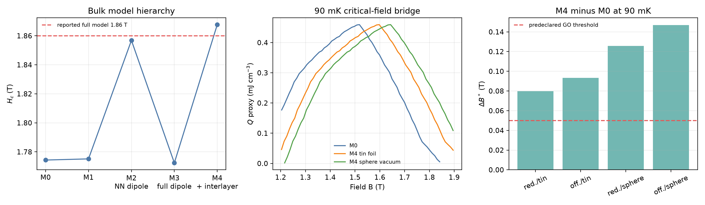

**Figure 1.** (a) Critical fields across M0–M4 for the tin-foil Ewald convention. M2 demonstrates why nearest-neighbor dipoles are a poor proxy for the long-range interaction. (b) The public 90 mK reference profile transported by the calculated critical-field shifts; the vertical scale is inherited and is not a direct M4 heat calculation. (c) All four representative-M4 transport and boundary scenarios exceed the predeclared 0.05 T threshold.

### C. Public diffraction converts P2 into a constrained model set

The representative P2 calculation is reproduced independently: \(\delta_c=0.02483\), folded \(q_z=0.33429\), an out-of-plane one-magnon bandwidth of 4.384 microelectronvolt, and an M4–M3 critical-field ablation of 0.09527 T. The source reports 4.4 microelectronvolt for the same bandwidth.

Twelve of the 375 deterministic stress-grid points satisfy the public near-saturation propagation-vector constraints. Their \(\delta_c\) values span 0.02418–0.02525, folded \(q_z\) spans 0.32367–0.33573, and out-of-plane bandwidth spans 3.484–5.280 microelectronvolt. Independent five-seed verification reclassifies none of the 12 models and reproduces the selected mode in at least three starts. Most parameter combinations are therefore rejected by an observable that was not used in the refrigerator calculation.

Constraint attribution shows which experiment supplies that rejection. The K–M-line residual accepts all 375 grid points, the in-plane $\delta_c$ band accepts 338, and the $q_z$ band accepts only 12; combining $\delta_c$ and $q_z$ leaves the same 12. None of the 18 one-coordinate outward extensions of retained edge points passes all three conditions. Thus the accepted set does not visibly continue through an original grid face, although the local audit does not rule out disconnected solutions or simultaneous multi-parameter extensions.

The retained models produce M4–M3 critical-field ablations of 0.05365–0.16365 T. With the central transported heat shape, 42 of 48 anchor/mapping cases cross both engineering gates at 90 mK; the full ranges are \(\Delta B^*=0.04589\)–0.16365 T and regret \(=3.81\)–20.44%. The six failures show directly that the propagation vector alone cannot guarantee a threshold-crossing refrigerator correction. The published representative set lies inside the constrained set but is not a unique basis for the decision.

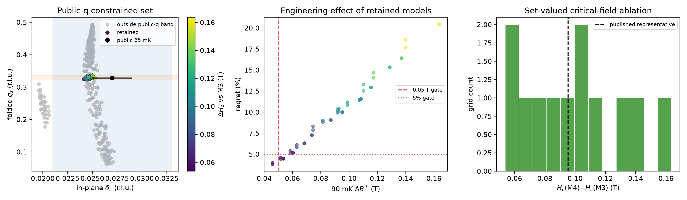

**Figure 2.** (a) Soft modes of all 375 grid points. Colored points satisfy the public in-plane and out-of-plane propagation-vector bands; gray points fail at least one condition. (b) The 90 mK decision effects of the 12 retained models under two measured critical-field anchors and two transport mappings; 42 of 48 cases cross both gates. (c) The retained critical-field ablations; the dashed line marks the published representative set. Grid fractions are descriptive coverage, not probabilities.

**Expanded simultaneous-variation audit.** The broader 256-point Sobol design retains four models. Two lie outside the original parameter box. Their critical-field ablations span 0.07260–0.14757 T. All 16 central anchor/mapping cases cross both gates, with \(\Delta B^*=0.06210\)–0.14757 T and regret \(=5.68\)–18.33%. Independent five-seed verification reproduces every selected mode in at least four starts. This result shows that simultaneous variations can cross the local box, but it does not establish the extrema of the admissible set.

**Adaptive inverse audit.** Starting from all 631 local and Sobol evaluations, three acquisition rounds add 192 exact calculations. Fifty-three new models pass the public-(q) constraints, giving 69 retained models among 823 exact evaluations; 52 of the 69 lie outside the original local box. The retained M4–M3 shifts span 0.03340–0.20211 T. The last round changes the minimum and maximum by −0.00228 and +0.00078 T, respectively. Five independent optimizer starts reproduce both extremal shifts and retain their public-(q) classifications. The 69 models generate 276 central anchor/mapping cases; 224 cross both gates, while the full ranges are \(\Delta B^*=0.02857\)–0.20211 T and regret \(=1.86\)–27.41%. Thus the initial local and Sobol designs both understate the decision range.

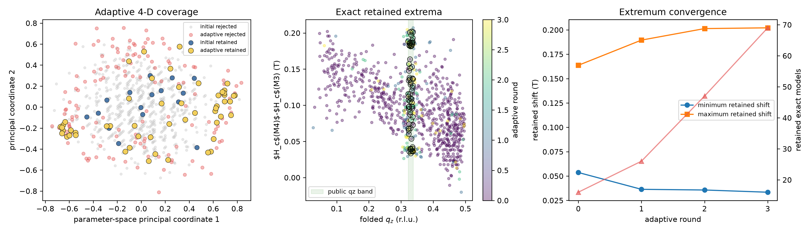

**Figure 3.** (a) Principal-coordinate view of the 631 initial and 192 adaptively selected exact M4 calculations. (b) Folded \(q_z\) and critical-field shift; black rings mark the 69 models satisfying every public propagation-vector constraint. (c) Retained extrema and model count across the three adaptive rounds. The surrogate selects coordinates only; all plotted physical values are exact multistart calculations.

**Field-dependent fan holdout.** For all 69 retained models, the fan solution at \(0.999H_c\) agrees with the independent soft-mode incommensuration within 0.000155 reciprocal-lattice units and \(\delta(H)\) is monotone over the declared fan window. The four lower-field points are more discriminating. Their mean absolute error spans 0.00420–0.00531 reciprocal-lattice units, and every retained model evolves more slowly than the experiment at the lowest holdout field. The holdout error increases strongly with the M4–M3 critical-field shift (Spearman \(\rho=0.940\)). Thus the largest predicted refrigerator corrections are also the least compatible with the unused field dependence within this mean-field family.

Twenty-three models have a holdout error no larger than the published representative set. Their shifts span 0.03340–0.10730 T; 40 of 92 rigid-profile central cases cross both engineering gates, but none of their 92 correlated microscopic-template cases does. These counts show the decision consequence of the field-dependent ranking, but they are not used to replace the full 69-model envelope because the published representative itself has a documented systematic curve mismatch. A quantitative reduction of the design set requires raw reduced diffraction values together with \(q_z(H)\) and phase-boundary energies.

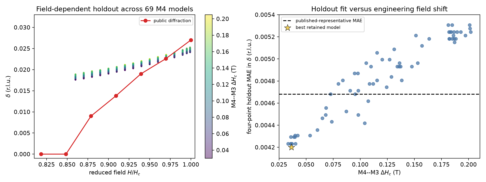

**Figure 4.** (a) Fan incommensuration curves for all 69 public-\(q\)-retained M4 models, colored by their critical-field shifts, compared with the digitized diffraction curve. (b) Four-point lower-field holdout error versus the engineering critical-field shift. The dashed line is the published representative model, not an experimental acceptance threshold.

**Independent public-INS bandwidth and linewidth audit.** The public 3.5 T source calculation has an 18.048 microelectronvolt bandwidth on each twin branch. Recalculation from its published equations agrees with the archived curves to \(3.71\times10^{-5}\) meV after branch permutation. As a separate implementation check, our representative M4 calculation gives 4.384 microelectronvolt along \((00l)\) for axial polarization, compared with the source value of 4.4 microelectronvolt.

Across the 69 diffraction-compatible models, the maximum transverse-field bandwidth over the two domain paths spans 10.1767–29.8298 microelectronvolt. Thirty models lie at or below the 18.048 microelectronvolt reference and 39 lie above it. The same 30 pass at every matched one-standard-deviation corner of \(J_z\), \(J_{xy}\), and \(g_{ab}\). Bandwidth and critical-field shift are strongly associated (Spearman \(\rho=0.882\)); the spectroscopy-compatible sensitivity subset has \(\Delta H_c=0.03340\)–0.14757 T, compared with 0.03340–0.20211 T for all 69 models. Its rigid-profile central cases pass both gates in 68 of 120 cases, whereas only 4 of 120 correlated microscopic-template cases do. This sensitivity rule therefore trims the high-effect tail without restoring a one-to-one critical-field transfer. Because the source bound is explicitly indicative, these 30 models do not replace the full 69-model design set.

The direct linewidth comparison prevents a stronger claim. With the source equal-twin coefficient fixed, 66 of 69 models have \(\chi^2\) no larger than the source curve's 28.35. Profiling the unresolved twin mixture reduces the M4 range to \(\chi^2=21.36\)–26.74, so all 69 are no worse than the source curve and the full 0.03340–0.20211 T shift range survives. The maximum profile-\(\chi^2\) difference across models is only 5.38, and the profiled score does not preferentially reject the high-shift tail (Spearman \(\rho=-0.276\)). Thus the 30-model set is a useful what-if envelope under the author's indicative bandwidth rule, while the more direct public linewidth observable provides no calibrated reason to remove 39 models.

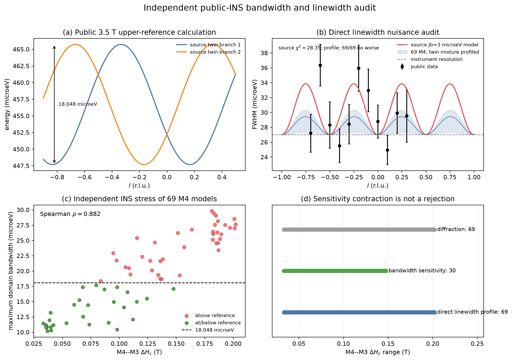

**Figure 5.** (a) Public 3.5 T calculated twin branches defining the 18.048 microelectronvolt sensitivity reference. (b) Public linewidth data, the source \(J_b=3\) microelectronvolt curve, and the envelope obtained after profiling the unresolved domain mixture for each M4 model. (c) Maximum predicted domain bandwidth versus M4–M3 critical-field shift for all 69 diffraction-compatible models. (d) The bandwidth rule contracts the sensitivity envelope to 30 models, whereas the direct linewidth nuisance audit leaves all 69 no worse than the source curve.

### D. A preregistered N=18 model cover rejects universal N=12 transfer

The direct N=12 calculation remains useful because it rejects rigid critical-field transport. Across the 12-model coverage set at 90 mK, the M4–M3 optimum shift is 0–0.08 T and the peak-heat ratio is 0.916–1.013. Three common-random repeats of M4-01 give a 0.100 T shift, a mean peak-heat ratio of 0.919, and total $W_{95}$-width ratios of 1.46–2.05. These results invalidate the earlier ±0.02 T residual-shift and ±20% width assumptions.

We test whether that conclusion is confined to one extreme Hamiltonian. Before inspecting the new N=18 results, we fixed four M4 models: the minimum retained bulk-shift model M4-00, nominal M4-02, median-shift/distinct-coupling M4-03, and maximum-shift M4-01. The same M3 baseline and all four M4 models are calculated on the periodic $3	imes3	imes2$, $N=18$ cluster. Unlike the $3	imes2	imes2$ cluster, this geometry accommodates three-sublattice order in both planar directions.

| Model | Sample | N=12 shift (T) | N=18 shift (T) | N=12 heat ratio | N=18 heat ratio | N=18 total-$W_{95}$ ratio |
|---|---:|---:|---:|---:|---:|---:|
| M4-00 | 761 | 0.000 | 0.293 | 1.013 | 0.852 | 1.054 |
| M4-02 | 188 | 0.040 | 0.339 | 0.994 | 0.749 | 0.993 |
| M4-03 | 738 | 0.050 | 0.360 | 0.961 | 0.663 | 0.917 |
| M4-01 | 773 | 0.100 | 0.425 | 0.919 | 0.537 | 0.909 |

The M3 N=18 peak is 1.17673 T. Across the preregistered M4 cover, the N=18 optimum shift spans 0.293–0.425 T, the peak-heat ratio spans 0.537–0.852, and the local total-$W_{95}$ ratio spans 0.909–1.054. A major transfer change is defined as an absolute N=18-minus-N=12 optimum-shift change of at least 0.05 T or an absolute peak-heat-ratio change of at least 0.10. 4 of the four M4 models (M4-00, M4-02, M4-03, M4-01) cross the declared major-transfer threshold. The N=18 shift is monotone in the preregistered bulk-shift order (Spearman rho=1.000). This model-family result is stronger than the previous M4-01-only comparison because selection was fixed from retained bulk and N=12 evidence before the new N=18 values were known.

Every Hamiltonian uses the same 1.10–2.10 T grid at 0.02 T spacing. Every close dense-grid local maximum is recalculated with 32 states per parity before peak selection. Multiple close candidates occur for M3 (2), M4-00 (2), M4-02 (2), M4-03 (2), M4-01 (2); increasing the state count changes the selected branch for none. The maximum K6/K7-to-K8/K9 cold-entropy change at the selected centers is 7.24e-05 $k_B$ per spin; the largest final K8/K9-to-K10/K11 hot-reference change is 4.37e-03 $k_B$ per spin. These checks meet the declared local numerical tolerances inside the projected N=18 calculation. They do not establish the thermodynamic limit.

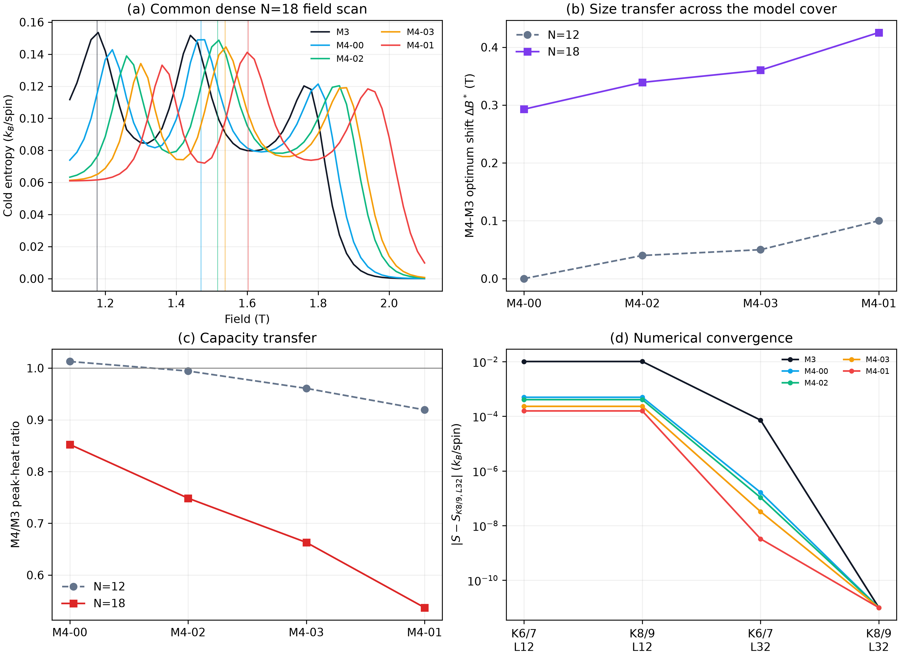

**Figure 6.** (a) Common-grid N=18 cold-entropy scans for M3 and four preregistered M4 models. (b) N=12 and N=18 optimum shifts. (c) N=12 and N=18 peak-heat ratios. (d) Low-state and projected-magnon-cutoff checks at the selected peaks. N=18 convergence is numerical convergence within one projected cluster, not bulk convergence.

Propagating all four correlated N=18 deformations, rather than only M4-01, expands the engineering stress from 52 to 68 scenarios. Peak support becomes 1.2943–1.7136 T. The unmeasured minimax field moves from 1.3660 to 1.4890 T and worst regret rises from 9.42% to 34.55%. The former N=12 field and inventory values remain transparent pre-convergence examples, not package acceptance values.

For provenance, the former N=12-only decisions are listed in Table II. They quantify what the smaller scenario set implied before the size test and must not be used as package acceptance values.

**Table II. N=12-conditional pre-convergence decisions.** Heat and volume are magnetic-only values within the former 52-scenario set.

| Temperature (mK) | Conditional field (T) | Worst regret (%) | Guaranteed $W_{95}$ (T) | Worst $Q$ (mJ cm$^{-3}$) | Volume for 0.10 microWatt, 60 min (cm$^3$) |
|---:|---:|---:|---|---:|---:|
| 90 | 1.3660 | 9.42 | none | 0.3825 | 0.941 |
| 100 | 1.3608 | 8.50 | none | 0.4938 | 0.729 |
| 120 | 1.3619 | 6.01 | none | 0.7448 | 0.483 |
| 150 | 1.3435 | 4.99 | 1.3434–1.3435 | 1.1624 | 0.310 |

### E. The result translates into a package-shape specification

The lattice-derived density is 4.206 g cm\(^{-3}\). Before the size-transfer test, the N=12 scenario set implied 3.96, 3.07, 2.03, and 1.30 g of ideal magnetic material for a 0.10 microWatt, 60 min magnetic-only hold at 90, 100, 120, and 150 mK. The public 1.65 g sample-equivalent volume then implied conditional holds of 25.0, 32.3, 48.7, and 76.0 min. Because N=18 changes both peak position and peak heat, these are now pre-convergence scaling examples rather than refrigerant acceptance values.

The separated steady-load envelope shows how those N=12 examples scale: at 90 mK, adding 0.20 or 0.97 microWatt of steady parasitics raises the former 3.96 g value to 11.87 or 42.35 g. These coordinates come from different architectures and refrigerants [14,15]. They verify the load-scaling calculation, but the failed size gate prevents their use as NBCP inventory predictions.

These numbers specify magnetic inventory rather than finished-device performance. Packing voids, binder, a thermal bus, addenda, heat switches, wiring, contact resistance, leakage, and irreversible ramp loss must be added to the total load and volume. The design chart is therefore directly scalable by a measured or specified total cold load without presenting generic parasitic-load assumptions as NBCP data.

The parametric transient envelope is likewise retained only as a reproducible scaling rule. At zero specified parasitic load, transient allocations of 10%, 25%, and 50% multiply the pre-convergence 90 mK mass to 4.40, 5.28, and 7.92 g. The 82 s measured recycle coordinate and 6.5 min target midpoint give single-stage duties of 97.8% and 90.2% for a 60 min hold. Final mass requires a bulk-converged or measured heat profile in addition to actual stage losses.

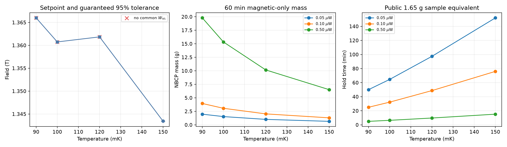

**Figure 7.** N=12-conditional design chart retained for provenance. (a) Former minimax field and \(W_{95}\) result. (b) Pre-convergence NBCP mass for a 60 min magnetic-only hold. (c) Corresponding hold of a volume equivalent to the public 1.65 g sample. None is a final acceptance value after the N=18 size gate fails.

The macroscopic field coordinate is independently first-order. The equal-volume spheroid for the public plate has \(c/a=0.122\), \(N_z=0.834\), and a saturation demagnetization bound of 0.136 T, close to the source-reported 8% scale [20]. Even a sphere gives 0.0545 T. To bound the conservative correction below 0.05, 0.02, or 0.01 T, the refrigerant must have its long dimension parallel to \(c\) with \(c/a\ge1.11\), 2.72, or 4.68, respectively. The public 1.65 g sample column has a reported comparison volume but no public dimensions, so no exact applied-field set point can be assigned to it.

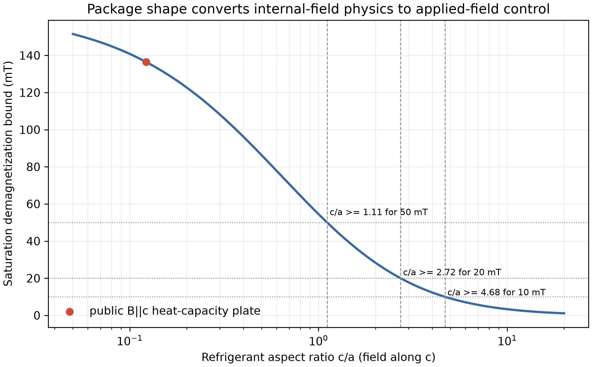

**Figure 8.** Conservative saturation demagnetization bound for equal-volume spheroids with the field parallel to \(c\). Dashed lines mark the aspect-ratio thresholds for 50, 20, and 10 mT; the red point is the public plate geometry. The curve is an upper envelope rather than a substitute for measured \(M(B,T)\).

### F. An independent public device validates the stage heat balance

The two YbNi1.6Sn warm-up curves provide a device-level test that is independent of NBCP. A joint fit over 0.21–0.25 K gives an effective refrigerant mass of 15.22 g, only 1.48% above the separately reported approximate 15 g, and a steady parasitic load of 0.254 microWatt, below the separately reported 0.4 microWatt upper bound [19]. Neither published quantity is imposed as a fitting constraint.

With those two fitted quantities frozen, the 0.25–0.28 K holdout is predicted with 0.592% normalized root-mean-square error and 1.27% maximum error relative to the full-interval enthalpy. After adding the fitted parasitic load, the independently recorded 2.5 and 5.0 microWatt energy curves collapse with 0.762% normalized root-mean-square difference. Omitting the source-reported nuclear heat capacity raises the holdout error from 0.592% to 0.761% and shifts the inferred mass to 15.81 g. Thus, the same heat-capacity integration and steady-load identity used for the NBCP sizing envelope recover both a known device mass scale and an independently bounded heat leak.

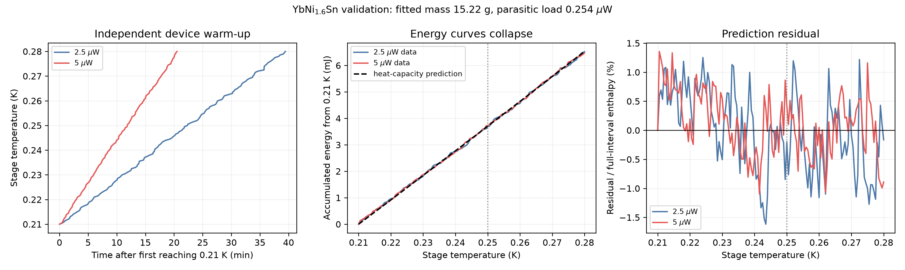

**Figure 9.** (a) Public warm-up trajectories for one YbNi1.6Sn pill under 2.5 and 5.0 microWatt labelled heat inputs. (b) Accumulated input energy after fitting one common mass and parasitic load below 0.25 K; the dashed curve is the independent zero-field heat-capacity integral. (c) Residuals normalized by the full 0.21–0.28 K enthalpy. The dotted line separates calibration from the held-out temperature interval.

### G. Direct public data give a temperature-dependent field schedule

Table III uses only published central-value entropy curves and compares the measured fields without field interpolation.

**Table III. Direct 90–300 mK candidate-field decisions.** \(W_{95}\) is a candidate set.

| Temperature (mK) | Best candidate (T) | Candidates in \(W_{95}\) (T) | \(Q_{\max}\) (mJ cm−3) |
|---:|---:|---|---:|
| 90 | 1.5 | 1.5 | 0.5386 |
| 100 | 1.5 | 1.5 | 0.7223 |
| 120 | 1.5 | 1.5, 1.3 | 1.0315 |
| 150 | 1.3 | 1.3, 1.5 | 1.5856 |
| 200 | 1.3 | 1.3, 0 | 2.6007 |
| 250 | 0 | 0, 1.3 | 3.9135 |
| 300 | 0 | 0 | 5.4379 |

The best measured candidate changes near 128 mK from 1.5 to 1.3 T and near 215 mK from 1.3 to 0 T when the published temperature curves are linearly interpolated within each field. At 100 mK and 1.5 T, the magnetic entropy budget is 0.7223 mJ cm−3. A 0.10 microWatt load for 60 min therefore requires 0.498 cm3 of magnetic material under the stated idealized accounting; 0.4 cm3 provides 48.2 min. These values are transparent conditional budgets rather than a device forecast.

The second-material check provides an external scale for the thermodynamic reconstruction. Across the 12 public Gd2B2MoO9 comparison points, the heat-capacity-derived adiabatic temperature change has a mean absolute error of 13.8 mK, a root-mean-square error of 15.8 mK, and a maximum absolute error of 27.6 mK relative to direct measurement [18]. The correlation is 0.99993 because the test spans both small inverse effects and large positive cooling changes. These author-selected points are not an independent random sample, but they show that the same type of equilibrium thermodynamic processing can recover direct cooling response in a second material. Figure S3 gives the pointwise comparison.

### H. Multimodel size stress defines the first heat measurements

The N=12-only design is retained as provenance: it gave 9.423% unmeasured regret at 1.366 T and selected 1.296 and 1.420 T on its 42-field grid. The four-model N=18 cover supplies 16 correlated stresses from four M4 models, two experimental anchors, and two mappings. Together with the 52 N=12 scenarios, this gives 68 adversarial scenarios, 34.551% unmeasured regret at 1.4890 T, and peak support of 1.2943–1.7136 T.

The first experiment must cover 1.292–1.716 T at 0.004 T spacing (107 points). At a declared ±2.5% per-reading heat bound, exhaustive enumeration of all 5,671 two-point panels selects 1.292 and 1.716 T. The panel leaves 4.246% worst regret and crosses the predeclared 5% gate. The former 1.296/1.420 T pair leaves 4.327% and remains below 5%. The full 107-point sweep leaves 1.820%.

The two-point panel is the minimum first-stage discrimination experiment if ±2.5% heat accuracy is available. The full field sweep localizes peaks and tests the scenario set itself. A measured curve outside the 68-scenario envelope requires a model update. These are deterministic set-membership bounds, not confidence intervals.

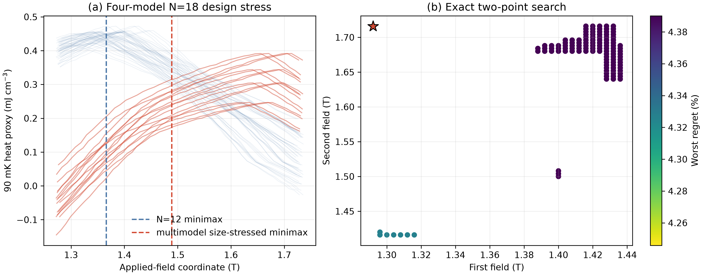

**Figure 10.** (a) N=12 scenario envelope and 16 correlated stresses derived from four preregistered N=18 M4 templates, with the baseline and augmented minimax fields. (b) The best 120 results from the exhaustive 5,671-panel search; the star marks 1.292/1.716 T. The N=18 curves are adversarial finite-cluster stresses, not bulk predictions.

### I. The complete six-qubit hardware benchmark resolves sign but not magnitude

The exact full-spectrum M2–M0 entropy correction for the open six-spin patch is −0.041611 \(k_B\) per spin at 100 mK. The adaptive prepared circuits give −0.041707 \(k_B\) per spin, confirming that local representation error is below the declared \(10^{-3} k_B\) per-spin target before hardware noise.

The complete twirled-TREX job on IBM Kingston gives −0.021679 \(k_B\) per spin, with a reported-error 95% interval of [−0.024627, −0.018727]. Adding zero-noise extrapolation moves the result toward the exact value, to −0.026822 \(k_B\) per spin with interval [−0.040300, −0.013193]. Both intervals exclude zero and both central values recover the exact negative sign. Zero-noise extrapolation reduces absolute bias from 0.019932 to 0.014789 \(k_B\) per spin, or 25.8%, while increasing the propagated standard deviation by a factor of 4.60. The exact value remains outside both reported-error intervals. The hardware therefore passes the sign-resolution gate and fails the quantitative-magnitude gate. The paired jobs used 38 and 113 s of free QPU time; their identifiers are `db6et9clf4us73c582f0` and `db6eurqmb58s738bmisg`.

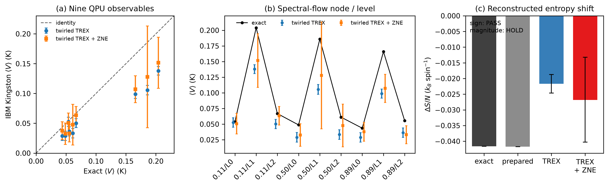

**Figure 11.** (a) Nine IBM Kingston expectation values against exact values. (b) The three spectral-flow nodes and three low levels; pointwise error bars show two Estimator-reported standard errors. (c) Exact, locally prepared, twirled-TREX, and twirled-TREX-plus-ZNE entropy corrections; hardware bars show propagated 95% reported-error intervals. Shared calibration and residual device bias are not contained in those intervals, so accuracy is judged against the exact six-spin benchmark.

## V. Discussion

### A. What is established for magnetic-refrigerator design

Four conclusions are robust within the declared evidence and hardware tests.

First, a local interaction ranking is not a safe engineering surrogate. The nearest-neighbor dipolar model suggests a large upward shift, while the full Ewald sum shows that the rest of the lattice can cancel it. Long-range electrostatic or magnetic interactions must be summed with an explicit boundary convention before weak terms are ranked.

Second, public propagation-vector data constrain the interlayer Hamiltonian strongly but do not guarantee that it changes the refrigerator decision. The local grid and expanded Sobol design retain only 16 models, but adaptive boundary and extremum searches find 53 additional admissible models. The resulting 0.0334–0.2021 T shift range is wider than either initial design, and only 224 of 276 central cases cross both gates. The correct claim is therefore conditional: the present wavevector data identify a set-valued decision range, not one Hamiltonian or a guaranteed threshold-crossing correction.

The lower-field fan curve supplies a second, unused observable and reveals a physically important tension. Across the 69 retained models, four-point holdout error and critical-field shift have a Spearman association of 0.940: models predicting the largest refrigerator correction reproduce the measured field evolution least well. The 23 models no worse than the published representative set reduce the upper shift to 0.1073 T, but the representative model itself misses the rapid experimental evolution. We therefore treat this subset as a descriptive ranking rather than a calibrated confidence set. The result strengthens the need for a joint fit to raw \(\delta(H)\), \(q_z(H)\), and phase boundaries before narrowing the engineering envelope.

The transverse-field INS archive adds an orthogonal energy-scale test that was not used in either diffraction retention or the fan ranking. Thirty of 69 models remain at or below the source's 18.048 microelectronvolt upper-reference bandwidth, and this membership is unchanged over all matched one-standard-deviation corners of the dominant exchange and \(g\)-factor fit. The upper shift of this sensitivity envelope falls by 27% from 0.2021 to 0.1476 T, and 68 of its 120 rigid-profile central cases cross both gates. That apparent contraction does not survive a direct comparison with the public linewidths: after the unresolved twin mixture is profiled, all 69 M4 models have \(\chi^2\) no larger than the source reference curve. The INS result therefore exposes a consequential non-identifiability rather than supporting a 39-model rejection. Peak-to-peak bandwidth is strongly associated with engineering shift, but the actually resolved one-peak linewidth cannot separate those models without independent twin fractions, a full resolution kernel, and reduced counts.

Third, finite-size transfer fails at the scale relevant to the engineering decision across a preregistered model family. The N=18 optimum shifts span 0.293–0.425 T, compared with 0.000–0.100 T for the same four M4 anchors at N=12; peak-heat ratios span 0.537–0.852, compared with 0.919–1.013. 4 of the four M4 models (M4-00, M4-02, M4-03, M4-01) cross the declared major-transfer threshold. The N=18 shift is monotone in the preregistered bulk-shift order (Spearman rho=1.000). The close-peak rule finds multiple candidates for M3 (2), M4-00 (2), M4-02 (2), M4-03 (2), M4-01 (2), and L32 reselects the branch for none. Local cutoff checks meet the declared tolerance at the selected centers. This is positive evidence against universal transfer, while one N=18 cluster remains short of a bulk prediction.

The multimodel value-of-information calculation turns that failure into a revised experiment. The 68-scenario peak support is 1.2943–1.7136 T, and the unmeasured minimax decision has 34.551% worst regret. At a ±2.5% heat bound, exhaustive enumeration of 5,671 pairs selects 1.292 and 1.716 T and leaves 4.246% regret. The full 107-point, 1.292–1.716 T sweep remains the model-falsification stage. Measurement precision and finite-size transfer are therefore coupled design variables.

Fourth, the quantum-hardware result has a decision-scale interpretation rather than a generic execution claim. All nine low-energy expectation values are measured and propagated to the final entropy correction. Present hardware resolves the sign, which distinguishes a correction from zero, but its residual bias is about twenty times the local state-preparation entropy error and prevents quantitative use in the refrigerator field or inventory calculation. The paired mitigation result identifies circuit and device error, rather than sampling alone, as the next quantum-computing bottleneck.

The demagnetization audit adds a second field scale of comparable magnitude. A public plate geometry gives a conservative 0.136 T correction, and even a sphere exceeds 0.05 T. An elongated package with \(c/a\ge2.72\) bounds the saturation correction below 0.02 T. A field specification without sample orientation and aspect ratio is therefore incomplete.

**Table V. Engineering use envelope.** Each output is paired with the decision it can support and the evidence still required for a stronger claim.

| Question | Current evidence | Usable output | Boundary or next action |
|---|---|---|---|
| Is NBCP worth refrigerator development? | public same-volume cooling and time traces [1] | yes; material-level screening is established | no new material-ranking claim is needed |
| Which 90 mK field is robust to the declared uncertainty? | 52 N=12 scenarios plus 16 stresses from four preregistered N=18 M4 models | no final set point; the adversarial minimax coordinate is 1.4890 T with 34.55% regret | obtain bulk-converged M4 thermodynamics or measure the expanded heat profile |
| What measurement closes the field ambiguity? | exhaustive search over 5,671 pairs on a 107-field grid | first measure 1.292 and 1.716 T at 90 mK; at a ±2.5% heat bound the worst regret is 4.246%; retain the 1.292–1.716 T sweep | treat an observation outside the 68-scenario envelope as model falsification |
| How much NBCP is required? | N=12-conditional entropy budget and verified load-scaling identities | 3.96 g and its steady/transient multiples are pre-convergence examples only | determine heat from a bulk-converged or measured profile, then add actual package losses |
| What package shape controls the applied-field error? | public \(g_c\), lattice constants, plate dimensions, and an equal-volume spheroid envelope [20] | align the long dimension with \(c\); require \(c/a\ge2.72\) for a conservative correction below 0.02 T | measure actual dimensions, packing fraction, orientation, and \(M(B,T)\) for a self-consistent correction |
| Is one interlayer Hamiltonian or a threshold-crossing shift uniquely identified? | 69 of 823 exact adaptive-audit models satisfy public-\(q\); four unused lower-field fan points give \(\rho=0.940\); an indicative INS bandwidth rule retains 30, but direct linewidth/twin profiling leaves all 69 no worse than the source curve | no; propagate the full 0.0334–0.2021 T range | jointly constrain raw \(\delta(H)\), \(q_z(H)\), phase boundaries, twin fractions, the resolution kernel, polarized interlayer dispersion, and finite-temperature heat |
| Does field-resolved thermodynamic processing track direct cooling in another frustrated refrigerant? | 12 public Gd2B2MoO9 indirect/direct comparison points [18] | yes at 13.8 mK mean absolute and 27.6 mK maximum error | validates the processing step, not the NBCP field-shift surrogate or package model |
| Does the stage heat balance predict an independent physical device? | two-load YbNi1.6Sn calibration and disjoint temperature holdout [19] | recovers 15.22 g and 0.254 microWatt; holdout NRMSE 0.592% | validates the lumped identity, not NBCP-specific package losses |
| Can present quantum hardware recover the selected low-energy correction? | nine adaptive six-qubit circuits on IBM Kingston, paired twirled-TREX and ZNE jobs | sign resolved and separated from zero; best magnitude −0.02682 versus exact −0.04161 \(k_B\) per spin | do not use hardware magnitude for bulk field or inventory; reduce circuit/device bias and demonstrate scalable state discovery |

### B. Limitations

The largest physical limitation is the absence of a converged three-dimensional finite-temperature M4 solution. The N=18 escalation removes the two-site planar circumference and is compatible with three-sublattice order, but it remains one periodic geometry and uses a projected-magnon space. State-count and cutoff checks control the declared numerical projection; they do not control the thermodynamic limit. The sharp N=12-to-N=18 change is therefore used to reject quantitative transfer of the smaller cluster, not to label the N=18 curve as bulk.

The public experimental curves provide only four terminal fields. The direct 90–300 mK \(W_{95}\) result is a measured-candidate set. The absence of a common continuous \(W_{95}\) at 90–120 mK under the shape envelope is a value-of-information result, not an experimental confidence statement. Experimental confidence intervals are unavailable for several source curves, so we do not fabricate statistical error bars or interpret stress-grid coverage as probability.

The revised measurement panel is conditional on 52 N=12 scenarios plus four correlated N=18 size stresses. Its bounded-error overlaps are conservative set-membership tests, not a noise likelihood, and the error fractions are resolution requirements rather than measured instrument uncertainties. All 5,671 two-point panels on the 107-field grid are enumerated, but the four N=18 curves cannot span every possible bulk finite-size trajectory. A measured heat value outside the envelope would falsify the scenario set and require expansion rather than assignment to the nearest template.

The interlayer search remains a finite stress design. The adaptive audit improves coverage from 631 to 823 exact M4 evaluations and targets the public-(q) boundary and predicted extrema, but its last-round minimum still moves by 0.00228 T. It therefore does not establish a posterior distribution or mathematically exhaust the continuous parameter box. Its scientific value is adversarial: it demonstrates that the initial local and Sobol designs missed compatible low- and high-effect models. The inference also continues to depend mainly on the public out-of-plane wavevector.

The field-dependent fan audit uses four values digitized from a vector figure because a reduced numerical table is not public. All retained mean-field curves evolve more slowly than experiment at 1.45 T, so even the best relative model is not a quantitatively adequate curve fit. The holdout ranking cannot be converted into posterior weights, and its 23-model relative subset does not replace the full set-valued design range. Raw reduced diffraction data and a simultaneous calculation of the V–fan transition and \(q_z(H)\) are needed for that step.

The INS audit uses an archived calculated bandwidth corresponding to the source's simplified \(J_b=3\) microelectronvolt model. The source itself calls this an indicative upper bound: the calculated linewidth has \(\chi^2=28.35\) for 11 published points without refitting, and the predicted energy modulation is not resolved in the data. In addition, the M4 \(J_2,J_a,J_b\) topology is more general than the source's \(J_b\)-only model. The calibrated linewidth proxy reproduces the source curve but deliberately profiles only an effective twin-mixture coefficient while fixing the published 0.027 meV resolution. Its all-model non-rejection is a diagnostic of insufficient information, not a posterior equivalence claim. A calibrated reduction would require the full resolution function, independently constrained twin populations, reduced counts, and a joint multi-branch fit.

The source-data audit found that the labels of Extended Data Fig. 6 sheets a/b do not reproduce the article's identifiable 94 mK NBCP point, while the independent time traces in sheet d do. We therefore exclude the ambiguous a/b labels from new cross-material calculations. This protects the present operating-field result, which uses separate entropy and heat-capacity data, but it prevents a fresh reanalysis of the same-volume demagnetization ranking from that workbook alone.

The QPU benchmark uses six qubits, an open patch, and exact classical eigenvectors as circuit-fitting targets. It therefore demonstrates a complete hardware measurement-and-propagation path, not quantum advantage, scalable eigenstate discovery, or an N=18 calculation. Reported Estimator errors also omit correlated calibration drift and residual device bias; the exact benchmark shows that this omitted bias remains decisive even after ZNE. No QPU value enters the bulk scenario envelope, robust field, or material inventory.

The heat budgets include only magnetic entropy. The stage and transient envelopes validate the scaling identities and expose the required device inputs, but the failed size-transfer gate removes the N=12 heat value as a final inventory basis. The YbNi1.6Sn holdout validates the lumped heat-capacity-to-hold-time identity; it does not infer NBCP losses. A complete prediction still requires a bulk-converged or measured NBCP heat profile together with nuclear and phonon heat capacities, package addenda, heat-switch conduction, wiring, contact resistance, ramp-rate-dependent loss, and warm-side regeneration heat.

The equal-volume spheroid is a conservative package envelope, not an exact rectangular-prism or packed-powder calculation. Saturation magnetization bounds the correction but overestimates it away from saturation. The public 1.65 g sample-column dimensions are unavailable, so its applied/internal-field relation cannot be reconstructed. Final field acceptance requires the actual package geometry and a self-consistent measured \(M(B,T)\) correction.

## VI. Conclusions

This study turns numerical size and sample shape into explicit engineering gates for a frustrated-magnet refrigerant. Long-range dipolar summation and interlayer topology first produce a 0.0334–0.2021 T set-valued critical-field correction across 69 public-wavevector-compatible models. Independent fan and neutron observables rank or trim sensitivities but do not identify one correction. A refrigerator set point therefore cannot be inferred from the polarized critical field alone.

Direct finite-temperature calculation supplies the decisive result. A preregistered minimum, nominal, median-distinct, and maximum-effect M4 cover gives N=18 optimum shifts of 0.293–0.425 T and peak-heat ratios of 0.537–0.852; 4 of four models cross the declared major-transfer threshold. The common-grid, close-peak, state-count, and projected-magnon checks pass inside N=18. The result rejects universal quantitative transfer of the N=12 templates while remaining explicitly short of a thermodynamic-limit prediction.

That result changes the engineering output. Propagating 16 correlated N=18 stresses gives 34.55% unmeasured worst regret at 1.4890 T across 68 scenarios. The former 1.366 T and 3.96 g results, together with their steady- and transient-load multiples, remain N=12-conditional pre-convergence examples rather than package acceptance values.

The surviving output is a falsifiable measurement plan. Peak support is 1.2943–1.7136 T, requiring a 1.292–1.716 T sweep at 0.004 T spacing. Exhaustive search of 5,671 two-point panels selects 1.292 and 1.716 T and leaves 4.246% regret at a ±2.5% heat bound. The complete 107-point sweep leaves 1.820% and tests whether the finite-cluster scenario set is adequate.

Sample geometry supplies an independent acceptance criterion. The public plate dimensions correspond to a conservative 0.136 T saturation correction. Aligning the long refrigerant dimension with \(c\) and requiring \(c/a\ge2.72\) bounds the spheroidal saturation correction below 0.02 T; \(c/a\ge4.68\) bounds it below 0.01 T. Exact applied-field conversion for the 1.65 g sample remains unavailable because its dimensions are not public.

An external audit of 12 public Gd2B2MoO9 points reproduces directly measured adiabatic temperature changes from heat-capacity-derived curves with 13.8 mK mean absolute error. This second-material result validates the equilibrium thermodynamic-processing step while leaving the NBCP-specific microscopic transport and device losses as explicit uncertainties.

An independent public-device audit closes the next link. Two YbNi1.6Sn warm-up curves calibrate to 15.22 g effective mass and 0.254 microWatt parasitic load, consistent with separate reports of approximately 15 g and less than 0.4 microWatt. The frozen balance predicts the disjoint 0.25–0.28 K interval with 0.592% normalized error. This supports the stage energy identity on an actual device without transferring its package losses to NBCP.

The quantum-hardware audit closes a different link. Two complete nine-circuit IBM Kingston jobs recover the negative sign of the six-spin spectral-flow entropy correction, and ZNE reduces absolute bias by 25.8%. The exact magnitude remains outside the reported-error interval, so current hardware is retained as a sign-resolving method benchmark and is not used as a quantitative refrigerator input.

The broader design lesson is that microscopic realism and quantum computation should be judged by the decision they change. For frustrated refrigerants, long-range summation and interlayer topology can matter more than the apparent magnitude of a local weak interaction. Classical sensitivity analysis identifies the observable that matters; a complete hardware benchmark then determines whether present QPU accuracy is sufficient to use it.

## Data and code availability

All experimental inputs are public source-data files or public article archives. Raw public files are preserved unchanged with SHA-256 hashes. Derived CSV and JSON files, source code, unit tests, figures, stopping decisions, and a complete file manifest are included in the associated repository. Sanitized QPU records include circuit resources, mitigation settings, usage accounting, the IBM job identifiers, and returned values; account tokens and service identifiers are excluded. A versioned GitHub release and Zenodo DOI will be added after author review.

## Author contributions

Ugwiyeon Lee: Conceptualization, Methodology, Software, Validation, Formal analysis, Investigation, Data curation, Visualization, Writing—original draft, Writing—review and editing, Project administration.
Seong-Yun Bae: Writing—review and editing.
Hakrae Kim: Writing—review and editing.
Jungsu Lee: Writing—review and editing.

The review-only roles are provisional until each coauthor confirms the manuscript and contribution statement.

## Competing interests

The authors declare no competing interests. This statement requires confirmation by all authors before submission.

## Acknowledgments

The authors acknowledge the providers of the public experimental source data. No statement here implies endorsement by those providers.

## References

1. J. Xiang *et al.*, “Giant magnetocaloric effect in spin supersolid candidate Na2BaCo(PO4)2,” *Nature* **625**, 270–275 (2024), doi:10.1038/s41586-023-06885-w.
2. Y. Gao *et al.*, “Spin supersolidity in nearly ideal easy-axis triangular quantum antiferromagnet Na2BaCo(PO4)2,” *npj Quantum Materials* **7** (2022), doi:10.1038/s41535-022-00500-3.
3. J. Sheng *et al.*, “Two-dimensional quantum universality in the spin-1/2 triangular-lattice quantum antiferromagnet Na2BaCo(PO4)2,” *PNAS* **119**, e2211193119 (2022), doi:10.1073/pnas.2211193119.
4. D. Flavián *et al.*, “Field-tuned incommensurate fan phase in an Ising-like triangular antiferromagnet,” arXiv:2607.23173v1 (2026), doi:10.48550/arXiv.2607.23173.
5. J. Jaklič and P. Prelovšek, “Lanczos method for the calculation of finite-temperature quantities in correlated systems,” *Physical Review B* **49**, 5065–5068 (1994), doi:10.1103/PhysRevB.49.5065.
6. S. Sugiura and A. Shimizu, “Thermal Pure Quantum States at Finite Temperature,” *Physical Review Letters* **108**, 240401 (2012), doi:10.1103/PhysRevLett.108.240401.
7. P. J. Shirron, “Applications of the magnetocaloric effect in single-stage, multi-stage and continuous adiabatic demagnetization refrigerators,” *Cryogenics* **62**, 130–139 (2014), doi:10.1016/j.cryogenics.2014.03.014.
8. P. J. Shirron, “Optimization strategies for single-stage, multi-stage and continuous ADRs,” *Cryogenics* **62**, 140–149 (2014), doi:10.1016/j.cryogenics.2014.03.012.
9. P. Wikus, E. Canavan, S. T. Heine, K. Matsumoto, and T. Numazawa, “Magnetocaloric materials and the optimization of cooling power density,” *Cryogenics* **62**, 150–162 (2014), doi:10.1016/j.cryogenics.2014.04.005.
10. P. Wikus, G. Burghart, and E. Figueroa-Feliciano, “Optimum operating regimes of common paramagnetic refrigerants,” *Cryogenics* **51**, 555–558 (2011), doi:10.1016/j.cryogenics.2011.07.001.
11. T. I. Popescu *et al.*, “Zeeman Split Kramers Doublets in Spin-Supersolid Candidate Na2BaCo(PO4)2,” *Physical Review Letters* **134**, 136703 (2025), doi:10.1103/PhysRevLett.134.136703.
12. L. Woodland, R. Okuma, J. R. Stewart, C. Balz, and R. Coldea, “From continuum excitations to sharp magnons via transverse magnetic field in the spin-1/2 Ising-like triangular lattice antiferromagnet Na2BaCo(PO4)2,” *Physical Review B* **112**, 104413 (2025), doi:10.1103/1pvl-kzjm.
13. S. W. de Leeuw, J. W. Perram, and E. R. Smith, “Simulation of electrostatic systems in periodic boundary conditions. I. Lattice sums and dielectric constants,” *Proceedings of the Royal Society of London A* **373**, 27–56 (1980), doi:10.1098/rspa.1980.0135.
14. P. Schüßler *et al.*, “A compact cryogen-free continuous adiabatic demagnetization refrigeration platform for quantum technology applications,” *Review of Scientific Instruments* **97**, 025214 (2026), doi:10.1063/5.0302131.
15. NASA Goddard Space Flight Center, “MSAM/Tophat—Adiabatic Demagnetization Refrigerator,” https://lambda.gsfc.nasa.gov/product/suborbit/TOPHAT/topweb.gsfc.nasa.gov/adr.html (accessed 12 October 2026).
16. J. Bartlett, G. Hardy, and I. D. Hepburn, “Performance of a fast response miniature Adiabatic Demagnetisation Refrigerator using a single crystal tungsten magnetoresistive heat switch,” *Cryogenics* **72**, 111–121 (2015), doi:10.1016/j.cryogenics.2015.10.004.
17. B. Wolf *et al.*, “Magnetocaloric effect and magnetic cooling near a field-induced quantum-critical point,” *Proceedings of the National Academy of Sciences* **108**, 6862–6866 (2011), doi:10.1073/pnas.1017047108.
18. Y. Zhang *et al.*, “Refrigeration down to 0.16 K using a frustrated magnet Gd2B2MoO9,” *Nature Communications* **17**, 1554 (2026), doi:10.1038/s41467-025-68278-z.
19. T. Gruner *et al.*, “Metallic local-moment magnetocalorics as a route to cryogenic refrigeration,” *Communications Materials* **5**, 63 (2024), doi:10.1038/s43246-024-00494-4; supporting dataset doi:10.17863/CAM.106770.
20. H. Li *et al.*, “Possible itinerant excitations and quantum spin state transitions in the effective spin-1/2 triangular-lattice antiferromagnet Na2BaCo(PO4)2,” *Nature Communications* **11**, 3996 (2020), doi:10.1038/s41467-020-18041-3.
21. S.-N. Sun, M. Motta, R. N. Tazhigulov, A. T. K. Tan, G. K.-L. Chan, and A. J. Minnich, “Quantum computation of finite-temperature static and dynamical properties of spin systems using quantum imaginary time evolution,” *PRX Quantum* **2**, 010317 (2021), doi:10.1103/PRXQuantum.2.010317.
22. G. Gentinetta, F. Metz, W. Kirby, and G. Carleo, “Quantum finite-temperature Lanczos method,” *Physical Review Research* **8**, 023285 (2026), doi:10.1103/f3q5-cm1n.
23. IBM Quantum, “Plans overview,” https://quantum.cloud.ibm.com/docs/en/guides/plans-overview (accessed 12 October 2026).
24. IBM Quantum, “Error mitigation and suppression techniques,” https://quantum.cloud.ibm.com/docs/en/guides/error-mitigation-and-suppression-techniques (accessed 12 October 2026).
