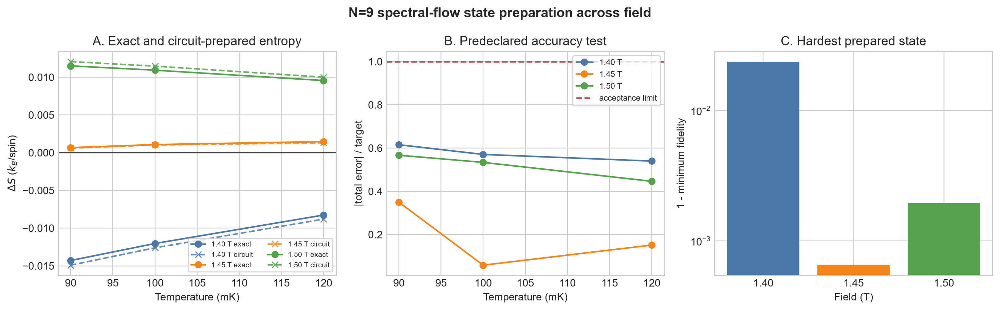

# Model-risk-aware operating fields for sub-kelvin refrigeration with a frustrated quantum magnet: classical validation and a quantum spectral-flow pilot

**Ugwiyeon Lee**1,* (ORCID: 0009-0008-8976-5363), **Seong-Yun Bae**1 (0009-0003-8731-428X), **Hakrae Kim**1 (0009-0002-5048-3568), and **Jungsu Lee**1 (0009-0006-9347-453X)

1Korea Gas Safety Corporation, Republic of Korea
*Corresponding author: lyullee@kgs.or.kr

Draft prepared in a *Physical Review Applied*-style structure. Numerical values and scope statements are frozen to the reproducibility manifest dated 12 October 2026.

## Abstract

Frustrated quantum magnets can provide large entropy changes below 1 K, but a refrigerator is controlled through a small set of engineering decisions: the terminal magnetic field, an acceptable field window, and the amount of refrigerant required for a specified heat load. We quantify how uncertainty in weak interactions changes those decisions for the spin-1/2 triangular-lattice refrigerant Na2BaCo(PO4)2 using only public data. We first test a hierarchy from the nearest-neighbor XXZ model (M0) to bond-dependent exchange, long-range dipolar coupling, and interlayer exchange (M4). N=15 and N=18 finite-temperature Lanczos and thermal-pure-state calculations reveal strong shell effects and prevent a bulk finite-temperature attribution from small clusters. A thermodynamic-limit polarized-state calculation gives a different and decision-relevant result: nearest-neighbor dipolar truncation shifts the critical field by 0.0825 T, but the long-range Ewald sum nearly cancels this shift under tin-foil boundary conditions. In contrast, a published representative frustrated interlayer network shifts the critical field by 0.0953 T. Propagating that ablation into public magnetocaloric curves moves the 90 mK optimum by 0.0815–0.0953 T and causes 8.80–10.00% regret if the two-dimensional field is retained, exceeding our preregistered thresholds of 0.05 T and 5%. Direct public entropy data identify 1.5 T as the best measured candidate at 90–120 mK, 1.3 T at 150–200 mK, and 0 T at 250–300 mK. To test whether the required weak-term correction is measurable on a quantum processor, we develop a low-energy spectral-flow estimator based on Hellmann–Feynman derivatives. Ideal N=9 and N=12 simulations pass all predeclared entropy-error and sign tests; physics-informed N=9 circuits pass at 1.40, 1.45, and 1.50 T. Two N=6 executions on IBM Fez under the free Open Plan establish the hardware path, while residual bias and zero-noise-extrapolation variance preclude a quantitative hardware claim. The result is a reproducible decision framework: long-range and interlayer physics must be resolved before setting the operating field, whereas present quantum hardware can validate the measurement pathway but does not yet improve the material prediction.

## I. Introduction

Magnetic refrigeration below 1 K depends on entropy stored in a magnetic material. Frustration and quantum fluctuations can retain unusually large entropy at low temperature, which makes frustrated magnets promising refrigerants. Na2BaCo(PO4)2 (NBCP) is a particularly strong example. Public measurements report a giant magnetocaloric response and cooling below 100 mK, together with an easy-axis triangular-lattice spin-1/2 description [1–4].

The material question and the engineering question are different. A microscopic study asks which spin Hamiltonian produces the observed phases. A refrigerator designer must choose a terminal field, determine how accurately that field must be reached, and size a material inventory for a heat load. A model can reproduce broad thermodynamics and still move the narrow low-temperature optimum enough to change these decisions. This risk is greatest near a critical field, where a small energy-scale error can translate into a large loss at a fixed operating point.

The commonly used nearest-neighbor XXZ Hamiltonian captures much of the NBCP phenomenology [1–4]. Recent neutron diffraction, however, found a field-tuned incommensurate fan phase immediately below saturation and showed that dipolar coupling, bond-dependent exchange, and frustrated interlayer paths are required to describe the full sequence of ordered states [4]. These terms are small relative to the main exchange, but their effect on a refrigerator operating field has not been separated from their role in explaining magnetic order.

This work asks four linked questions.

1. Does a realistic interaction change the optimal terminal field by at least 0.05 T or cause at least 5% loss when a simpler-model field is used?
2. Does the conclusion survive finite-size diagnostics and uncertainty in the long-range dipolar boundary convention?
3. What field choices and magnetic entropy budgets follow directly from public measurements between 90 and 300 mK?
4. If the decision depends on a small free-energy correction, can a quantum algorithm estimate that correction with a lower sampling burden than direct entropy evaluation, and can the circuit path be demonstrated on free-access hardware?

We answer these questions with a staged calculation. Classical calculations determine whether the engineering effect is large enough to justify any quantum work. Only after the preregistered engineering threshold is passed do we test quantum algorithms. This order prevents a small hardware demonstration from becoming the reason for selecting the scientific problem.

Our main physical finding is that weak terms cannot be ranked from their local magnitude alone. The nearest-neighbor part of the dipolar interaction creates a large critical-field shift, but the full long-range sum can cancel it. The representative frustrated interlayer network then restores a shift large enough to change the engineering decision. Our main quantum result is similarly qualified: a low-energy spectral-flow estimator solves the ideal sampling problem for N=9 and N=12, while current N=6 hardware remains too biased for quantitative thermodynamics.

## II. Decision problem and model hierarchy

### A. Engineering quantities

We use the public 2 K, 4 T state as the hot reference. Its measured magnetic entropy density is

\[
S_{\rm hot}=6.6877263\;{\rm mJ\,cm^{-3}\,K^{-1}}.
\]

For a cold endpoint at temperature \(T\) and field \(B\), the conditional magnetic entropy budget is

\[
Q(B,T)=T\,[S(B,T)-S_{\rm hot}].
\]

This is the reversible magnetic contribution available during a cold hold. It is not cooling power, coefficient of performance, or a complete cycle simulation. The optimal measured or calculated field is

\[
B^*(T)=\arg\max_B Q(B,T),
\]

and the 95% operating set is

\[
W_{95}(T)=\{B:Q(B,T)\ge 0.95Q_{\max}(T)\}.
\]

For continuous reconstructed profiles, \(W_{95}\) is an interval. For direct public data at only 0, 1.3, 1.5, and 1.66 T, it is a set of measured candidates and must not be interpreted as a continuous field range.

If a field selected from model \(a\) is used under model or scenario \(b\), the design regret is

\[
R_{a\rightarrow b}(T)=100\frac{Q_b(B_b^*,T)-Q_b(B_a^*,T)}{Q_b(B_b^*,T)}\;\%.
\]

We fixed the decision thresholds before the final calculations: an interaction is engineering-relevant if \(|\Delta B^*|\ge0.05\) T or regret is at least 5%. A shift below 0.02 T and regret below 2% support stopping the quantum stage.

### B. M0–M4 hierarchy

The baseline model is the spin-1/2 nearest-neighbor easy-axis XXZ Hamiltonian for a field along the crystallographic \(c\) axis,

\[
H_0=J_{zz}\sum_{\langle ij\rangle}\left[S_i^zS_j^z+\Delta(S_i^xS_j^x+S_i^yS_j^y)\right]-g_{zz}\mu_BB\sum_iS_i^z.
\]

We use \(J_{zz}=0.1225\) meV, \(\Delta=0.636\), and \(g_{zz}=4.716\) from the public interaction analysis [4]. The model hierarchy is:

- **M0:** two-dimensional nearest-neighbor XXZ;
- **M1:** M0 plus the reported bond-dependent \(J_{\pm\pm}=-1.9\) microelectronvolt term;
- **M2:** M1 plus only the nearest-neighbor dipolar tensor;
- **M3:** M1 plus the full long-range dipolar interaction within and between AA-stacked layers, evaluated by a three-dimensional Ewald sum;
- **M4:** M3 plus representative interlayer exchange paths.

The magnetic lattice uses space group \(P\bar{3}\), \(a=5.312\) Å, \(c=6.983\) Å, and one Co magnetic site per primitive cell. The complete equivalent magnetic-lattice input and hashes are provided in `sources/crystal_input_provenance_20261012.json`.

For the interlayer uncertainty analysis, P0 denotes M3 without interlayer exchange. P1 adds an explicit simple vertical bond \(J_\perp=0.05\) K based on a published density-functional energy scale. P2 uses the representative network reported in Ref. [4]: \(J_2=2.8\) microelectronvolt, \(J_a=0\), \(J_b=7.9\) microelectronvolt, and \(\Delta_c=0.08\). The source authors explicitly describe P2 as representative and non-unique. We therefore treat P0–P2 as ablation and stress scenarios, not a fitted probability distribution.

## III. Methods

### A. Public data and entropy reconstruction

All experimental inputs are public source-data workbooks associated with Ref. [1], public article source files, or a public diffraction data archive. The preserved raw files are hashed in the input manifests. We interpolate only in temperature within a published field curve. Direct 90–300 mK rankings do not interpolate across magnetic field.

For the continuous near-saturation diagnostic, we reconstructed the published XTRG entropy surface by integrating the recovered \(C_m/T\) field-temperature map downward from its 1 K entropy anchor. The zero-field reconstructed entropy agrees with the independently published vector curve with a root-mean-square error of 0.0335 J mol−1 K−1. We use the reconstructed surface as the M0 bulk reference profile; it is not relabeled as an M4 solution.

### B. Finite-size thermodynamics

We implemented matrix-free Hamiltonian-vector products and verified them against exact N=9 and N=12 matrices. N=15 and N=18 thermodynamics were computed with finite-temperature Lanczos sampling and thermal-pure-state checks [5,6]. Internal tests included the high-temperature \(\ln2\) entropy limit, \(dU/dT=C\), exact small-system agreement, random-vector convergence, and deterministic low-energy replacement.

The cluster calculations serve two roles. First, they determine whether a weak-term correction is visible at the target temperatures. Second, disagreement between sizes acts as a stopping signal against an unjustified bulk claim. Fixed-magnon-sector calculations through N=27 were added near saturation to separate truncation error from shell effects.

### C. Bulk polarized-state stability and dipolar summation

For each model, the zero-temperature polarized-state critical field was obtained from the minimum eigenvalue of the transverse Hessian over the three-dimensional Brillouin zone. The M0 implementation reproduces its analytic field to \(4.4\times10^{-16}\) T. Long-range dipoles were summed by Ewald decomposition. Because the \(k=0\) dipolar term depends on macroscopic shape, we report both tin-foil and spherical-vacuum conventions. Real- and reciprocal-space cutoffs and the Ewald splitting parameter were converged independently.

The stability calculation is a bulk critical-mode diagnostic, not a finite-temperature entropy solver. To connect it to refrigeration, we horizontally transport the public M0 entropy profile by two decision-scale mappings: fixed reduced field \(B/H_c\) and fixed critical-field offset \(B-H_c\). Reporting both prevents a single similarity assumption from determining the conclusion.

The published full-model mean-field critical field is 1.86 T, whereas neutron diffraction and bulk probes place the measured transition at 1.65–1.70 T [4]. Consequently, the primary P0–P2 engineering analysis anchors P2 to the measured interval and transports only the calculated ablation shifts to P0 and P1. This removes the known absolute mean-field bias from the recommended operating field.

### D. Robust operating fields and conditional sizing

For a scenario set \(\Theta\), the robust field minimizes the worst regret,

\[
B_{\rm robust}=\arg\min_B\max_{\theta\in\Theta}R(B;\theta).
\]

We distinguish two scenario sets. The primary set contains the measured 1.65 and 1.70 T critical fields and the two transport mappings. The stress set additionally spans P0–P2. Material volume for a prescribed magnetic-only hold is

\[
V=\frac{P_{\rm load}t_{\rm hold}}{Q},
\]

with consistent conversion of microWatts, seconds, and millijoules. These volumes exclude nuclear and lattice heat capacities, sample holder, wiring, heat switches, contact resistance, and irreversible ramp losses.

### E. Quantum spectral-flow estimator

The quantum target is not the full entropy surface. It is the low-energy correction between a reference and a realistic Hamiltonian,

\[
H(\lambda)=H_{\rm M0}+\lambda V,\qquad V=H_{\rm M3}-H_{\rm M0}.
\]

For an instantaneous eigenstate \(|k,\lambda\rangle\), the Hellmann–Feynman relation gives

\[
\frac{dE_k}{d\lambda}=\langle k,\lambda|V|k,\lambda\rangle.
\]

We prepare only the thermally relevant low-energy states, measure \(V\) at three Gauss–Legendre nodes, integrate the derivative to recover the corrected levels, and calculate the low-rank partition function and entropy classically. Degenerate states with identical energy and derivative are grouped. Tail bounds are obtained from the omitted Boltzmann weight and a Fannes–Audenaert entropy bound.

This observable-specific route was selected after direct finite-difference entropy, covariance integration, Jarzynski estimation, variational Gibbs preparation, and QITE–QMETTS alternatives were evaluated under the same error target. At the N=9 sign-change point, direct finite differences required approximately \(3.87\times10^9\) shots. The selected low-energy route reduced the ideal estimate by orders of magnitude, although state search and noisy-hardware overhead remain.

N=9 physics-informed circuits use number-conserving Givens rotations plus a small sector-mixing layer required by \(J_{\pm\pm}\). The optimization target is an exact classical eigenvector, so this test measures representability and observable bias; it does not establish a scalable eigensolver. N=12 uses ideal low-energy spectral data and certified tail bounds.

### F. Hardware protocol

All hardware submissions were guarded to accept only an IBM account whose plan preference was exactly `open`. N=9 raw hardware execution was stopped after a fake-backend audit predicted excessive depth. A smaller N=6 open 3×2 fragment was compiled live to IBM Fez and executed twice: once with twirled readout error extinction (TREX), and once with TREX, gate twirling, and zero-noise extrapolation (ZNE). IBM documents an Open Plan allowance of up to 10 QPU minutes per rolling 28-day window and describes the applied mitigation levels [10,11]. Job identifiers and QPU seconds are frozen; credentials and cloud resource names are excluded.

## IV. Results

### A. Small clusters diagnose rather than remove the bulk problem

The N=15 and N=18 calculations detect a low-temperature correction, but they disagree in sign. At 90 mK and 1.50 T, \(S_{\rm M3}-S_{\rm M0}\) is +0.00664 \(k_B\) per spin for N=15 and −0.00331 \(k_B\) per spin for N=18. Aligning the cluster critical fields to the bulk instability does not remove the sign reversal. N=21, N=24, and N=27 low-magnon calculations continue an alternating size sequence whose magnitude decreases toward zero.

For N=18, a deterministic 16-level calculation agrees with the full finite-temperature estimate within \(2.42\times10^{-4}\;k_B\) per spin, showing that random trace noise is not responsible. N=24 boundary-residual and energy-denominator tests constrain the first omitted sectors to an estimated 90 mK entropy influence of \(8.72\times10^{-5}\;k_B\) per spin. The dominant uncertainty is therefore the finite-size shell sequence rather than the magnon cutoff.

This negative result sets the scope of the paper: finite clusters cannot determine the bulk sign of the local M3 entropy correction. We retain the public XTRG surface for absolute finite-temperature thermodynamics and use the independently converged bulk instability only to test whether the field scale changes enough to matter.

### B. A nearest-neighbor dipolar model gives the wrong hierarchy

The bulk critical fields are summarized in Table I.

**Table I. Thermodynamic-limit polarized-state critical fields.** Values are model-scale diagnostics, not direct operating fields.

| Model | Added physics | Tin-foil \(H_c\) (T) | Spherical-vacuum \(H_c\) (T) |
|---|---|---:|---:|
| M0 | nearest-neighbor XXZ | 1.77436 | 1.77436 |
| M1 | + \(J_{\pm\pm}\) | 1.77516 | 1.77516 |
| M2 | + nearest-neighbor dipole | 1.85682 | 1.85682 |
| M3 | + full long-range dipole | 1.77240 | 1.82608 |
| M4 | + representative interlayer exchange | 1.86767 | 1.92135 |

The \(J_{\pm\pm}\) contribution to the critical field is 0.00080 T. The nearest-neighbor dipolar term appears much larger, increasing \(H_c\) by 0.08246 T. That conclusion does not survive the long-range sum: M3 returns to within −0.00196 T of M0 under tin-foil conditions and lies +0.05172 T above M0 for a spherical-vacuum boundary. Thus a nearest-neighbor dipolar truncation can assign both the wrong magnitude and, relative to other weak terms, the wrong design priority. The macroscopic dipolar convention is itself a reportable source of model risk.

The P2 interlayer network shifts M4 relative to M3 by 0.09527 T under either boundary convention. This invariance occurs because the same dipolar surface term is present on both sides of the ablation. The simple P1 vertical bond gives only 0.03157 T. The comparison shows that the topology and anisotropy of the frustrated interlayer network, not the existence of an arbitrary small interlayer energy scale, drive the threshold-crossing result.

**Figure 1.** (a) Critical fields across M0–M4 for the tin-foil Ewald convention. M2 demonstrates why nearest-neighbor dipoles are a poor proxy for the long-range interaction. (b) The public 90 mK reference profile transported by the calculated critical-field shifts; the vertical scale is inherited and is not a direct M4 heat calculation. (c) All four M4–M0 transport and boundary scenarios exceed the preregistered 0.05 T threshold.

### C. Interlayer uncertainty changes the 90 mK design decision

After anchoring P2 to the measured 1.65–1.70 T interval, the P2–P0 shift in \(B^*\) is 0.08150–0.09527 T at 90 mK. If the P0 optimum is retained under P2, regret is 8.80–10.00%. Both metrics independently pass the preregistered engineering gate. P1 yields only a 0.0270–0.0316 T shift and 1.83–2.07% regret and therefore fails the gate. This separation prevents the broad claim that every weak interlayer coupling is important.

The primary actual-material decision uses the measured critical-field range without P0–P2 counterfactuals. It gives \(B_{\rm robust}=1.41085\) T at 90 mK with 3.52% worst-case regret across the two measured anchors and two transport mappings. In contrast, treating P0–P2 all as plausible produces a stress-test field of 1.34685 T and 11.89% worst regret. We report the latter as model-risk exposure, not as an operating recommendation.

**Figure 2.** (a) P0–P2 model-scale critical fields under two Ewald boundaries. (b) Minimax field and worst regret for the deliberately broad P0–P2 stress set from 90 to 150 mK. (c) Conditional magnetic material volume for a 0.10 microWatt load held for 60 min using the worst heat budget. The volume omits nonmagnetic and irreversible loads.

### D. Direct public data give a temperature-dependent field schedule

Table II uses only published central-value entropy curves and compares the measured fields without field interpolation.

**Table II. Direct 90–300 mK candidate-field decisions.** \(W_{95}\) is a candidate set.

| Temperature (mK) | Best candidate (T) | Candidates in \(W_{95}\) (T) | \(Q_{\max}\) (mJ cm−3) |
|---:|---:|---|---:|
| 90 | 1.5 | 1.5 | 0.5386 |
| 100 | 1.5 | 1.5 | 0.7223 |
| 120 | 1.5 | 1.5, 1.3 | 1.0315 |
| 150 | 1.3 | 1.3, 1.5 | 1.5856 |
| 200 | 1.3 | 1.3, 0 | 2.6007 |
| 250 | 0 | 0, 1.3 | 3.9135 |
| 300 | 0 | 0 | 5.4379 |

The best measured candidate changes near 128 mK from 1.5 to 1.3 T and near 215 mK from 1.3 to 0 T when the published temperature curves are linearly interpolated within each field. At 100 mK and 1.5 T, the magnetic entropy budget is 0.7223 mJ cm−3. A 0.10 microWatt load for 60 min therefore requires 0.498 cm3 of magnetic material under the stated idealized accounting; 0.4 cm3 provides 48.2 min. These values are transparent conditional budgets rather than a device forecast.

### E. Low-energy spectral flow passes the ideal quantum gate

The selected spectral-flow estimator passes all nine N=9 field-temperature cases at 1.40, 1.45, and 1.50 T and 90, 100, and 120 mK. N=12 also passes all nine cases with 96 low-energy levels and certified tail bounds. At N=9, 1.45 T, and 100 mK, a direct finite-difference entropy estimate requires approximately \(1.55\times10^8\) shots, whereas the ideal spectral-flow budget is approximately \(3.83\times10^4\) shots for the ordinary accuracy target. At the strict 1.45 T, 90 mK sign-change point, the conservative budget is \(1.42\times10^6\) shots for a \(2\times10^{-4}\;k_B\) per-spin target.

The N=9 physics-informed state preparation results are listed in Table III. All final entropy errors remain below their predeclared targets and all signs are correct, even though the hardest 1.40 T doublet has a lower full-state fidelity. This shows why observable bias must be checked directly rather than using fidelity as the only circuit criterion.

**Table III. N=9 state-preparation and observable tests.**

| Field (T) | Low levels | Distinct circuits | Minimum fidelity | Maximum \(|\Delta S|\) error (\(k_B\)/spin) | Maximum error/target |
|---:|---:|---:|---:|---:|---:|
| 1.40 | 7 | 12 | 0.97636 | 0.000615 | 0.615 |
| 1.45 | 5 | 9 | 0.99935 | 0.000151 | 0.350 |
| 1.50 | 5 | 9 | 0.99806 | 0.000567 | 0.567 |

**Figure 3.** (a) Exact and circuit-prepared M3–M0 entropy corrections. (b) Absolute total error divided by the predeclared target; every value remains below one. (c) Infidelity of the hardest state at each field. The lowest fidelity does not correspond to failure of the target observable.

### F. IBM Fez proves the execution path, not quantitative accuracy

The live preflight selected IBM Fez. Across the N=6 circuits, the maximum transpiled two-qubit count was 84 CZ, the minimum product of instruction success probabilities was 0.805, and the maximum circuit-duration-to-median-T1 ratio was 0.040. These diagnostics supported a minimal N=6 pilot but not N=9 execution.

For the hardware point \(B=1.05\) T and \(\lambda=0.5\), the exact \(\langle V\rangle\) is 0.04873698 K. TREX returned 0.020955±0.001848 K, with an absolute error of 0.027782 K. TREX+ZNE returned 0.031144±0.015893 K, with an absolute error of 0.017593 K. The ZNE central bias is 36.7% smaller, but its uncertainty is much larger; the improvement is not statistically established. The two jobs consumed 19 and 52 Open Plan QPU seconds, respectively.

**Figure 4.** (a) IBM Fez estimates compared with the exact N=6 observable. TREX alone leaves a large systematic discrepancy; ZNE reduces the central discrepancy but increases variance. (b) QPU time. The two jobs used 71 free seconds and left 412 seconds in the rolling allowance at completion.

## V. Discussion

### A. What is established for magnetic-refrigerator design

Three conclusions are robust within the available public evidence.

First, an interaction that is weak in energy can matter because the refrigerator operates near a narrow critical-field feature. The P2–P0 ablation exceeds both decision thresholds after the known mean-field bias is removed by experimental anchoring.

Second, a local dipolar truncation is not a safe engineering surrogate. M2 suggests a large upward shift, while M3 shows that the rest of the lattice can cancel it. Long-range electrostatic or magnetic interactions must be summed with an explicit boundary convention before ranking weak terms.

Third, the appropriate deliverable is a robust field and regret curve, not a statement that a Hamiltonian is more realistic. The measured critical-field interval yields a clear 90 mK center field near 1.41 T. The P0–P2 stress result quantifies the price of unresolved microscopic structure and shows where new data would be valuable.

### B. What is established for quantum computing

The quantum contribution is problem-specific. The desired output is a small correction to a few thermally occupied levels, not a full thermal density matrix or a complete wavefunction. This lets spectral flow replace a noisy entropy derivative with expectation values of the weak-term operator. In ideal simulation, that replacement produces a decisive sampling advantage over the direct finite-difference estimator for the tested instances.

The result is not a quantum-advantage demonstration. Exact classical eigenvectors supplied the N=9 state-preparation targets, and the N=12 test used ideal low-energy spectral data. The IBM experiment used only N=6 and did not feed into the material conclusion. The hardware result identifies the next bottleneck quantitatively: N=9 circuits reach up to 374 ECR gates on a representative heavy-hex backend, while N=6 already shows a large gate-noise bias. Symmetry tapering, shallower problem-informed preparation, and observable-specific mitigation are required before another QPU run is justified.

### C. Limitations

The largest physical limitation is the absence of a converged three-dimensional finite-temperature M4 solution. The horizontal transport of a public XTRG curve preserves its height and shape; it does not calculate entropy redistribution or a change in \(Q_{\max}\). We therefore attribute the threshold-crossing result to interlayer model uncertainty, not uniquely to the published P2 Hamiltonian.

The public experimental curves provide only four terminal fields. The 90–300 mK \(W_{95}\) result is a measured-candidate set. Continuous field windows at 200–300 mK require denser data. Experimental confidence intervals are unavailable for several source curves, so we do not fabricate statistical error bars.

The heat budgets include only magnetic entropy. A complete refrigerator model must add nuclear and phonon heat capacities, addenda, heat switches, wiring, contact resistance, magnetic-ramp losses, and thermal leakage. Conditional volume calculations are lower-bound design scenarios.

Finally, Ewald boundary conventions bracket a macroscopic shape effect but do not replace a demagnetization calculation for a specified sample geometry. A future device calculation should couple the microscopic susceptibility to its actual shape.

## VI. Conclusions

This study converts a quantum-magnet Hamiltonian question into a falsifiable refrigerator decision. In NBCP, \(J_{\pm\pm}\) alone has little effect on the polarized critical field. A nearest-neighbor dipolar model appears important but is qualitatively misleading because the long-range sum cancels much of its shift. A representative frustrated interlayer network produces a 0.095 T critical-field ablation and moves the inferred 90 mK operating optimum by 0.0815–0.0953 T, causing 8.80–10.00% regret when the two-dimensional optimum is retained. The result passes both preregistered engineering thresholds.

Public measurements support a practical temperature-dependent candidate schedule: 1.5 T at 90–120 mK, 1.3 T at 150–200 mK, and 0 T at 250–300 mK. The 90 mK field robust to the measured critical-field interval is 1.41085 T with 3.52% worst regret under the two transport mappings.

The same weak-term correction has a quantum-computing structure: only a few low-energy derivatives are needed. Spectral-flow simulations and N=9 state-preparation tests pass their predeclared accuracy targets, but N=6 IBM hardware retains too much bias for quantitative thermodynamics. Present hardware therefore supports a reproducible execution proof, while the refrigerator conclusion remains classical and public-data based.

The broader design lesson is that microscopic realism should be judged by the decision it changes. For frustrated refrigerants, long-range summation and interlayer topology can matter more than the apparent magnitude of a local weak interaction, and a quantum algorithm becomes relevant only after that decision sensitivity has been demonstrated classically.

## Data and code availability

All experimental inputs are public source-data files or public article archives. Raw public files are preserved unchanged with SHA-256 hashes. Derived CSV and JSON files, source code, unit tests, figures, stopping decisions, IBM job identifiers, and a complete file manifest are included in the associated repository. IBM credentials and cloud resource names are excluded. A versioned GitHub release and Zenodo DOI will be added after author review.

## Author contributions

Ugwiyeon Lee: Conceptualization, Methodology, Software, Validation, Formal analysis, Investigation, Data curation, Visualization, Writing—original draft, Writing—review and editing, Project administration.
Seong-Yun Bae: Writing—review and editing.
Hakrae Kim: Writing—review and editing.
Jungsu Lee: Writing—review and editing.

The review-only roles are provisional until each coauthor confirms the manuscript and contribution statement.

## Competing interests

The authors declare no competing interests. This statement requires confirmation by all authors before submission.

## Acknowledgments

The authors acknowledge the providers of the public experimental source data and the IBM Quantum Open Plan used for the two hardware pilot jobs. No statement here implies endorsement by those providers.

## References

1. J. Xiang *et al.*, “Giant magnetocaloric effect in spin supersolid candidate Na2BaCo(PO4)2,” *Nature* **625**, 270–275 (2024), doi:10.1038/s41586-023-06885-w.
2. Y. Gao *et al.*, “Spin supersolidity in nearly ideal easy-axis triangular quantum antiferromagnet Na2BaCo(PO4)2,” *npj Quantum Materials* **7** (2022), doi:10.1038/s41535-022-00500-3.
3. J. Sheng *et al.*, “Two-dimensional quantum universality in the spin-1/2 triangular-lattice quantum antiferromagnet Na2BaCo(PO4)2,” *PNAS* **119**, e2211193119 (2022), doi:10.1073/pnas.2211193119.
4. D. Flavián *et al.*, “Field-tuned incommensurate fan phase in an Ising-like triangular antiferromagnet,” arXiv:2607.23173v1 (2026), doi:10.48550/arXiv.2607.23173.
5. J. Jaklič and P. Prelovšek, “Lanczos method for the calculation of finite-temperature quantities in correlated systems,” *Physical Review B* **49**, 5065–5068 (1994), doi:10.1103/PhysRevB.49.5065.
6. S. Sugiura and A. Shimizu, “Thermal Pure Quantum States at Finite Temperature,” *Physical Review Letters* **108**, 240401 (2012), doi:10.1103/PhysRevLett.108.240401.
7. S. R. White, “Minimally Entangled Typical Quantum States at Finite Temperature,” *Physical Review Letters* **102**, 190601 (2009), doi:10.1103/PhysRevLett.102.190601.
8. S.-N. Sun *et al.*, “Quantum Computation of Finite-Temperature Static and Dynamical Properties of Spin Systems Using Quantum Imaginary Time Evolution,” *PRX Quantum* **2**, 010317 (2021), doi:10.1103/PRXQuantum.2.010317.
9. G. Gentinetta *et al.*, “Quantum finite-temperature Lanczos method,” *Physical Review Research* **8**, 023285 (2026), doi:10.1103/f3q5-cm1n.
10. IBM Quantum, “Plans overview,” https://quantum.cloud.ibm.com/docs/en/guides/plans-overview (accessed 12 October 2026).
11. IBM Quantum, “Error mitigation and suppression techniques,” https://quantum.cloud.ibm.com/docs/en/guides/error-mitigation-and-suppression-techniques (accessed 12 October 2026).
