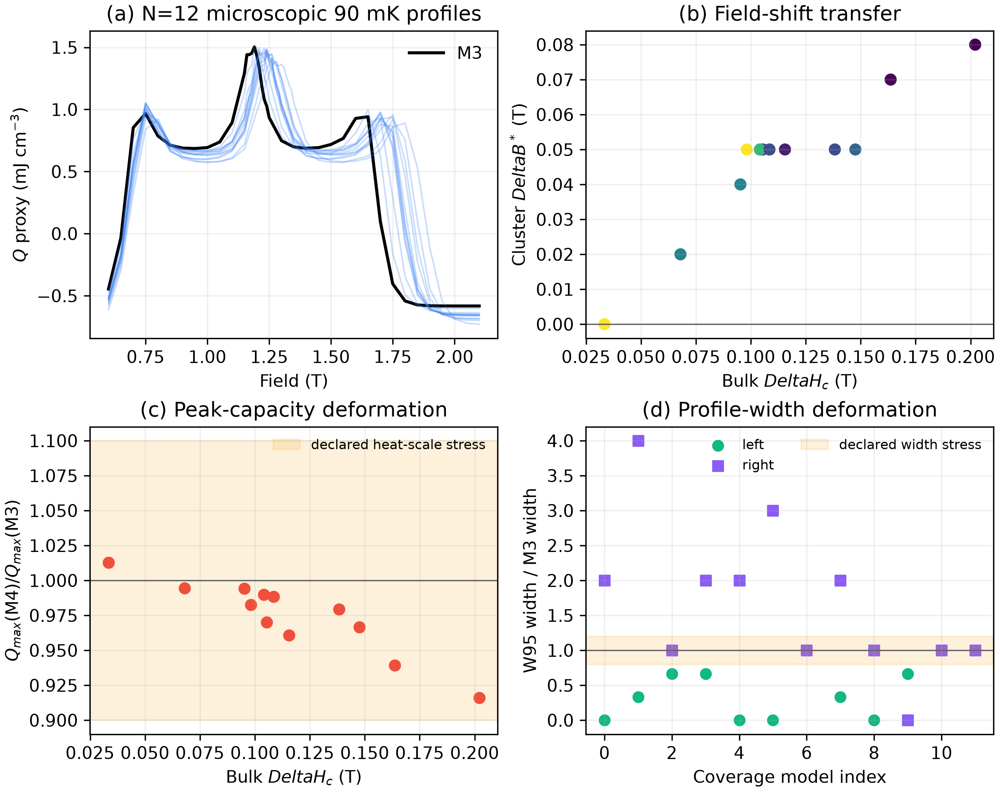
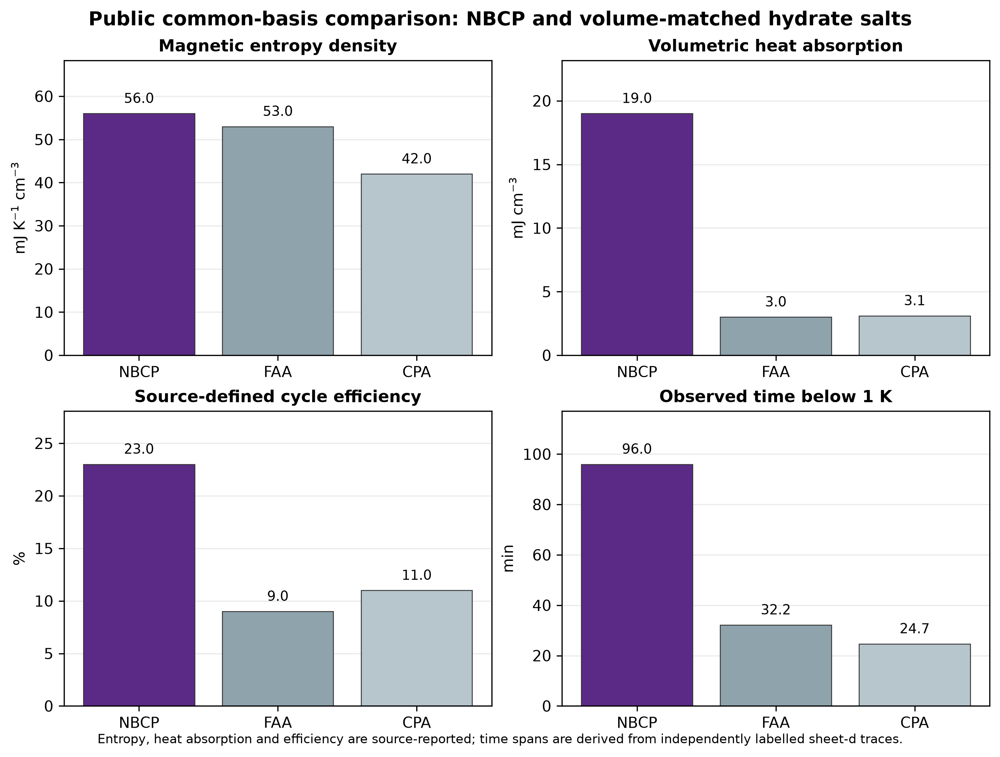
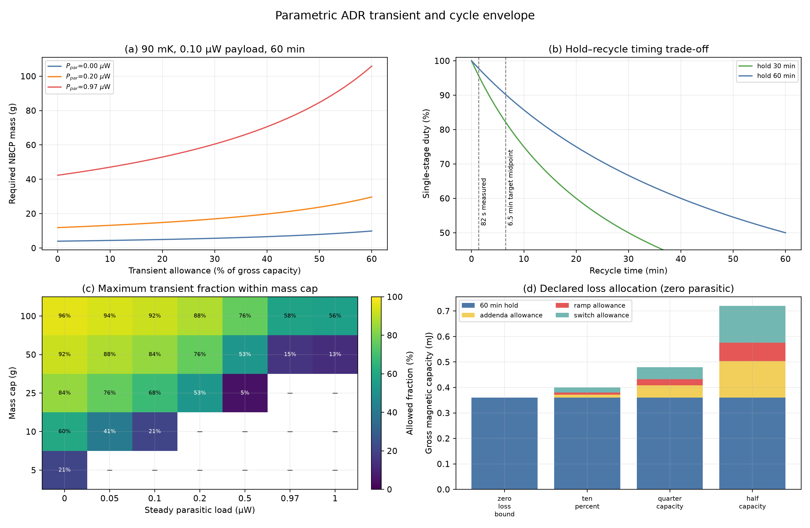
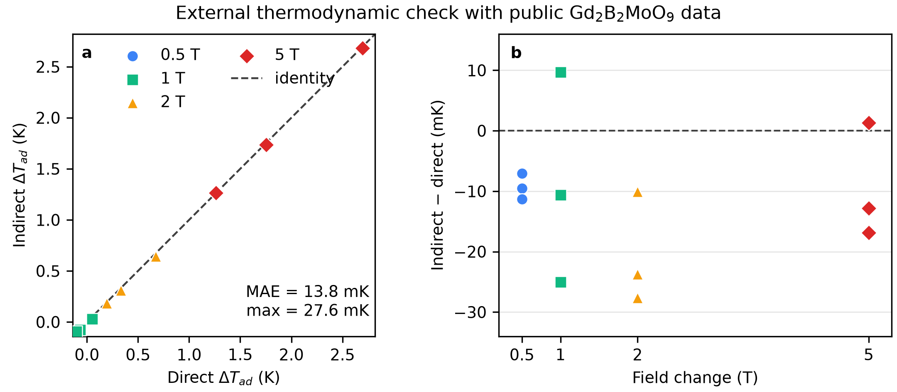
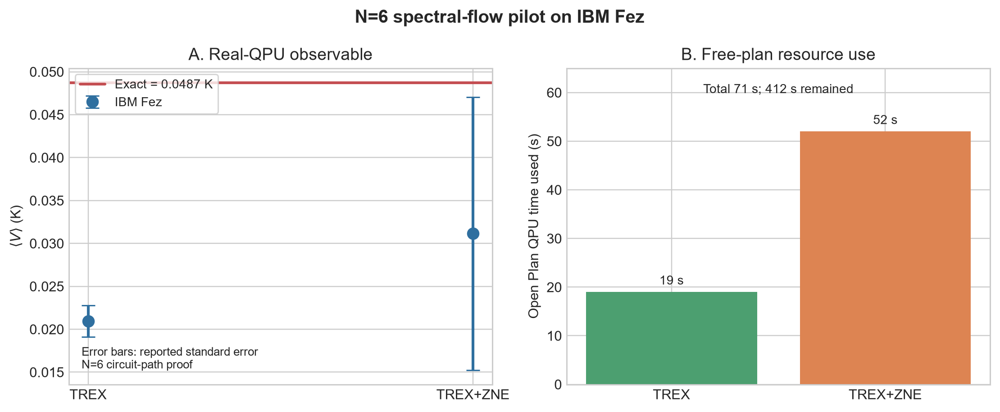

# Supplementary Information

## Finite-size and package-shape gates for sub-kelvin refrigerator design with a frustrated quantum magnet

Ugwiyeon Lee, Seong-Yun Bae, Hakrae Kim, and Jungsu Lee

## S1. Reproducibility policy

The study was run as a sequence of gates. Later calculations were allowed only after a recorded earlier gate passed. Thresholds were fixed before the P0–P2 engineering calculation:

- engineering GO if \(|\Delta B^*|\ge0.05\) T or regret ≥5%;
- engineering STOP if \(|\Delta B^*|<0.02\) T and regret <2%;
- ordinary quantum entropy target: absolute error ≤0.001 \(k_B\) per spin;
- sign-change quantum target: absolute error ≤0.0002 \(k_B\) per spin;
- inferred field uncertainty target: \(\sigma_B\le0.02\) T.

The work log is `연구실행_체크리스트_20261011.csv`. The final hash inventory is `results/bulk_path_manifest_20261011.json`. Each negative route was retained rather than deleted so that algorithm selection can be audited.

The interlayer parameter-grid analyses were added as reviewer-oriented robustness tests after the original P0–P2 result. The original independent finite-temperature shape box is retained only as an adversarial destruction test. The primary shape calculation now uses correlated templates extracted from direct finite-temperature M3/M4 calculations on a stacked 12-spin cluster, including a three-seed common-random verification of the strongest deformation. These are deterministic sensitivity calculations, not registered confidence intervals, posterior samples, or a converged bulk M4 thermodynamic solution.

## S2. Public sources and provenance

### S2.1 Experimental thermodynamics

The following source-data workbooks associated with Xiang *et al.* were downloaded from the publisher and preserved unchanged:

| Local file | Use | SHA-256 |
|---|---|---|
| `sources/figure_2.xlsx` | demagnetization and heat-capacity source data | `6c0ff63711b67815e368a229a2ec53a60a338b7728f4b5cf1eb7657907c42c27` |
| `sources/extended_figure_4.xlsx` | entropy and correction curves | `ee95f89f71d58c0ef06d16ed14afa6b5261a1c0018334f45c9bf902a16897805` |
| `sources/extended_figure_6.xlsx` | refrigeration comparisons and hold-time source data | `26a31b0d22ff37f808763679b9aab3423d6eb6b68fb727d3e6cc02dfa068dbe7` |

The source workbooks contain central-value curves, not a complete set of original synchronized instrument logs. No confidence interval was invented where the public file did not supply one.

### S2.2 Magnetic structure and Hamiltonian

The 2026 arXiv source archive was preserved with SHA-256 `8e6b98abf97340684470416ab4f3229993548c10677cf66b3a047eaa17881b13`. The magnetic-lattice input is documented in `sources/crystal_input_provenance_20261012.json`. A public full atomic CIF was not found in the preserved archives. A full CIF is unnecessary for the frozen spin model because the Ewald and exchange calculations require only the Co magnetic sublattice, lattice vectors, bond displacements, and g tensor.

The independent spectroscopy audit uses the 2025 Oxford Research Archive package associated with Woodland *et al.* (data DOI `10.5287/ora-qrd6mzojz`; article DOI `10.1103/1pvl-kzjm`). The downloaded ZIP has SHA-256 `C231F504EBB7773BD7A1ABFE7046B76C47425A9FBD035DF83304A7ED244D0D36`. The exact archived files used here are `fig17b.xy` (calculated twin dispersions; SHA-256 `BB7DA73AB85985A09936E863F74F8041A760AF2E10A775DE7F5F5A549AEB3169`), `fig17c.xye` (measured linewidths; `F43FC2F5A8A8FAC4EF2046FD64FC59162ED9AD63F594DF806188AC95C734C504`), and `fig17c.xy` (source linewidth calculation; `6C576F3CC5F7A20C379701D56EBD3BA7864830C874C26DD4851292541B8BAC56`). External files retain their source terms and are excluded from redistribution; the official URL and hashes are recorded in `sources/public_ins_interlayer_bandwidth_provenance_20261012.json`.

## S3. Hamiltonian conventions

### S3.1 Nearest-neighbor exchange

The M0 Hamiltonian is

\[
H_0=J_{zz}\sum_{\langle ij\rangle}\left[S_i^zS_j^z+\Delta(S_i^xS_j^x+S_i^yS_j^y)\right]-h\sum_iS_i^z,
\quad h=g_{zz}\mu_BB.
\]

The parameters are \(J_{zz}=0.1225\) meV, \(\Delta=0.636\), and \(g_{zz}=4.716\). The M1 correction is

\[
H_{\pm\pm}=\sum_{\langle ij\rangle}\left(J_{\pm\pm}\gamma_{ij}S_i^+S_j^++J_{\pm\pm}^*\gamma_{ij}^*S_i^-S_j^-\right),
\]

with \(J_{\pm\pm}=-1.9\) microelectronvolt and \(\gamma_{ij}=1,e^{i2\pi/3},e^{-i2\pi/3}\) for the three positive triangular bonds. \(J_{z\pm}\) is zero in the representative parameterization used here.

### S3.2 Dipolar interaction

For magnetic moment \({\bf m}_i=\mu_B{\bf g}{\bf S}_i\),

\[
H_{\rm dip}=\sum_{i<j}\frac{\mu_0}{4\pi r_{ij}^3}
\left[{\bf m}_i\cdot{\bf m}_j-3({\bf m}_i\cdot\hat{\bf r}_{ij})({\bf m}_j\cdot\hat{\bf r}_{ij})\right].
\]

M2 retains only the nearest-neighbor tensor. M3 and M4 use the periodic Ewald tensor with \(\alpha=0.22\) Å−1, real-space cutoff 42 Å, and reciprocal cutoff 8 Å−1 in the frozen production calculation. Tin-foil omits the \(k=0\) surface term. Spherical-vacuum adds \(4\pi I/(3V)\). Convergence checks are stored in `results/bulk_stability_convergence.json`.

### S3.3 Interlayer paths

The AA-stacked triangular convention is implemented in `stacked_lattice.py`. Each site has one vertical \(J_2\) path and two symmetry-inequivalent sets of three diagonal paths, \(J_a\) and \(J_b\), to the next layer. Reversing the crystallographic \(c\) direction exchanges the labels \(J_a\) and \(J_b\) without changing the spectrum.

P1 is a sensitivity model with one isotropic vertical bond above and below and \(J_\perp=0.05\) K. The published P2 seed uses \(J_2=2.8\) microelectronvolt, \(J_a=0\), \(J_b=7.9\) microelectronvolt, and \(\Delta_c=0.08\).

The set-valued P2 screen uses:

- \(J_2=\{1.4,2.8,4.2\}\) microelectronvolt;
- \(J_a=\{-2.8,-1.4,0,1.4,2.8\}\) microelectronvolt;
- \(J_b=\{3.95,5.925,7.9,9.875,11.85\}\) microelectronvolt;
- \(\Delta_c=\{0.04,0.06,0.08,0.10,0.12\}\).

This gives 375 deterministic combinations. All exchange magnitudes remain below 10% of \(J_{zz}\), and every \(\Delta_c\) remains strongly Ising-like. The ranges are a local robustness envelope around the published representative set, not confidence limits.

## S4. Public entropy processing and engineering metrics

The workbooks were read sheet by sheet without changing the raw files. Duplicate points were collapsed only when their entropy values agreed within \(10^{-9}\). Temperature interpolation is piecewise linear and restricted to the published range. The direct candidate table contains no interpolation between magnetic fields.

The hot-state entropy is obtained from the 4 T curve at 2 K. For each cold endpoint,

\[
Q=T(S_{\rm cold}-S_{\rm hot}).
\]

Negative \(Q\) means that the endpoint cannot absorb heat relative to the selected hot-state entropy under this endpoint accounting. The 90–300 mK direct results are stored in:

- `results/temperature_candidate_comparison.csv`;
- `results/temperature_candidate_ranking.csv`;
- `results/engineering_case_refinement.json`.

The reconstructed continuous reference profile comes from top-down integration of public XTRG \(C_m/T\) data. Its field dependence at the 1 K anchor is supplied by exact N=9/N=12 entropy differences. This hybrid reconstruction is used only as a decision-scale reference and is validated independently at zero field.

## S5. Finite-size and low-magnon diagnostics

### S5.1 Matrix-free validation

The matrix-free implementation was checked against explicitly constructed Pauli matrices at N=9 and N=12. Maximum elementwise discrepancies were below numerical roundoff. Spin conventions, bond multiplicities, and periodic cells are unit-tested in `test_matrix_free_hamiltonian.py`, `test_stacked_lattice.py`, and `test_dipole_ewald.py`.

### S5.2 FTLM and TPQ tests

FTLM follows Jaklič and Prelovšek. Random trace vectors are propagated through Krylov spaces and combined with exact low-energy states. TPQ calculations provide an independent typical-state check. The following identities or limits were verified:

1. \(S/N\rightarrow\ln2\) at high temperature;
2. \(C=dU/dT\) within the finite-difference tolerance;
3. exact diagonalization agreement at N=9 and N=12;
4. random-vector convergence at N=15;
5. deterministic low-energy replacement at N=18.

At 90 mK and 1.50 T, the N=18 full estimator and the lowest 16 deterministic levels differ by \(1.45\times10^{-4}\;k_B\) per spin for the M3–M0 correction. This is smaller than the N=15/N=18 disagreement and confirms that shell effects dominate stochastic error.

### S5.3 Fixed-magnon truncation

Near saturation, the Hilbert space was partitioned by the number of down spins for M0 and by even/odd parity for M3. N=18 through N=27 calculations progressively included low-magnon sectors. For N=24, the first omitted parity-compatible sectors have boundary residuals up to 0.056 K, but the minimum isolated energy denominator is 2.5816 K. A statewise \(r^2/\Delta E\) diagnostic gives a Boltzmann-weighted shift of 0.586 mK and a 90 mK entropy influence of \(8.72\times10^{-5}\;k_B\) per spin.

The size sequence of the M3–M0 correction at 90 mK alternates in sign: N=15 positive, N=18 negative, N=21 positive, N=24 negative, and N=27 negative but closer to zero. This is why the finite clusters are used as a diagnostic rather than a bulk extrapolation.

## S6. Polarized-state stability

For a fully polarized state, the quadratic transverse fluctuation matrix is constructed in momentum space and its lowest eigenvalue is minimized over the Brillouin zone. The critical field is where the lowest mode reaches zero. The M0 analytic result is reproduced to \(4.44\times10^{-16}\) T.

The frozen values are:

| Model | Boundary | \(H_c\) (T) | Critical wavevector (r.l.u.) |
|---|---|---:|---|
| M0 | tin foil | 1.7743602 | (1/3, 2/3, 0) |
| M1 | tin foil | 1.7751632 | (0.34050, 0.65950, 0) |
| M2 | tin foil | 1.8568211 | (0.73061, 0.36530, 0) |
| M3 | tin foil | 1.7723974 | (0.28357, 0.64179, 0.50000) |
| M4 | tin foil | 1.8676712 | (0.71632, 0.35816, 0.66571) |
| M3 | sphere vacuum | 1.8260773 | same finite-k minimum |
| M4 | sphere vacuum | 1.9213511 | same finite-k minimum |

The surface term changes the uniform contribution and absolute field but leaves the P2–P0 ablation at 0.0952738 T.

### S6.1 Public-propagation-vector screen

Near saturation, Ref. [4] reports \(\delta_c=0.027(2)\) along a K–M boundary and \(q_z=0.328(2)\). The same source approximates \(q_z\) by \(1/3\) in its interlayer model. Before the grid calculation, the acceptance bands were fixed to \(\delta_c=0.021\)–0.033, folded \(q_z=0.322\)–0.3373, and a K–M line residual no larger than 0.003 reciprocal-lattice units. Each point uses three optimizer starts and retains the largest critical field, which is the first mode to soften as field is lowered. Twelve of 375 models pass:

| \(J_2\) | \(J_a\) | \(J_b\) | \(\Delta_c\) | \(\Delta H_c\) vs M3 (T) | \(\delta_c\) | folded \(q_z\) | \((00l)\) bandwidth (microelectronvolt) |
|---:|---:|---:|---:|---:|---:|---:|---:|
| 1.4 | −2.8 | 7.900 | 0.10 | 0.060360 | 0.024177 | 0.324178 | 3.484 |
| 1.4 | −1.4 | 5.925 | 0.12 | 0.053646 | 0.024450 | 0.332444 | 3.738 |
| 1.4 | 0.0 | 5.925 | 0.10 | 0.068321 | 0.024893 | 0.329831 | 3.979 |
| 1.4 | 2.8 | 11.850 | 0.04 | 0.163650 | 0.025245 | 0.327820 | 3.772 |
| 2.8 | −2.8 | 9.875 | 0.08 | 0.087090 | 0.024264 | 0.327937 | 3.988 |
| 2.8 | −2.8 | 11.850 | 0.06 | 0.108503 | 0.024450 | 0.332444 | 3.738 |
| 2.8 | 0.0 | 5.925 | 0.12 | 0.073709 | 0.024754 | 0.325444 | 5.082 |
| 2.8 | 0.0 | 7.900 | 0.08 | 0.095274 | 0.024826 | 0.334289 | 4.384 |
| 4.2 | −1.4 | 9.875 | 0.08 | 0.107304 | 0.024463 | 0.323669 | 4.884 |
| 4.2 | −1.4 | 11.850 | 0.06 | 0.128791 | 0.024600 | 0.329369 | 4.410 |
| 4.2 | 1.4 | 7.900 | 0.08 | 0.115488 | 0.025037 | 0.328267 | 5.280 |
| 4.2 | 1.4 | 9.875 | 0.06 | 0.137199 | 0.025011 | 0.335726 | 4.707 |

Exchange entries are in microelectronvolt. The representative set reproduces the paper's 4.4 microelectronvolt bandwidth to 0.016 microelectronvolt. An independent five-seed audit reclassifies none of the 12 rows and repeats every selected mode in at least three starts. Over the full designed grid, the critical-field ablation correlates most strongly with \(J_b\) (descriptive Spearman \(\rho=0.824\)); this is a sensitivity diagnostic, not a fitted causal coefficient.

### S6.2 Adaptive set-valued inverse audit

The 375-point Cartesian grid and 256-point Sobol design provide 631 exact M4 calculations, but neither design targets the narrow public-\(q\) acceptance boundary or the extrema of the retained critical-field shift. We therefore perform three adaptive rounds. At each round, a radial-basis acquisition surrogate is fitted to the completed exact calculations. A new scrambled Sobol pool of 32,768 coordinates is ranked for five acquisition roles: predicted feasible minimum shift, predicted feasible maximum shift, public-\(q\) boundary proximity, predicted feasible-set coverage, and distance from all prior calculations. Sixty-four separated coordinates are selected per round.

The surrogate is never used as a physical result. Every selected coordinate is evaluated by the same three-start M4 calculation used in the initial designs. A deterministic 64-point cross-validation split gives a shift mean absolute error of 0.000048 T, but only four of eight feasible holdout points are classified by the surrogate. This limited recall is acceptable for acquisition, because all final labels are exact; it also motivates the explicit space-filling component.

| Adaptive round | Total exact evaluations | Public-\(q\)-retained models | Retained \(\Delta H_c\) range (T) |
|---:|---:|---:|---:|
| 0 | 631 | 16 | 0.053646–0.163650 |
| 1 | 695 | 26 | 0.036379–0.189499 |
| 2 | 759 | 47 | 0.035680–0.201329 |
| 3 | 823 | 69 | 0.033404–0.202107 |

The 192 new calculations add 53 admissible models, and 52 of the final 69 retained models lie outside the original Cartesian box. The minimum-shift model is \((J_2,J_a,J_b,\Delta_c)=(0.00802,-2.45639,5.57039,0.12898)\), with \(\Delta H_c=0.033404\) T, \(\delta_c=0.024196\), and folded \(q_z=0.330317\). The maximum-shift model is \((4.58618,3.44090,13.63851,0.03837)\), with \(\Delta H_c=0.202107\) T, \(\delta_c=0.025191\), and folded \(q_z=0.332891\). Exchange entries are in microelectronvolt. Five new optimizer starts reproduce both shifts to better than \(10^{-8}\) T and keep both modes inside the public-\(q\) bands.

The last round changes the minimum by −0.002276 T and the maximum by +0.000777 T. This is evidence of substantial improvement, especially at the high-shift edge, but it is not a proof of continuous convergence. The output is therefore described as an adaptive exact stress audit, not a posterior or a globally exhaustive inverse solution. Full rows, acquisitions, extrema, and the independent verifier are in `results/interlayer_adaptive_inverse_uq*.csv/json`.

### S6.3 Field-dependent fan-curve holdout

The retention screen uses the 1.65 T near-saturation incommensuration but none of the lower-field fan curve. We reconstruct the fixed-length source ansatz

\[
\sin\!\left(\frac{\theta_{\mathbf R}}{2}\right)
=\frac{\xi}{2}\cos(\mathbf Q\!\cdot\!\mathbf R)
\]

with the full M4 Fourier coupling for each retained model. At every reduced field we minimize over the fan amplitude \(\xi\) and \(\delta\) on a 0.000125 reciprocal-lattice-unit grid. The 1.65 T point is reserved for an internal consistency check. The four scored points at 1.45, 1.50, 1.55, and 1.60 T are digitized from the source-vector Figure 7d and were not used in model retention.

All 69 fan curves are monotone over \(0.86\le H/H_c\le0.999\). At \(0.999H_c\), the fan optimum and independently calculated soft-mode incommensuration differ by at most 0.0001542 reciprocal-lattice units. This checks the energy convention, reciprocal branch, and near-critical limit independently of the curve score.

| Fan-curve diagnostic | Result |
|---|---:|
| retained models evaluated | 69 |
| four-point holdout MAE range | 0.00420–0.00531 r.l.u. |
| published-representative holdout MAE | 0.004681 r.l.u. |
| best retained-model holdout MAE | 0.004200 r.l.u. |
| Spearman MAE versus \(\Delta H_c\) | 0.9403 |
| models no worse than representative | 23 |
| their \(\Delta H_c\) range | 0.03340–0.10730 T |
| their central 90 mK gate passes | 40/92 |
| their correlated-template 90 mK gate passes | 0/92 |

The positive association means that, within this M4 family, larger predicted refrigerator corrections systematically accompany worse agreement with the unused field dependence. This is a model challenge rather than a statistical rejection. The source paper already states that its representative mean-field curve evolves more slowly than experiment, and every retained curve has the same signed discrepancy at the lowest holdout field. The 23-model subset is therefore reported only relative to the published representative; it is not used as a posterior, confidence set, or replacement for the full 69-model engineering envelope. A calibrated reduction requires raw reduced diffraction values and a joint calculation of \(\delta(H)\), \(q_z(H)\), and the V–fan transition.


### S6.4 Independent public-INS interlayer-bandwidth and linewidth audit

The propagation-vector retention and fan-curve ranking use axial-field diffraction. We therefore reserve the transverse-field INS archive of Woodland *et al.* as an independent energy-scale test. At 3.5 T along the published path $(-2/3,1/3,l)$, the source reports no resolvable modulation of the peak energy. Its Appendix calculation assumes only an isotropic $J_b=0.003$ meV interlayer coupling, equal structural-twin weights, and a 0.027 meV Gaussian resolution. The two archived calculated branches each have a peak-to-peak bandwidth of 18.048 microelectronvolt. The source calls this coupling an *indicative upper bound* because the linewidth modulation is matched only approximately and the predicted energy modulation is not seen.

For a field polarized along $y$, the M4 linear-spin-wave energy used in the common one-site primitive convention is

\[
\hbar\omega(\mathbf k)=\sqrt{[h-SJ_{yy}(0)+SJ_{xx}(\mathbf k)]
[h-SJ_{yy}(0)+SJ_{zz}(\mathbf k)]-[SJ_{xz}(\mathbf k)]^2},
\]

where $h=g_{ab}\mu_BB$. The source bond convention uses phases $h$, $k$, and $h+k$, whereas the bulk code uses $u$, $v$, and $u-v$; hence the experimental in-plane coordinate maps from $(-2/3,1/3)$ to $(1/3,2/3)$ modulo reciprocal vectors. We evaluate this path and its structural-domain K counterpart over 401 values of $l$ and retain the larger branch bandwidth for each model.

Two checks close the convention. First, direct evaluation of the source's published LSWT equation reproduces `fig17b.xy` to a maximum absolute difference of $3.71\times10^{-5}$ meV after swapping the branch labels. Second, the independent axial-field implementation gives 4.3841 microelectronvolt for the representative M4 $\Gamma$-line bandwidth, compared with 4.4 microelectronvolt reported in the 2026 diffraction source.

| INS diagnostic | Result |
|---|---:|
| diffraction-compatible M4 models evaluated | 69 |
| M4 maximum-domain bandwidth range | 10.1767–29.8298 microelectronvolt |
| public $J_b=3$ microelectronvolt reference bandwidth | 18.0480 microelectronvolt |
| models at or below the central reference | 30/69 |
| models passing all matched 1-sigma $J_z,J_{xy},g_{ab}$ corners | 30/69 |
| reference range over those eight corners | 18.0437–18.0509 microelectronvolt |
| Spearman bandwidth versus $\Delta H_c$ | 0.8817 |
| 30-model $\Delta H_c$ range | 0.03340–0.14757 T |
| central 90 mK gate passes | 68/120 |
| correlated-template 90 mK gate passes | 4/120 |
| source linewidth proxy RMSE versus archived curve | 0.000141 meV |
| equal-twin M4 models no worse than source $\chi^2$ | 66/69 |
| twin-profiled M4 models no worse than source $\chi^2$ | 69/69 |
| profiled $\chi^2$ range | 21.361–26.741 |

The source linewidth curve has $\chi^2=28.35$ against 11 public linewidth points without refitting, or 2.58 per point as a descriptive ratio, and a mean absolute error of 0.003843 meV. To test whether those measured linewidths justify the 30-model bandwidth screen, we reconstruct the source calculation with

\[
w^2(l)=w_0^2+c[\Delta E_{\rm twin}(l)]^2,
\]

where $w_0=0.027$ meV is the source resolution and $\Delta E_{\rm twin}$ is the unresolved separation of the two structural-domain branches. Calibrating $c$ only to the archived source calculation reproduces its 201-point linewidth curve with 0.000141 meV root-mean-square and 0.000223 meV maximum error. The proxy gives $\chi^2=28.31$ at the 11 experimental coordinates, compared with 28.35 for the archived source curve.

For each M4 model, the direct linewidth score is evaluated first at the source equal-twin coefficient and then with the effective mixture coefficient profiled from the single-domain limit to that equal-twin limit. With equal twins fixed, 66/69 models have $\chi^2\leq28.35$. After profiling, all 69 do; their scores span 21.361–26.741, their effective minor-domain fraction proxies span 0.119–0.500, and the complete 0.03340–0.20211 T engineering-shift range remains. The largest profile-$\chi^2$ difference is 5.379, and profile score versus shift has Spearman $\rho=-0.276$. A descriptive 95% diagnostic that inflates errors by the source curve's own 2.577 chi-square-per-point ratio also retains all 69.

The bandwidth association remains useful as a declared what-if stress: applying the source's indicative 18.048 microelectronvolt rule lowers the upper shift from 0.20211 to 0.14757 T. The direct linewidth audit, however, shows that this contraction cannot be interpreted as experimental rejection. The measured single-peak widths cannot separate branch amplitude from unresolved structural-domain mixture, and the full resolution kernel, independent domain populations, reduced counts, and pixel covariance are not public. The authoritative engineering set therefore remains all 69 models for a stronger reason than the source wording alone: the available measured linewidth observable directly fails to validate the 39-model removal. Full per-model, per-corner, and linewidth-profile values are in `results/public_ins_interlayer_bandwidth_*`; the independent arithmetic check is `results/public_ins_interlayer_bandwidth_verification.json`.

## S7. Critical-field transport and robust optimization

Let \(Q_0(B,T)\) be the public reference curve with source critical field \(H_{c,0}\). For a target critical field \(H_c\), the two mappings are:

\[
Q_{\rm red}(B,T;H_c)=Q_0\left(B\frac{H_{c,0}}{H_c},T\right),
\]

\[
Q_{\rm off}(B,T;H_c)=Q_0\left(B-H_c+H_{c,0},T\right).
\]

The mappings bracket two simple assumptions about how the near-critical profile moves. They do not alter \(Q_{\max}\), which is why the manuscript calls the inherited heat scale a surrogate.

The 2026 full-model mean-field field overestimates the measured field. P2 is therefore set to either 1.65 or 1.70 T and the calculated shifts are subtracted to obtain P0 and P1. Under all four anchor/mapping combinations, P2–P0 passes both engineering thresholds.

The robust-field grid spacing is 0.00005 T in the final minimax calculation. The identity \(E=P t\) was checked for every row of the 24-condition load/hold map.

### S7.1 Direct M4 finite-temperature sensitivity and correlated templates

The earlier workflow moved the public M0 heat profile horizontally by the bulk critical-field ablation and independently varied residual peak position, left/right width, and heat scale. We test that assumption directly on a periodic \(3\times2\times2\), \(N=12\) stacked cluster containing M1 exchange, the complete periodic Ewald dipolar tensor, and M4 \(J_2,J_a,J_b,\Delta_c\) interlayer exchange. This geometry is computationally tractable but has a two-site periodic circumference; it is a finite-cluster sensitivity test rather than a converged incommensurate bulk calculation.

Twelve retained M4 models are selected by deterministic farthest-point coverage in the four interlayer parameters plus bulk critical-field shift, seeded with the minimum-shift, maximum-shift, and published representative models. Finite-temperature Lanczos calculations use eight random trace vectors, 60 Krylov steps, and exact replacement of the lowest 12 states. The temperatures are 90, 100, 120, and 150 mK, with the public 2 K, 4 T state as the hot reference.

At 90 mK, the 12-model primary cover gives an M4–M3 optimum shift of 0–0.08 T and a peak-heat ratio of 0.9162–1.0127. Raw width ratios are too sensitive to independent field-by-field FTLM noise for direct use. We therefore recompute the strongest primary model, M4-01, on a 0.01 T grid from 1.08 to 1.38 T using the same random trace at every field for each of three independent seeds. All three repeats give a 0.100 T optimum shift. Their peak-heat ratios are 0.9115–0.9270; total \(W_{95}\)-width ratios are 1.4598–2.0469; left-width ratios are 1.2452–1.6627; and right-width ratios are 1.3482–2.4689. Thus the earlier 0.9–1.1 heat band contains the verified result, whereas the 0.8–1.2 width band and ±0.02 T residual-shift band do not.

Each coverage model supplies one correlated template: residual peak shift after bulk alignment, heat ratio, and left/right width ratios. Metrics are the median over five spline-smoothing levels. The verified M4-01 means replace its primary noisy metrics at 90 mK. Apparent contractions below 0.8 are floored at the earlier size-based lower bound because the common-random audit verified broadening but did not verify stronger contraction. The four coordinates always remain tied to the same microscopic model.

For the actual material, a nominal profile plus 12 templates is combined with two measured critical-field anchors and two mappings, giving 52 scenarios per temperature. For the model-attribution gate, each of the 69 retained bulk models receives its nearest template in normalized \(J_2,J_a,J_b,\Delta_c\) space, giving 276 cases at 90 mK. Fifty-six cases cross both predeclared gates. The full optimum-shift range is 0.001319–0.100000 T and the regret range is 0.0393–13.6525%. The descriptive pass fraction, 20.3%, is not a probability.

The independent Cartesian outer bound uses residual peak shifts of ±0.12 T, left-width factors 0.5–1.7, right-width factors 0.5–2.5, and heat factors 0.9–1.1. It gives 83.6% worst regret and only 0.0678 mJ cm\(^{-3}\) worst heat at its 90 mK minimax field. Those coordinate extremes come from different microscopic models, so their independent combination is an adversarial destruction test and is not used for inventory sizing.



**Figure S4.** (a) Direct 90 mK M3 and M4 heat profiles on the stacked \(N=12\) cluster. (b) Finite-cluster optimum shift versus the corresponding bulk critical-field ablation. (c) Peak-heat deformation; the former 0.9–1.1 band contains the coverage calculations. (d) Raw width diagnostics, which motivate the common-random verification. The verified strongest-model total-width ratio is 1.46–2.05 across three seeds, outside the former ±20% band.

All primary curves, model coordinates, metrics, common-random repeats, templates, gate propagation, and regression checks are in `results/m4_finite_temperature_cluster_*`, `results/thermodynamic_shape_*`, and `results/microscopic_shape_template_verification.json`.

### S7.2 Preregistered N=18 interlayer-model cover

We repeat M3 and a preregistered four-model M4 cover on a periodic $3	imes3	imes2$, $N=18$ cluster. The cover contains minimum retained bulk-shift M4-00 (sample 761), nominal M4-02 (sample 188), median-shift/distinct-coupling M4-03 (sample 738), and maximum-shift M4-01 (sample 773). Selection uses only retained-model and N=12 evidence. The maximum parity-breaking Ewald $xz/yz$ coupling is $3.19	imes10^{-18}$ of the largest bond, permitting separate even and odd projected-magnon sectors.

The K4/K5 pilot showed multiple separated local peaks. Before the K6/K7 results completed, the protocol was amended to a common 1.10–2.10 T grid at 0.02 T spacing. The original 0.01 $k_B$ per spin close-peak window was then widened conservatively to 0.02 before any of the five dense scans completed: existing M3 L12-to-L32 corrections reached 0.01023 $k_B$ per spin, comparable to the original window. Every interior L12 local maximum inside the amended window is recalculated with 32 states per parity at the center and ±0.02 T. The candidate with the largest L32 local quadratic peak is selected, then crosschecked at K8/K9 with 12 and 32 states per parity. The 4 T, 2 K reference is evaluated at K6/K7, K8/K9, and K10/K11. The frozen plan, pilot amendment, conservative candidate amendment, convergence rule, and independent plan verification are stored in `results/n18_multimodel_*`.

| Model | Sample | Bulk shift (T) | N=12 optimum shift (T) | N=18 optimum shift (T) | N=12 heat ratio | N=18 heat ratio | N=18 total-$W_{95}$ ratio |
|---|---:|---:|---:|---:|---:|---:|---:|
| M4-00 | 761 | 0.03340 | 0.00000 | 0.29283 | 1.01272 | 0.85237 | 1.05416 |
| M4-02 | 188 | 0.09527 | 0.04000 | 0.33921 | 0.99434 | 0.74851 | 0.99316 |
| M4-03 | 738 | 0.11556 | 0.05000 | 0.36034 | 0.96080 | 0.66302 | 0.91670 |
| M4-01 | 773 | 0.20211 | 0.10000 | 0.42543 | 0.91923 | 0.53704 | 0.90886 |

The N=18 shift range is 0.293–0.425 T, the peak-heat-ratio range is 0.537–0.852, and the total-$W_{95}$-ratio range is 0.909–1.054. A major transfer change means an absolute N=18-minus-N=12 optimum-shift change of at least 0.05 T or an absolute peak-heat-ratio change of at least 0.10. 4 of the four M4 models (M4-00, M4-02, M4-03, M4-01) cross the declared major-transfer threshold. The N=18 shift is monotone in the preregistered bulk-shift order (Spearman rho=1.000). Multiple close candidates occur for M3 (2), M4-00 (2), M4-02 (2), M4-03 (2), M4-01 (2); the L32 selection differs from the L12 grid maximum for none. The maximum cold cutoff difference at the selected centers is 7.235701e-05 $k_B$ per spin, and the maximum last hot-cutoff change is 4.366568e-03 $k_B$ per spin. All dense peaks are interior and all close local maxima were checked at L32.

These checks establish convergence inside the N=18 projection and reject universal quantitative transfer of the N=12 template. They do not establish the thermodynamic limit. Raw spectra are in `results/n18_stacked_m4_work`; compilation and independent checks are provided by `compile_n18_multimodel_cover.py` and `verify_n18_multimodel_cover.py`.

For the engineering destruction test, four N=18 templates are combined with two experimental anchors and two mappings to give 16 correlated N=18 stresses. Appending them to the 52 N=12 scenarios gives 68 scenarios, moves the minimax field from 1.3660 to 1.4890 T, raises unmeasured regret from 9.423% to 34.551%, and expands peak support to 1.294298–1.713578 T. This is a size-stress envelope rather than a bulk prediction.

### S7.3 Density and design conversion

Using \(a=5.312\) Å, \(c=6.983\) Å, one formula unit per \(P\bar 3\) primitive cell, and a formula mass of 432.1793 g mol\(^{-1}\), the crystallographic density is 4.2056 g cm\(^{-3}\). The reported 1.65 g NBCP sample in the public Extended Data Fig. 6b workbook therefore corresponds to 0.3923 cm\(^3\). Required magnetic mass is \(m=\rho P_{\rm load}t_{\rm hold}/Q\). Packing and nonmagnetic components are not included.

The 3.96 g value and its load and transient multiples use the N=12-conditional worst heat. Because the N=18 size gate fails, the identity remains valid but that heat input is not accepted for final sizing.

### S7.4 Demagnetization and package shape

For a uniformly magnetized ellipsoid with field along \(c\), \(B_{\rm int}=B_{\rm app}-N_z\mu_0M\). With \(g_c=4.79\), one effective spin-1/2 per cell, and the public lattice constants, \(\mu_0M_s=0.163566\) T. We approximate a package by an equal-volume spheroid and use \(M_s\) to produce a conservative upper correction.

The public 1.87 by 1.16 by 0.18 mm \(B\parallel c\) heat-capacity plate has an equivalent \(c/a=0.1222\), \(N_z=0.8341\), and a 0.13643 T saturation bound. This independently reproduces the source's reported demagnetization scale of about 8%. A sphere gives 0.05452 T. With the long axis parallel to \(c\), the minimum spheroidal aspect ratios for 0.05, 0.02, and 0.01 T bounds are 1.111, 2.722, and 4.679. The public 1.65 g column has a comparison volume but no published dimensions, so an exact correction cannot be assigned. Results and checks are in `results/sample_demagnetization_envelope_*`.

### S7.5 Minimum near-saturation field sweep

The original 52 N=12 scenarios give the previously reported 90 mK support. After the 16 correlated four-model N=18 stresses are included, support is 1.294298–1.713578 T. Sampling 1.292–1.716 T every 0.004 T gives 107 points and guarantees a grid point within 0.002 T of any peak in the augmented support without fitting a line shape.

The grid localizes the peak only. Field calibration, sample demagnetization, thermal equilibration, entropy reconstruction, heat uncertainty, and profile width must be measured separately. The former 42-point list is retained as N=12 provenance; the expanded grid is stored with the multimodel design-stress results.

### S7.6 Robust measurement value of information

The expanded grid in S7.5 guarantees peak localization within the size-stressed support but does not say which measurements should be taken first. We use 52 N=12-calibrated scenarios plus 16 correlated stresses from the four N=18 M4 templates, two experimental anchors, and two mappings, without assigning probabilities. At a candidate coordinate $x=(T,B)$, a declared per-reading bound is

\[
\epsilon_T=\eta\,{\rm median}_{\theta}Q_{\max,\theta}(T).
\]

Two scenario predictions are conservatively retained together when $|Q_i(x)-Q_j(x)|\le2\epsilon_T$, so their symmetric error intervals overlap. For each possible true scenario, the post-measurement field minimizes maximum 90 mK regret over every still-indistinguishable scenario. The panel score is the largest conditional minimax regret. This union-of-overlaps construction is conservative.

At $\eta=2.5\%$, all 5,671 two-point panels on the 107-field grid are enumerated. The exact pair is 1.292 and 1.716 T, reducing worst regret from 34.5514% to 4.2459%. The previous 1.296/1.420 T pair gives 4.3274% and remains below the 5% gate. The full sweep gives 1.8197%.

These results are a model-conditional experiment design, not confidence intervals or validation of N=18 as bulk. A real observation outside the 68-profile envelope falsifies the scenario set. Files are `results/n18_multimodel_design_stress_*`; `verify_n18_multimodel_design.py` independently checks the scenario construction, exhaustive panel count, optimum, and sizing identity.

### S7.7 Public refrigeration-workbook consistency audit

The public Source Data workbook for Extended Data Fig. 6 was checked independently of the entropy reconstruction. Sheet d gives unambiguous material-labelled time traces. Using the interval between the first and last sampled temperatures below 1 K, NBCP spans 95.954 min, FAA 32.157 min, and CPA 24.665 min. The corresponding minimum sampled temperatures are 0.09417, 0.11293, and 0.11179 K. These values support the contextual material-promise statement but do not enter the terminal-field optimization.

The source paper and its public full text also provide a consistent metric definition for the three approximately volume-matched samples [1,22]. Entropy density, heat absorption, and efficiency are source-reported quantities; the time spans are independently recalculated from sheet d.

| Material | Sample volume (cm3) | Magnetic entropy density (mJ K−1 cm−3) | Heat absorption (mJ cm−3) | Source-defined efficiency (%) | Observed time below 1 K (min) |
|---|---:|---:|---:|---:|---:|
| NBCP | 0.395 | 56 | 19.0 | 23 | 95.954 |
| FAA | 0.409 | 53 | 3.0 | 9 | 32.157 |
| CPA | 0.421 | 42 | 3.1 | 11 | 24.665 |

Relative to the better of FAA and CPA for each metric, NBCP is 1.057 times higher in magnetic entropy density, 6.129 times higher in volumetric heat absorption, 2.091 times higher in the source-defined efficiency, and 2.984 times longer in the observed below-1-K span. The efficiency is the ratio of cold-process heat absorption to heat released during magnetization at the environment temperature; it is not a finished-refrigerator coefficient of performance. The 50 g GGG experiment is retained separately as context because it is not volume matched and has no sheet-d hold trace. It is not included in these ratios.



**Figure S1.** Public common-basis comparison for NBCP and the two approximately volume-matched hydrate salts. The first three panels reproduce source-reported definitions; the fourth uses the independently labelled source-workbook time traces. GGG is excluded from this figure because its 50 g experiment is not on the same volume basis.

Sheets a/b require a stronger restriction. The article identifies an NBCP point near 94 mK at a remaining field of about 1.5 T for (B_0=4) T and (T_0=2) K. At the corresponding field drop (B_0-B\simeq2.5) T, the sheet-a curve labelled `GGG-2-4` gives 0.094097 K at (B=1.49750) T. The curve labelled `NBCP-2-4` gives 0.481948 K at (B=1.50053) T. The workbook labels therefore do not reproduce the identifiable article statement. No sheet-a/b labelled curve is used for a new cross-material ranking, operating-field decision, or model calibration. The audit is machine-readable in `results/refrigerant_experimental_benchmark.json`.

### S7.8 Interlayer constraint attribution and boundary audit

The public-(q) filters do not contribute equally:

| Constraint set | Passing models out of 375 |
|---|---:|
| in-plane (δ_c) only | 338 |
| folded (q_z) only | 12 |
| K–M residual only | 375 |
| (δ_c) and (q_z) | 12 |
| all three | 12 |

Several of the 12 retained models touch an original grid edge. We therefore moved each edge coordinate one additional step outward while holding the other three parameters fixed. This generated 18 unique candidates spanning (J_2=0) or 5.6 microelectronvolt, (J_a=\pm4.2) microelectronvolt, (J_b=1.975) or 13.825 microelectronvolt, and (Δ_c=0.02) or 0.14 where applicable. Zero of the 18 candidates retained all public-(q) constraints under the same three-start search. The tested local set therefore does not continue through a grid face by a single-coordinate move. A disconnected region and simultaneous outward moves remain outside the audit. All rows are in `results/interlayer_boundary_audit.csv`.

The one-coordinate result is not sufficient to test simultaneous changes. A scrambled Sobol design therefore sampled 256 points over (J_2=0)–5.6, (J_a=-4.2)–4.2, and (J_b=1.975)–13.825 microelectronvolt with (Δ_c=0.02)–0.14. Four points pass all public-(q) conditions; two are outside the original local box. Their critical-field shifts span 0.072597–0.147574 T. The lowest-shift model has (J_2=0.68490), (J_a=-0.03612), (J_b=6.59712) microelectronvolt, and (Δ_c=0.08131). The two outside-box solutions show that the zero-pass one-coordinate shell does not close the simultaneous-variation problem. An independent five-seed audit reclassifies none of the four rows and repeats each selected global mode in at least four starts. The full expanded rows and engineering propagation are in `results/interlayer_expanded_sobol*.csv`.

The adaptive audit then uses all 631 initial points to choose 192 further exact evaluations. It finds 53 new admissible models and expands the critical-field-shift range to 0.033404–0.202107 T. This result supersedes the local and Sobol ranges for the main engineering stress envelope. The initial designs remain reported because they show why passive finite coverage was insufficient and provide an exact starting set for adaptive acquisition.

### S7.9 Steady-hold stage-load envelope

The original inventory table treats its load as a specified total cold load. To expose the device quantity that must be measured, we separate it into

\[
P_{\rm total}=P_{\rm payload}+P_{\rm parasitic},\qquad
m=\rho\frac{P_{\rm total}t_{\rm hold}}{Q_{\rm worst}}.
\]

The mass multiplier relative to a payload-only calculation is therefore \(1+P_{\rm parasitic}/P_{\rm payload}\), independent of refrigerant density and magnetic capacity. The generated envelope contains four temperatures, three payloads, ten steady-parasitic coordinates, and two hold times, for 240 deterministic rows. Every row is checked against the energy identity and the zero-parasitic rows reproduce the original design chart.

Three primary public sources provide system-level context. They are not combined into an NBCP prior because temperature, architecture, refrigerant, pill geometry, and interface differ.

| System | Refrigerant | Temperature | Reported parasitic load | Associated observation | Use here |
|---|---|---:|---:|---|---|
| compact four-stage cADR [19] | CPA in the two lowest stages | 20–25 mK | approximately 0.20 microWatt | sample stage warmed from 20 to 25 mK over 10 h | context anchor |
| MSAM/Tophat ADR [20] | FAA | 100 mK | 0.97 microWatt | 134 mJ capacity, 138 ks hold | context and source-identity check |
| fast-response miniature ADR [21] | CPA | 200 mK | 13.14 microWatt | 3 min parasitic-only hold | context anchor |

For the primary 90 mK, 0.10 microWatt payload and 60 min case, the conditional masses are 3.958 g at zero specified parasitic load, 11.875 g at 0.20 microWatt, 42.353 g at 0.97 microWatt, and 524.068 g at 13.14 microWatt. The last value is deliberately retained to show that a parasitic value from a warmer, fast-response miniature architecture cannot be transferred blindly. The public 1.65 g sample-equivalent holds are 25.011, 8.337, 2.337, and 0.189 min at the same four coordinates.

The Tophat source provides an independent arithmetic check: \(0.97\) microWatt multiplied by \(138{,}000\) s gives 133.86 mJ, only 0.11% below the separately reported 134 mJ capacity. Machine-readable provenance, the 240-row envelope, anchor table, and verification are in `sources/adr_device_anchor_provenance_20261012.json`, `results/adr_stage_load_envelope.csv`, `results/adr_literature_system_anchors.csv`, and `results/adr_stage_load_envelope_verification.json`.

### S7.10 Parametric transient-loss and cycle envelope

The steady-load result cannot determine a finished package because no NBCP device provides addenda, ramp, heat-switch, or regeneration measurements. We therefore expose the required margin without assigning a fabricated loss. For a declared total transient fraction \(f_{\rm tr}<1\) of gross magnetic capacity,

\[
E_{\rm hold}=(P_{\rm payload}+P_{\rm parasitic})t_{\rm hold},\qquad
E_{\rm gross}=\frac{E_{\rm hold}}{1-f_{\rm tr}},\qquad
m=\rho\frac{E_{\rm gross}}{Q_{\rm worst}}.
\]

The bookkeeping allocations are:

| Scenario | Addenda fraction | Ramp fraction | Switch fraction | Total fraction | Mass multiplier |
|---|---:|---:|---:|---:|---:|
| zero-loss bound | 0 | 0 | 0 | 0 | 1.000 |
| ten-percent stress | 0.03 | 0.02 | 0.05 | 0.10 | 1.111 |
| quarter-capacity stress | 0.10 | 0.05 | 0.10 | 0.25 | 1.333 |
| half-capacity stress | 0.20 | 0.10 | 0.20 | 0.50 | 2.000 |

These fractions are deterministic design coordinates, not measured NBCP efficiencies, priors, or probabilities. They show what a future stage must satisfy. At 90 mK, 0.10 microWatt payload, zero specified steady parasitic load, and 60 min hold, the four masses are 3.958, 4.398, 5.278, and 7.916 g. A 5 g cap leaves 0.0947 mJ, or 20.8% of gross capacity, for all transients. At the 0.20 microWatt steady-parasitic coordinate, 10 g is infeasible before transients, whereas 25 g leaves 1.194 mJ, or 52.5% of gross capacity.

Cycle timing is kept independent of cold-capacity loss:

\[
D_{\rm single}=\frac{t_{\rm hold}}{t_{\rm hold}+t_{\rm recycle}}.
\]

Bartlett *et al.* report an 82 s complete recycle, a 180 s hold, and a 67% duty for their miniature CPA ADR [21]. Direct arithmetic gives 68.7%; the 1.7-point difference is retained rather than overwritten and is consistent with additional handover time outside the two-duration identity. The same source reports a 6–7 min target recycle for each dADR, a heat-switch ratio of 38,800 at 0.2 K, a 1,000-fold conductivity reduction within 5 s, and approximately 82% of the 0.2 K parasitic load from the heat switch. Its 0.474 J warm-side rejection is context only and is not transferred to NBCP. For the 60 min design hold, 82 s and the 6.5 min target midpoint give single-stage duties of 97.77% and 90.23%; 30 and 60 min recycle durations are additional declared stress coordinates.



**Figure S2.** (a) Required 90 mK mass versus the fraction of gross capacity reserved for transient loss. (b) Single-stage duty versus recycle time. Dashed lines mark a measured 82 s recycle and the midpoint of a published 6–7 min target. (c) Maximum transient fraction within selected mass caps; dashes are infeasible even before transients. (d) The explicit component allocation used only for sensitivity bookkeeping. None of the fractions is a measured NBCP package value.

The 2,688-row envelope, 35 mass-cap boundaries, provenance, and independent verification are in `results/adr_transient_cycle_envelope.csv`, `results/adr_transient_allowance_boundaries.csv`, `sources/adr_transient_cycle_provenance_20261012.json`, and `results/adr_transient_cycle_verification.json`.

### S7.11 External thermodynamic validation on Gd2B2MoO9

The 2026 Gd2B2MoO9 source workbook contains heat-capacity-derived and directly measured adiabatic temperature changes at matched field changes of 0.5, 1, 2, and 5 T. For each field, we linearly interpolate the indirect curve only in starting temperature to the three direct-comparison points selected by the source authors. No field interpolation or refitting is used.

Across the 12 comparisons, indirect minus direct has a mean bias of −11.97 mK, mean absolute error of 13.80 mK, root-mean-square error of 15.76 mK, and maximum absolute error of 27.64 mK. The Pearson correlation is 0.99993. This validates field-resolved equilibrium thermodynamic processing against direct demagnetization response in a second frustrated refrigerant. It does not validate the NBCP critical-field transport surrogate, microscopic model, or stage losses. The publisher workbook remains in the ignored local raw-data directory under its stated CC BY-NC-ND 4.0 terms; code, provenance hashes, and derived scalar results are included.



**Figure S3.** (a) Heat-capacity-derived versus directly measured adiabatic temperature changes at the twelve public comparison coordinates. The dashed line is identity. (b) Pointwise residuals by field change. The direct points were selected by the source authors and are not a random hold-out sample.

### S7.12 Independent stage heat-balance validation on YbNi1.6Sn

The Cambridge dataset associated with Gruner *et al.* contains zero-field electronic heat capacity and warm-up histories for the same approximately 15 g pressed YbNi1.6Sn pill. We use the two curves labelled 2.5 and 5.0 microWatt, because they share the same 9 T initial field and cover a common 0.21–0.28 K warming interval. Starting at the first passage through 0.21 K, the stage balance is

\[
0.06(P_j+P_0)\Delta t_j(T)
=\frac{1000m_{\rm eff}}{M}\int_{0.21\,{\rm K}}^T
\left[C_{\rm elec}(T')+\frac{\alpha_0}{T'^2}\right]dT',
\]

where powers are in microWatts, time is in minutes, energy is in millijoules, \(M=385.66444\) g mol\(^{-1}\) Yb, and the source supplement gives \(\alpha_0=4.4\) mJ K mol\(^{-1}\) Yb. RuO2 readout noise is handled by using the first-passage time through a monotonically accumulated temperature trace; no temperature or time values are fitted.

One least-squares calibration over 0.21–0.25 K estimates \(m_{\rm eff}=15.2216\) g and \(P_0=0.25399\) microWatt. These agree with the independently reported approximate 15 g functional mass and less-than-0.4 microWatt parasitic-load bound. In the unused 0.25–0.28 K interval, normalized root-mean-square and maximum errors are 0.5918% and 1.2734% of the full-interval enthalpy. The two load curves themselves collapse to 0.7619% normalized root-mean-square difference after the single common parasitic correction. Removing the nuclear term increases the holdout error to 0.7612% and gives 15.807 g.

This is stronger than transferring a literature heat-leak coordinate: it tests the governing energy identity on an independent physical stage and recovers two separately reported device properties without imposing them. It validates the thermodynamic-to-stage translation, while leaving NBCP-specific addenda, contacts, heat-switch conduction, ramp loss, and regeneration unvalidated. The CC BY-NC-ND raw archive is downloaded from its DOI repository and hash-checked but is not redistributed. Derived profiles, scalar results, provenance, and independent verification are in `results/ybni16sn_stage_heat_balance_*`, `sources/ybni16sn_stage_validation_provenance_20261012.json`, `audit_external_stage_heat_balance.py`, and `verify_external_stage_heat_balance.py`.

### S7.13 Complete adaptive six-qubit QPU benchmark

The quantum-hardware calculation is deliberately downstream of the classical decision audit. It asks whether a complete low-energy entropy correction can be measured on present hardware after the classical analysis has shown that such corrections can change the engineering decision. It does not replace the N=18 calculation or supply a bulk material value.

For the open (3\times2\), (N=6) triangular patch, we define

\[
H(\lambda)=H_{\rm M0}+\lambda V,\qquad
V=H_{\rm M2}-H_{\rm M0},
\]

and reconstruct each of the three lowest M2 levels using

\[
E_k(1)=E_k(0)+\int_0^1
\langle k,\lambda|V|k,\lambda\rangle\,d\lambda.
\]

Three-point Gauss–Legendre quadrature requires nine state/observable circuits. One local Givens/pair-mixing layer is fitted first. Generators from a reversed second layer are appended in descending fidelity-gradient order until the state fidelity is at least 0.9999 and the absolute expectation-value error is at most 0.001 K. The resulting nine circuits have minimum local fidelity 0.999916, maximum local (V)-error 0.000900 K, and a final entropy error of (-9.53\times10^{-5} k_B) per spin relative to the exact full-spectrum correction. Exact eigenvectors are the fitting targets; this is therefore a circuit-representation and execution audit rather than a scalable state-discovery algorithm.

The live preflight saw 405 s of free Open Plan time, selected IBM Kingston, and compiled all circuits with at most 96 CZ gates. The worst calibration-product heuristic was 0.8435 and the maximum scheduled-duration/median-(T_1) ratio was 0.0313. The saved account was restricted to `plans_preference=['open']`; the execution scripts refuse a paid-plan selection. Credentials and service identifiers are never written to result files.

Two jobs used identical circuits, a 0.02 K target precision, XpXm dynamical decoupling, gate twirling, and TREX measurement mitigation. The second job additionally used gate-folding zero-noise extrapolation. The table reports the final nonlinear entropy reconstruction; intervals come from 100,000 independent normal draws using the Estimator-reported standard errors and therefore do not include residual device bias.

| Calculation | Job ID | \(\Delta S/N\) (\(k_B\) spin\(^{-1}\)) | Reported-error 95% interval | Absolute bias from exact | Free QPU time |
|---|---|---:|---|---:|---:|
| exact full spectrum | — | −0.041611 | — | 0 | — |
| locally prepared circuits | — | −0.041707 | — | 0.000095 | — |
| twirled TREX | `db6et9clf4us73c582f0` | −0.021679 | [−0.024627, −0.018727] | 0.019932 | 38 s |
| twirled TREX + ZNE | `db6eurqmb58s738bmisg` | −0.026822 | [−0.040300, −0.013193] | 0.014789 | 113 s |

Both hardware intervals exclude zero and both central values have the exact negative sign. ZNE reduces absolute bias by 25.8% but increases propagated standard deviation by a factor of 4.60. Neither interval contains the exact value. The frozen decision is therefore `PASS_SIGN_RESOLUTION_HOLD_QUANTITATIVE_MAGNITUDE`. No QPU result is used in the N=18 size-transfer conclusion, the 68-scenario field design, or the conditional material inventory.

Reproduction files are `adapt_compressed_n6_stateprep.py`, `preflight_adaptive_n6_qpu.py`, `run_adaptive_n6_qpu.py`, `compile_adaptive_n6_qpu_evidence.py`, `verify_adaptive_n6_qpu_evidence.py`, `results/adaptive_compressed_stateprep_N6.json`, `results/adaptive_n6_live_preflight.json`, `results/adaptive_n6_qpu_complete_TWIRLED_TREX.json`, `results/adaptive_n6_qpu_complete_TWIRLED_TREX_ZNE.json`, and `results/adaptive_n6_qpu_complete_summary.json`.

## S8. Quantum-algorithm screening

The following routes were evaluated under a common final entropy-error target:

| Route | Main failure or result | Decision |
|---|---|---|
| direct temperature finite difference | cancellation amplifies measurement variance; up to \(3.87\times10^9\) shots | STOP |
| covariance/thermodynamic integration | too many Hamiltonian covariance terms at required precision | STOP for Open Plan |
| Jarzynski ramp | exponential-work variance and ramp depth | STOP |
| variational Gibbs state | low-temperature conditioning and auxiliary resources | STOP |
| QITE–QMETTS | N=9 adaptive three-body tangent reduces residual but reaches up to 1057 CX per step | STOP on current QPU |
| low-energy spectral flow | passes N=9/N=12 ideal accuracy and admits observable-specific circuits | SELECT |

The screening summary and Pareto evidence are in `results/quantum_algorithm_screening_summary.json` and `results/quantum_algorithm_second_screen_summary.json`.

## S9. Spectral-flow error accounting

For each field and temperature, total entropy error includes:

1. low-energy truncation and certified thermal tail;
2. Gauss–Legendre integration error;
3. state-preparation bias in \(\langle V\rangle\);
4. propagated energy error in the partition function;
5. sampling target where a shot budget is reported.

The strict sign-change point uses a smaller absolute tolerance because the physical correction is near zero. All N=9 and N=12 exact-state tests preserve the sign. The N=9 circuit-prepared scan also preserves the sign in all nine field-temperature combinations.

At 1.40 T, the hardest degenerate pair has fidelity 0.97636. Its \(V\) expectation and final entropy remain within target. At 1.45 T, the minimum fidelity is 0.99935 and the maximum entropy error is \(1.51\times10^{-4}\;k_B\) per spin. At 1.50 T, the minimum fidelity is 0.99806 and maximum entropy error is \(5.67\times10^{-4}\;k_B\) per spin.

## S10. QPU preflight and jobs

The submission script performs the following guards before any job:

1. load only the named saved account;
2. require `plans_preference=['open']` exactly;
3. require at least 30 remaining QPU seconds;
4. select an operational non-simulator backend;
5. transpile every circuit before submission;
6. record only sanitized backend, job, usage, circuit, observable, and error data.

The N=6 live preflight on IBM Fez gave a maximum of 84 CZ gates, minimum calibration-product heuristic 0.8049, and maximum circuit duration divided by median T1 of 0.03986. The two completed jobs were:

| Mitigation | Job ID | Estimate (K) | Reported standard error (K) | Absolute error (K) | QPU seconds |
|---|---|---:|---:|---:|---:|
| TREX | `db5r8184qg6s73c3sl0g` | 0.0209552 | 0.0018476 | 0.0277818 | 19 |
| TREX + twirling + ZNE | `db5r8nimb58s738atca0` | 0.0311438 | 0.0158933 | 0.0175932 | 52 |

The exact value is 0.04873698 K. TREX is inconsistent with the exact value at two reported standard errors. The ZNE interval contains the exact value within two standard errors, but the uncertainty is too large for a thermodynamic claim. No additional QPU execution is justified until the N=9 ECR count is reduced and a stronger noisy preflight predicts target-level accuracy.



**Figure S5.** (a) IBM Fez estimates compared with the exact N=6 observable. TREX alone leaves a large systematic discrepancy; ZNE reduces the central discrepancy but increases variance. (b) QPU time. The two jobs used 71 free seconds. This figure is supplementary because neither hardware estimate enters the material or refrigerator result.

## S11. Verification suite

The frozen verification commands are:

```text
python verify_engineering_decision.py
python verify_quantum_stateprep_qpu.py
python verify_second_screen.py
python test_quantum_local_benchmark.py
python test_bulk_polarized_stability.py
python test_interlayer_robustness.py
python screen_interlayer_parameter_ensemble.py
python audit_interlayer_envelope_boundaries.py
python screen_interlayer_expanded_sobol.py
python stress_test_expanded_sobol_shape.py
python plot_expanded_sobol_audit.py
python adaptive_interlayer_inverse_uq.py
python verify_adaptive_interlayer_inverse_uq.py
python audit_field_dependent_fan_holdout.py
python verify_field_dependent_fan_holdout.py
python audit_public_ins_interlayer_bandwidth.py
python verify_public_ins_interlayer_bandwidth.py
python extract_refrigerant_benchmark.py
python compile_refrigerant_common_basis.py
python verify_refrigerant_common_basis.py
python stress_test_thermodynamic_shape.py
python audit_m4_finite_temperature_cluster.py
python verify_m4_finite_temperature_cluster.py
python test_general_truncated_magnon_operator.py
python verify_n18_multimodel_plan.py
python compile_n18_multimodel_cover.py
python verify_n18_multimodel_cover.py
python stress_test_n18_multimodel_design.py
python verify_n18_multimodel_design.py
python integrate_n18_multimodel_manuscript.py
python compile_n18_stacked_m4_convergence.py
python verify_n18_stacked_m4_convergence.py
python stress_test_microscopic_shape_templates.py
python verify_microscopic_shape_templates.py
python optimize_measurement_value_of_information.py
python verify_measurement_value_of_information.py
python stress_test_cluster_size_transfer.py
python verify_cluster_size_transfer.py
python audit_sample_demagnetization_envelope.py
python verify_sample_demagnetization_envelope.py
python compile_refrigerator_design_chart.py
python compile_adr_stage_load_envelope.py
python verify_adr_stage_load_envelope.py
python compile_adr_transient_cycle_envelope.py
python verify_adr_transient_cycle_envelope.py
python audit_second_material_public_validation.py
python verify_second_material_validation.py
python audit_external_stage_heat_balance.py
python verify_external_stage_heat_balance.py
python compile_adaptive_n6_qpu_evidence.py
python verify_adaptive_n6_qpu_evidence.py
python plot_evidence_to_decision_workflow.py
python make_bulk_manifest.py
```

All passed on Python 3.14.8 with NumPy 2.5.3, SciPy 1.18.1, and Matplotlib 3.11.2 under Windows 11. Independent Octave 11.3.0 checks reproduced the M0–M4 polarized-state calculation and the N=9 exact thermodynamic regression. The public QMagen low-bond-dimension N=54 route was stopped because it failed convergence and log-partition-function convexity tests.

## S12. Scope table for reviewers

| Statement | Supported? | Evidence boundary |
|---|---|---|
| every public-$q$-compatible interlayer model shifts the central-profile optimum by more than 0.05 T | no | 224 of 276 adaptive-audit central cases pass; the minimum \(\Delta B^*\) is 0.02857 T |
| a bulk critical-field ablation transfers one-for-one to the finite-temperature cooling optimum | no | the strongest verified model has a 0.202 T bulk ablation but a 0.100 T optimum shift |
| every retained model passes both gates after correlated microscopic-template assignment | no | 56 of 276 cases pass; the optimum-shift range is 0.00132–0.100 T |
| the N=12 finite-temperature template transfers quantitatively to a three-sublattice-compatible larger cluster | no | the preregistered four-model N=18 cover gives shifts of 0.293–0.425 T and heat ratios of 0.537–0.852; 4 of four cross the major-transfer threshold |
| the N=18 model cover is a bulk prediction | no | common-grid, close-peak, low-state, and cutoff convergence is established only within one projected 3×3×2 cluster |
| P2 is the unique microscopic Hamiltonian of NBCP | no | source explicitly calls it representative and non-unique; 69 adaptive-audit models are retained |
| the initial 16 local-plus-Sobol models exhaust the interlayer Hamiltonians | no | the adaptive audit finds 53 more retained models and expands the shift range to 0.0334–0.2021 T |
| the four-point fan holdout defines a calibrated 23-model confidence set | no | it ranks models relative to a representative curve that is itself systematically biased; the full 69-model envelope remains authoritative |
| the INS reference defines a calibrated 30-model confidence set | no | the indicative bandwidth rule retains 30, but a source-calibrated direct linewidth proxy leaves all 69 no worse than the source curve after twin-mixture profiling; the full 69-model envelope remains authoritative |
| the Extended Data Fig. 6 sheet-a/b labels can be used for a new material ranking | no | the labelled curves do not reproduce the article's identifiable 94 mK NBCP point; only independent sheet-d time traces are used contextually |
| full dipolar summation is needed before judging nearest-neighbor dipoles | yes | M2 versus M3 bulk stability and Ewald convergence |
| the former 1.296/1.420 T heat panel remains optimal after multimodel size stress | no | exhaustive search of 5,671 pairs selects 1.292/1.716 T; the former pair leaves 4.327% regret |
| the former 1.292–1.456 T field sweep covers the multimodel size-stressed peak support | no | the required 107-point grid is 1.292–1.716 T at 0.004 T spacing |
| the calculated volumes predict a finished refrigerator | no | reversible magnetic budgets, specified steady loads, and declared transient/cycle margins; actual package losses and warm-side rejection remain unmeasured |
| a field set point can be specified independently of package shape | no | the public plate gives a 0.136 T saturation bound; \(c/a\ge2.72\) is required for a conservative bound below 0.02 T |
| the published parasitic-load values predict an NBCP stage | no | context anchors for the separated steady-load envelope only; no cross-device transfer is claimed |
| second-material agreement validates the NBCP field-shift surrogate | no | Gd2B2MoO9 validates only equilibrium thermodynamic processing against 12 author-selected direct points |
| the six-qubit QPU result is a bulk NBCP prediction | no | the open patch is a complete hardware method benchmark; no QPU value enters the N=18 or engineering result |
| present hardware resolves the sign of the complete N=6 entropy correction | yes | both paired nine-circuit intervals exclude zero and have the exact negative sign |
| present hardware gives a quantitatively accurate N=6 entropy magnitude | no | ZNE reduces absolute bias by 25.8%, but its reported-error interval still excludes the exact value |
| the QPU circuits demonstrate scalable eigenstate discovery or quantum advantage | no | exact classical eigenvectors are fitting targets and only six qubits are executed |
| spectral flow is more sample-efficient than direct finite-difference entropy for the tested ideal instances | yes | common error target and shot estimates |
| a quantum advantage has been demonstrated | no | classical targets and N=6 noisy pilot |
| IBM hardware gives a quantitatively reliable NBCP correction | no | N=6 bias and variance; N=9 not run |
