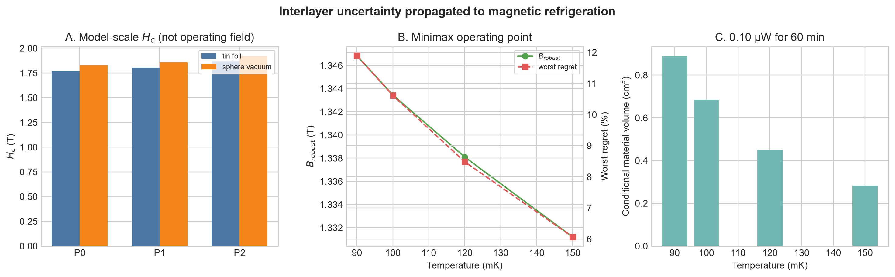

# P0–P2 층간결합 시나리오와 자기냉동 공학 판정

## 결론

층간결합을 빼거나 단순화하면 90 mK 최적 자기장과 냉각열량 판단이 달라진다. 2026년 공개 대표모형 P2를 2차원 P0와 비교하면 최적장 이동은 `0.0815–0.0953 T`, P0가 고른 장을 그대로 썼을 때의 설계 후회량은 `8.80–10.00%`이다. 사전에 정한 `|ΔB*|≥0.05 T`와 `regret≥5%`를 모두 넘는다. 따라서 **공학적 중요성은 GO**이다.

다만 P2 층간결합은 실험이 유일하게 결정한 값이 아니다. 원 논문도 “대표적인 한 세트”라고 명시한다. 유한온도 3차원 엔트로피를 직접 계산하지 않고 공개 XTRG 곡선의 가로 위치를 옮긴 결과이므로 **미시적 원인 귀속은 HOLD**이다.

## P0, P1, P2가 무엇인가

| 시나리오 | 뜻 | 공개 근거 |
|---|---|---|
| P0 | 장거리 쌍극자와 결합방향 이방성은 포함하지만 층간 교환은 0인 2차원 M3 | 본 프로젝트의 수렴된 Ewald/LSWT M3 |
| P1 | P0에 단순 등방성 수직결합 `J⊥=0.05 K`를 위·아래 한 개씩 추가 | arXiv:2202.05242 공개 원문 2081–2083행의 DFT 추정 |
| P2 | `J2=2.8 μeV`, `Ja=0`, `Jb=7.9 μeV`, `Δc=0.08`인 2026 대표 층간모형 | arXiv:2607.23173v1 Table 1과 275–317행 |

P1의 단순 수직결합은 임계장을 `0.03157 T` 올린다. P2는 P0보다 `0.09527 T` 올린다. P2 계산은 tin-foil과 spherical-vacuum Ewald 경계에서 같은 층간 증가량을 보였다.

P1은 결정구조를 유일하게 재현하는 모형이 아니라 공개 DFT 에너지 규모를 분명한 단순 결합으로 바꾼 민감도 시나리오이다. P2도 공개 논문이 비유일한 대표값이라고 밝힌다. 이 불확실성을 숨기지 않고 P0–P2 전체를 계산했다.

## 이론 임계장을 그대로 설계장으로 쓰지 않은 이유

P0–P2의 절대 이론 임계장은 Ewald 경계에 따라 약 `1.77–1.92 T`이다. 하지만 2026 원문은 전체모형의 평균장 임계장 `1.86 T`가 실험 `1.65–1.70 T`보다 약 9% 높다고 명시한다.

따라서 P2의 절대장은 실험값 `1.65 T`와 `1.70 T`에 맞췄다. P0와 P1에는 계산된 **상대 이동량**만 역으로 적용했다. 이 방식은 이론의 알려진 절대장 편향을 공학 운전장으로 가져오는 오류를 피한다.

## 90 mK 사전 관문 결과

P1과 P2를 각각 P0와 비교한 결과는 다음과 같다. 범위는 두 실험 임계장 기준과 `B/Hc`, `B-Hc` 두 매핑을 모두 포함한다.

| 비교 | `ΔB*` 범위 | P0 장을 쓸 때 regret | 관문 |
|---|---:|---:|---|
| P1 − P0 | `0.0270–0.0316 T` | `1.83–2.07%` | 기준 미달 |
| P2 − P0 | `0.0815–0.0953 T` | `8.80–10.00%` | 두 기준 모두 통과 |

즉, 작은 등방성 결합 규모만으로는 공학 관문을 넘지 않지만, 공개 2026 대표모형의 좌절된 여러 층간 경로는 설계 결정을 바꿀 만큼 크다. 이는 층간결합의 존재 여부보다 **결합망과 이방성의 구체적 형태**가 중요하다는 뜻이다.

## 실제 재료용 운전장과 모형 스트레스시험을 구분해야 한다

실제 재료의 1차 설계에는 측정된 임계장을 직접 이용하는 것이 가장 강한 근거다. 실험 `Hc=1.65–1.70 T`와 두 매핑만 사용하면 90 mK 강건장은 `1.41085 T`, 최악 regret은 `3.52%`이다.

P0–P2를 모두 가능한 모형으로 취급한 스트레스시험에서는 다음 minimax 결과가 나온다.

| 온도 | 모형 스트레스 강건장 | 최악 regret | 최악 냉각열량 |
|---:|---:|---:|---:|
| 90 mK | 1.34685 T | 11.89% | 0.4048 mJ/cm³ |
| 100 mK | 1.34345 T | 10.61% | 0.5253 mJ/cm³ |
| 120 mK | 1.33810 T | 8.48% | 0.8006 mJ/cm³ |
| 150 mK | 1.33120 T | 6.07% | 1.2748 mJ/cm³ |

이 값은 실제 운전장 권고가 아니라 “미시모형이 P0부터 P2까지 틀릴 수 있다”는 가혹한 시험이다. 모든 반사실적 모형에서 regret을 5% 아래로 만드는 단일 장은 없었다. 실제 장치에는 실험기반 `1.41085 T`를 중심값으로 쓰고, P0–P2 결과는 모델 위험을 보여주는 보조 결과로 제시하는 편이 타당하다.

## 90–300 mK 공개 실험자료의 직접 설계표

공개 실험 엔트로피 곡선은 자기장 사이를 보간하지 않고 `0`, `1.3`, `1.5`, `1.66 T` 후보만 비교했다.

| 온도 | 최선 공개 후보장 | 95% 안의 후보장 | 최대 자기 엔트로피 냉각예산 |
|---:|---:|---|---:|
| 90 mK | 1.5 T | 1.5 T | 0.5386 mJ/cm³ |
| 100 mK | 1.5 T | 1.5 T | 0.7223 mJ/cm³ |
| 120 mK | 1.5 T | 1.5, 1.3 T | 1.0315 mJ/cm³ |
| 150 mK | 1.3 T | 1.3, 1.5 T | 1.5856 mJ/cm³ |
| 200 mK | 1.3 T | 1.3, 0 T | 2.6007 mJ/cm³ |
| 250 mK | 0 T | 0, 1.3 T | 3.9135 mJ/cm³ |
| 300 mK | 0 T | 0 T | 5.4379 mJ/cm³ |

이 표의 “95% 운전창”은 연속 자기장 구간이 아니라 공개된 네 후보 중 최대값의 95% 이상인 후보 집합이다. 연속 W95를 주장하려면 자기장 간 추가 실험자료가 필요하다.

## 열부하·유지시간·부피 예시

모형 스트레스시험의 최악 냉각열량을 사용하면 총 저온 열부하 `0.10 µW`를 60분 버티는 데 필요한 자성체 부피는 다음과 같다.

| 온도 | 필요한 자성체 부피 |
|---:|---:|
| 90 mK | 0.889 cm³ |
| 100 mK | 0.685 cm³ |
| 120 mK | 0.450 cm³ |
| 150 mK | 0.282 cm³ |

공개 실험 중심값에서 100 mK, 1.5 T의 냉각예산은 `0.7223 mJ/cm³`이다. 같은 조건이면 60분에 `0.498 cm³`가 필요하며, `0.4 cm³` 시료는 약 `48.2분`의 자기 엔트로피 예산을 갖는다.

이 계산은 자성체의 자기 엔트로피만 포함한다. 핵스핀, 격자, 시료받침, 열스위치, 배선, 접촉 열저항과 비가역 손실은 제외했다. 따라서 실제 장치 크기나 유지시간의 예측값이 아니라 조건부 하한 설계표이다.

## 논문에서 가능한 주장

1. 공개 실험 임계장만으로도 단순모형 운전장을 쓰는 비용은 90 mK에서 `17.96–36.47%`이며 공학 관련성 관문을 통과한다.
2. 층간결합 P2를 제거한 P0 반사실험에서도 `ΔB*=0.0815–0.0953 T`, regret `8.80–10.00%`로 별도 관문을 통과한다.
3. P1은 관문을 통과하지 않으므로 “아무 작은 층간결합이나 중요하다”라고 말할 수는 없다. 좌절된 결합망과 이방성이 핵심 후보이다.
4. 유한온도 3차원 직접해가 없으므로 P2가 실제 엔트로피 이동의 유일한 원인이라고 주장하지 않는다.
5. 냉각열량과 부피는 공개 중심값에 기반한 조건부 자기 엔트로피 예산으로 제시한다.

## 재현 파일

- `interlayer_engineering_scenarios.py`
- `results/interlayer_engineering_scenarios.json`
- `results/interlayer_P0_P2_critical_fields.csv`
- `results/interlayer_P0_P2_metrics.csv`
- `results/interlayer_P0_P2_regret.csv`
- `results/robust_conditional_design_map.csv`
- `figures/interlayer_engineering_scenarios.png`
- `experimental_hc_engineering_anchor.py`
- `results/experimental_hc_engineering_anchor.json`
- `refine_engineering_case.py`
- `results/engineering_case_refinement.json`

모든 입력은 공개 논문 원문과 공개 보충자료에서 왔고, 시나리오 가정과 중단 한계를 JSON과 CSV에 함께 기록했다.
